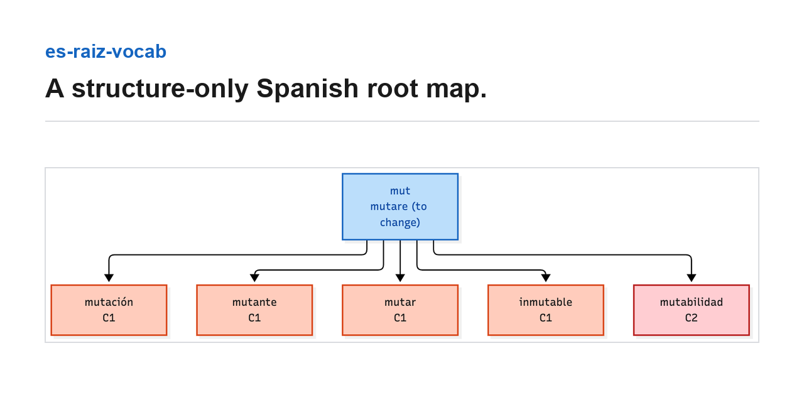
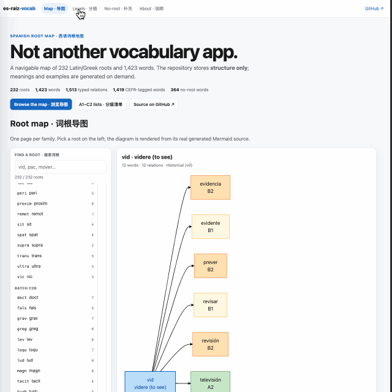

# es-raiz-vocab

**English** · [中文](README.zh-CN.md)

> **Not another vocabulary app — a navigable Spanish root map.**
>
> 232 Latin/Greek roots · 1,423 words · 1,513 typed relations · A1–C2 tags.
> The repository stores **structure only**; meanings and examples are generated on demand.

[Online demo (GitHub Pages)](https://auding1900.github.io/es-raiz-vocab/) · [Root index](mindmaps/root_tree.md) · [Levels](#levels-a1c2) · [60-second demo script](docs/promo/demo-script.md) · [Contributing](#contributing)

> The Pages deployment is enabled separately; if the link is not live yet, use the repository view below.

[](LICENSE)




*Built from a real generated page: root `mut` (“to change”) and its five C1/C2 derivatives. The full index contains 232 roots and links to one page per family.*

---

## What this is

A Spanish vocabulary project built around **word families**, not word lists.

Each root is a small page with a Mermaid graph:

- the root and its Latin origin,
- derived words,
- `asociar` (semantic association) and `confundir` (easily confused) links,
- a CEFR tag on every word that has one.

You navigate the map, pick a word, and send a prepared query to an LLM. The repository never stores the answer.

`no-raiz-vocab.md` is the companion list for high-frequency Spanish words that cannot be decomposed with Latin roots: native words, Arabic/Germanic loans, function words, and irregular verbs whose root is no longer productive. It stores only the word and its part of speech.

**Scope:** this is not a DELE word list and does not claim to cover any official syllabus. The root map and the no-root list are complementary; neither replaces the other.

---

## See it in motion



*This is a labeled placeholder, not a recording. The 60-second shot list is in [`docs/promo/demo-script.md`](docs/promo/demo-script.md). Replace `assets/demo.gif` with the real recording when it exists.*

---

## The three hard constraints

| Constraint | What it means |
| --- | --- |
| **No definitions** | No `definition`, `translation`, gloss, or Chinese explanation fields. The validator rejects them. |
| **No example sentences** | Not one Spanish example sentence is stored in the repository. |
| **Structure only** | Root, word form, relation type, CEFR level, and Latin origin. Nothing else. |

Why: dictionary definitions and examples are usually copyrighted compilations, and static copies go stale. The repository owns the map; the LLM produces the content at query time.

The validator in `scripts/generate_mermaid.py --check` enforces the field whitelist, relation integrity, CEFR enums, duplicate edges, self-loops, and Chinese/definition leakage.

---

## Look up a word

Generated links open **Doubao** by default because the link contains a URL-encoded prompt. You do **not** need Doubao: the same prompt works in ChatGPT, Claude, Gemini, or any other LLM.

Default prompt used by generated links:

```text
西班牙语{word}，词根{root}，解释词义、DELE等级、语体、常用搭配、近义词辨析，并且给2条来自公版西语文本（Wikisource/古登堡）的自然例句，例句优先选用现代标准西班牙语，古体例句标注【arcaísmo】
```

English equivalent:

```text
Spanish word {word}, root {root}. Explain its meaning, DELE level, register, common collocations, and near-synonym distinctions. Give two natural example sentences from public-domain Spanish texts (Wikisource / Project Gutenberg); prefer modern standard Spanish and mark archaic examples as [arcaísmo].
```

- Replace `{word}` with the word form, keeping accents (`mañana`, `canción`).
- Replace `{root}` with the root id (`duc`, `vid`, …). If a word has no root, delete the `词根{root}，` / `root {root}.` clause to avoid an empty fragment.
- The default template and URL live in `scripts/generate_mermaid.py` (`PROMPT_TEMPLATE`, `DOUBAO_URL`).

GitHub renders Mermaid but ignores `click` directives for security. Use the **word link table** at the bottom of each family page, or the `豆包` column in `levels/*.md`.

---

## Browse the map

| Entry point | What you get |
| --- | --- |
| [`mindmaps/root_tree.md`](mindmaps/root_tree.md) | Index of all 232 roots, grouped by batch, with word/relation counts and links to each family page |
| [`mindmaps/associate_graph.md`](mindmaps/associate_graph.md) | Index of `asociar` / `confundir` relations |
| [`levels/A1.md`](levels/A1.md) … [`levels/C2.md`](levels/C2.md) | Level lists, one row per word: word · root · lookup link |
| [`no-raiz-vocab.md`](no-raiz-vocab.md) | Words that cannot be decomposed by Latin roots, grouped by CEFR |

### Levels (A1–C2)

| Level | Words | List |
| --- | ---: | --- |
| A1 | 77 | [`levels/A1.md`](levels/A1.md) |
| A2 | 218 | [`levels/A2.md`](levels/A2.md) |
| B1 | 326 | [`levels/B1.md`](levels/B1.md) |
| B2 | 406 | [`levels/B2.md`](levels/B2.md) |
| C1 | 300 | [`levels/C1.md`](levels/C1.md) |
| C2 | 92 | [`levels/C2.md`](levels/C2.md) |

1,419 of 1,423 words carry a CEFR tag; the remaining four appear only in the graph. Levels are teaching-oriented reference points, not an official DELE word list.

---

## Offline use

- **Repository / VSCode:** the Mermaid source and Markdown tables are plain text. Clone the repo, open it in VSCode, install a Mermaid preview extension if needed, and browse without a network connection.
- **What works offline:** root trees, derivation chains, associations, confusions, CEFR colors, and link URLs.
- **What needs a network:** the actual meaning, register, collocations, synonym distinctions, and example sentences.
- **GitHub Pages:** the optional web view loads Mermaid from a CDN on first visit, so it is not fully offline. The offline claim applies to the repository view.

---

## Quick start

```bash
python3 -m venv .env
source .env/bin/activate          # Windows: .env\Scripts\activate
pip install -r requirements.txt

# 1. Validate data only (writes nothing)
python scripts/generate_mermaid.py --check

# 2. Regenerate mindmaps/ and levels/ (clears old generated .md files first)
python scripts/generate_mermaid.py

# 3. Regenerate the no-root list
python scripts/build_no_raiz.py
```

Useful flags:

```bash
python scripts/generate_mermaid.py --dry-run   # show what would be written
python scripts/generate_mermaid.py --quiet     # no progress output
python scripts/build_no_raiz.py --dry-run      # count entries per level
```

`mindmaps/`, `levels/`, `no-raiz-vocab.md`, and `no-raiz-vocab*.yaml` are **generated artifacts**. Do not hand-edit them. Change `data/*.yaml` or the scripts, then regenerate.

---

## Project layout

```text
es-raiz-vocab/
├── README.md                 # English landing page
├── README.zh-CN.md           # Chinese landing page
├── assets/                   # README images and demo GIF
├── data/
│   ├── raices.yaml           # roots: id / root_name / latin_origin / batch
│   ├── afijos.yaml           # affixes: id / affix / meaning / type
│   └── relations.yaml        # edges: source / target / rel_type / cefr_level / prompt_template
├── scripts/
│   ├── generate_mermaid.py   # data -> mindmaps/ + levels/
│   ├── build_no_raiz.py      # data -> no-raiz-vocab.md + optional YAML
│   ├── export_pdf.py         # optional offline PDF bundles -> dist/pdf/
│   ├── make_root_tree_card.py    # optional: legacy 1200x630 card
│   ├── make_root_tree_social_card.py  # optional: 1280x640 card from the real base
│   └── make_demo_placeholder.py  # optional: labeled assets/demo.gif placeholder
├── mindmaps/                 # generated: root index + one graph per family
├── levels/                   # generated: A1.md ... C2.md
├── no-raiz-vocab.md          # generated: no-root word list
└── docs/promo/               # launch drafts and checklists (not part of the data pipeline)
```

### Data model

```yaml
# data/raices.yaml
raices:
  - id: pac
    root_name: pac
    latin_origin: "pax, pacis (peace)"
    batch: b9
```

```yaml
# data/relations.yaml
relations:
  - source: pac
    target: paz
    rel_type: derivar
    cefr_level: A2
    prompt_template: null
```

- `rel_type`: `derivar` (root derivation), `asociar` (semantic association), `confundir` (easily confused).
- `cefr_level`: `A1`–`C2` or `null`.
- A word is declared as a `target`; the level is attached to the derivation edge, so there is no second word table to maintain.
- `data/afijos.yaml` currently participates in validation and statistics; affixes are not rendered as separate graph nodes.

---

## Contributing

Pull requests are welcome for exactly four kinds of changes:

1. a new root in `data/raices.yaml`;
2. a new word as a `target` in `data/relations.yaml`;
3. a new `derivar` / `asociar` / `confundir` edge;
4. a CEFR tag on an existing word.

Please do **not** submit:

- definitions, dictionary text, translations, or Chinese glosses;
- example sentences — not even self-written ones or public-domain quotations;
- synonym-discussion prose, register notes, or collocation lists;
- images, PDFs, or corpus files unrelated to the network structure.

Those belong to the query-time LLM response, not to the repository.

Before opening a PR:

```bash
python scripts/generate_mermaid.py --check
python scripts/generate_mermaid.py
git diff --check
```

Commit `data/` together with the regenerated `mindmaps/` and `levels/` files. If the generated diff is not what you expect, fix the data instead of editing the generated files.

---

## Offline PDFs

Prebuilt PDFs are **not committed**. The release contains seven PDF bundles plus `SHA256SUMS.txt`, attached to the [v0.29.1 release](https://github.com/auding1900/es-raiz-vocab/releases/tag/v0.29.1). You can also build them locally:

```bash
pip install -r requirements.txt
npm install -g @mermaid-js/mermaid-cli   # or let the script fall back to npx
python scripts/export_pdf.py --chrome "/Applications/Google Chrome.app/Contents/MacOS/Google Chrome"
```

Output: `dist/pdf/A1.pdf` … `C2.pdf` plus `index-toc.pdf`. `dist/` is git-ignored. The release assets are built from the same data; detailed build notes: [`docs/promo/pdf-build.md`](docs/promo/pdf-build.md).

PDFs are static snapshots and do not preserve clickable lookup links.

---

## CEFR disclaimer

CEFR labels are teaching-oriented reference points used to layer the map. They are not an official DELE syllabus, and this project is not affiliated with or endorsed by Instituto Cervantes. The same word may be graded differently across textbooks and regional corpora.

---

## License

[MIT](LICENSE). Copyright (c) 2026 es-raiz-vocab contributors.

The repository contains only word structure and linguistic facts: roots, word forms, relation types, CEFR tags, and Latin origins. It contains no dictionary definitions, translations, or example sentences. Word forms and Latin origins are public linguistic facts. If you believe something is misattributed, please open an issue.

Version history: [CHANGELOG.md](CHANGELOG.md).
