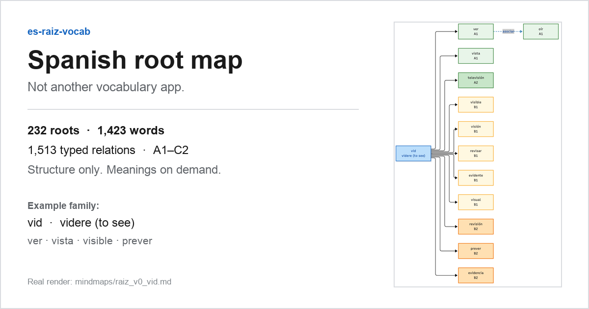
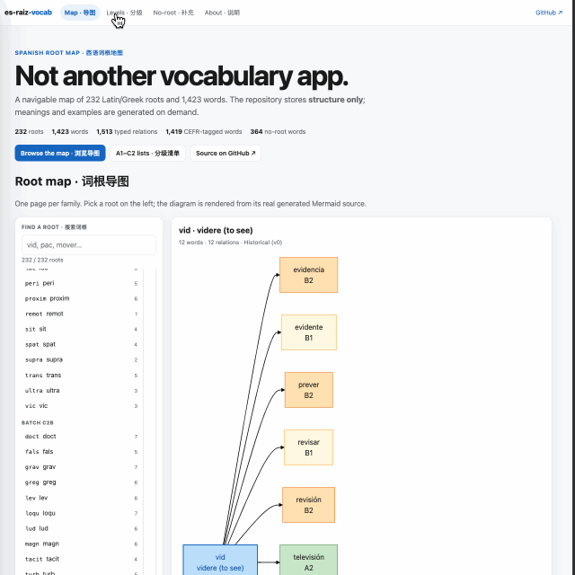

# es-raiz-vocab

[English](README.md) · **中文**

> **不是又一个背单词 App，而是一张可导航的西语词根地图。**
>
> 232 个拉丁 / 希腊词根 · 1,423 个单词 · 1,513 条带类型的关系 · A1–C2 分级标记。
> 仓库只存**结构**；释义与例句在查询时实时生成。

[在线体验（GitHub Pages）](https://auding1900.github.io/es-raiz-vocab/) · [词根索引](mindmaps/root_tree.md) · [分级清单](#分级清单a1c2) · [60 秒演示脚本](docs/promo/demo-script.md) · [参与贡献](#参与贡献)

> Pages 需要单独启用；链接尚未生效时，请直接浏览下面的仓库入口。

[](LICENSE)




*卡片内容来自真实生成的词族页：词根 `vid`（“看见”）、它的派生词、CEFR 配色，以及一条 `asociar` 联想边。完整索引包含 232 个词根，每个词根链接到自己的图页。*

---

## 这是什么

这是一个按**词族**组织的西语词汇项目，不是一张单词表。

每个词根是一张小页面，里面有一张 Mermaid 图：

- 词根本身与拉丁本源；
- 派生词；
- `asociar`（语义联想）与 `confundir`（形近易混）关系；
- 有级别的单词都带 CEFR 标签。

你沿着图导航，选中一个词，把预置查询发给大模型。仓库从不保存回答。

`no-raiz-vocab.md` 是补充清单，收录无法用拉丁词根拆解的高频词：西语原生词、阿拉伯 / 日耳曼借词、功能词，以及词根已失效的不规则动词。它只记录单词与词性。

**边界：** 本项目不是 DELE 全词表，也不声称覆盖任何官方大纲。词根图和补充清单是互补关系，不能互相替代。

---

## 看它动起来



*这是一张明确标注的占位图，不是录屏。60 秒分镜脚本见 [`docs/promo/demo-script.md`](docs/promo/demo-script.md)。录好后用真实录屏替换 `assets/demo.gif`。*

---

## 三条硬约束

| 约束 | 含义 |
| --- | --- |
| **不存释义** | 不允许 `definition`、`translation`、中文解释等字段；校验脚本会直接报错。 |
| **不存例句** | 仓库里没有一句西语例句。 |
| **只存结构** | 词根、词形、关系类型、CEFR 级别、拉丁本源，别的都不存。 |

原因：词典释义和例句通常属于受版权保护的汇编内容，静态副本也容易过期。仓库负责“地图”，内容由大模型在查询时生成。

`scripts/generate_mermaid.py --check` 会校验字段白名单、关系完整性、CEFR 枚举、重复边、自环，以及中文 / 释义泄漏。

---

## 查一个词

生成的链接默认打开**豆包**，因为链接里已经带好 URL 编码的查询指令。你并不需要豆包：同一条指令可以粘贴到 ChatGPT、Claude、Gemini 或任意 LLM。

生成链接使用的默认指令：

```text
西班牙语{word}，词根{root}，解释词义、DELE等级、语体、常用搭配、近义词辨析，并且给2条来自公版西语文本（Wikisource/古登堡）的自然例句，例句优先选用现代标准西班牙语，古体例句标注【arcaísmo】
```

英文等价版本：

```text
Spanish word {word}, root {root}. Explain its meaning, DELE level, register, common collocations, and near-synonym distinctions. Give two natural example sentences from public-domain Spanish texts (Wikisource / Project Gutenberg); prefer modern standard Spanish and mark archaic examples as [arcaísmo].
```

- 把 `{word}` 换成单词词形，重音照写（`mañana`、`canción`）。
- 把 `{root}` 换成词根 id（`duc`、`vid` …）。如果这个词没有词根，把 `词根{root}，` / `root {root}.` 这一小段删掉，避免出现空片段。
- 默认模板和查询入口在 `scripts/generate_mermaid.py` 的 `PROMPT_TEMPLATE`、`DOUBAO_URL`。

GitHub 会忽略 Mermaid 的 `click` 指令（安全策略）。请用每个词族页底部的**单词链接表**，或 `levels/*.md` 里的「豆包」列。

---

## 浏览入口

| 入口 | 内容 |
| --- | --- |
| [`mindmaps/root_tree.md`](mindmaps/root_tree.md) | 232 个词根的索引，按批次分组，附单词数 / 关系数和各词族页链接 |
| [`mindmaps/associate_graph.md`](mindmaps/associate_graph.md) | `asociar` / `confundir` 关系索引 |
| [`levels/A1.md`](levels/A1.md) … [`levels/C2.md`](levels/C2.md) | 分级清单，每行：单词 · 词根 · 查询链接 |
| [`no-raiz-vocab.md`](no-raiz-vocab.md) | 无法用拉丁词根拆解的词，按 CEFR 分组 |

### 分级清单（A1–C2）

| 级别 | 单词数 | 清单 |
| --- | ---: | --- |
| A1 | 77 | [`levels/A1.md`](levels/A1.md) |
| A2 | 218 | [`levels/A2.md`](levels/A2.md) |
| B1 | 326 | [`levels/B1.md`](levels/B1.md) |
| B2 | 406 | [`levels/B2.md`](levels/B2.md) |
| C1 | 300 | [`levels/C1.md`](levels/C1.md) |
| C2 | 92 | [`levels/C2.md`](levels/C2.md) |

1,423 个单词中有 1,419 个带 CEFR 标签，剩余 4 个只出现在图里。级别是教学参考坐标，不是官方 DELE 词表。

---

## 离线可用性

- **仓库 / VSCode：** Mermaid 源文件和 Markdown 表格都是纯文本。克隆仓库，用 VSCode 打开，必要时装一个 Mermaid 预览扩展，断网也能浏览。
- **断网能看：** 词根树、派生链、联想与易混关系、CEFR 配色、链接地址。
- **断网不能看：** 词义、语体、搭配、近义词辨析、例句。
- **GitHub Pages：** 网页版首次加载会从 CDN 取 Mermaid，因此不是完全离线；“离线可用”指的是仓库视图。

---

## 快速开始

```bash
python3 -m venv .env
source .env/bin/activate          # Windows: .env\Scripts\activate
pip install -r requirements.txt

# 1. 只校验数据，不写文件
python scripts/generate_mermaid.py --check

# 2. 重新生成 mindmaps/ 与 levels/（会先清空旧产物）
python scripts/generate_mermaid.py

# 3. 重新生成无词根清单
python scripts/build_no_raiz.py
```

常用参数：

```bash
python scripts/generate_mermaid.py --dry-run   # 只看会写哪些文件
python scripts/generate_mermaid.py --quiet     # 不打印进度
python scripts/build_no_raiz.py --dry-run      # 只统计每级词数
```

`mindmaps/`、`levels/`、`no-raiz-vocab.md`、`no-raiz-vocab*.yaml` 都是**生成物**，不要手改。改 `data/*.yaml` 或脚本，然后重新生成。

---

## 目录结构

```text
es-raiz-vocab/
├── README.md                 # 英文落地页
├── README.zh-CN.md           # 中文落地页
├── assets/                   # README 图片与演示 GIF
├── data/
│   ├── raices.yaml           # 词根：id / root_name / latin_origin / batch
│   ├── afijos.yaml           # 词缀：id / affix / meaning / type
│   └── relations.yaml        # 关系边：source / target / rel_type / cefr_level / prompt_template
├── scripts/
│   ├── generate_mermaid.py   # data -> mindmaps/ + levels/
│   ├── build_no_raiz.py      # data -> no-raiz-vocab.md + 可选 YAML
│   ├── export_pdf.py         # 可选离线 PDF -> dist/pdf/
│   ├── make_root_tree_card.py    # 可选：生成 README / 社交预览横版卡片
│   └── make_demo_placeholder.py  # 可选：生成 assets/demo.gif 占位图
├── mindmaps/                 # 生成物：词根索引 + 每个词族一张图
├── levels/                   # 生成物：A1.md ... C2.md
├── no-raiz-vocab.md          # 生成物：无词根词清单
└── docs/promo/               # 推广草稿与人工检查清单（不参与数据流水线）
```

### 数据格式

```yaml
# data/raices.yaml
raices:
  - id: pac
    root_name: pac
    latin_origin: "pax, pacis (peace)"
    batch: b9
```

```yaml
# data/relations.yaml
relations:
  - source: pac
    target: paz
    rel_type: derivar
    cefr_level: A2
    prompt_template: null
```

- `rel_type`：`derivar`（词根派生）、`asociar`（语义联想）、`confundir`（形近易混）。
- `cefr_level`：`A1`–`C2` 或 `null`。
- 单词在 `target` 处声明，级别挂在派生边上，不需要第二份单词表。
- `data/afijos.yaml` 目前只参与校验与统计，词缀暂时不渲染成独立节点。

---

## 参与贡献

PR 只接受四类改动：

1. 在 `data/raices.yaml` 新增词根；
2. 在 `data/relations.yaml` 的 `target` 处新增单词；
3. 新增 `derivar` / `asociar` / `confundir` 关系；
4. 给已有单词补 CEFR 标签。

请不要提交：

- 释义、词典文本、译文、中文解释；
- 例句——自己写的、教材抄的、公版书摘的都不行；
- 近义词辨析、语体说明、搭配清单；
- 与关系结构无关的图片、PDF、语料文件。

这些内容属于查询时的大模型回答，不属于仓库。

提交前请运行：

```bash
python scripts/generate_mermaid.py --check
python scripts/generate_mermaid.py
git diff --check
```

把 `data/` 和重新生成的 `mindmaps/`、`levels/` 一起提交。如果生成结果和预期不符，改数据，不要改生成物。

---

## 离线 PDF

预构建 PDF **不提交进仓库**，当前也没有指向某个 Release 的下载链接。需要时在本地构建：

```bash
pip install -r requirements.txt
npm install -g @mermaid-js/mermaid-cli   # 或让脚本自动改用 npx
python scripts/export_pdf.py --chrome "/Applications/Google Chrome.app/Contents/MacOS/Google Chrome"
```

产物在 `dist/pdf/A1.pdf` … `C2.pdf`，外加 `index-toc.pdf`。`dist/` 已加入 `.gitignore`。维护者可以把这些文件附到 GitHub Release；发布草稿与上传步骤见 [`docs/promo/release-draft.md`](docs/promo/release-draft.md)，构建细节见 [`docs/promo/pdf-build.md`](docs/promo/pdf-build.md)。

PDF 是静态快照，不保留可点击的查询链接。

---

## 定级声明

CEFR 级别是用于分层和安排学习顺序的教学参考坐标，不是官方 DELE 大纲。本项目与 Instituto Cervantes 没有隶属或授权关系。同一个词在不同教材、不同地区语料中的级别可能不同。

---

## 开源协议

[MIT](LICENSE)。Copyright (c) 2026 es-raiz-vocab contributors。

仓库只包含词语结构与语言事实：词根、词形、关系类型、CEFR 标签、拉丁本源；不包含词典释义、译文或例句。词形与拉丁本源属于公共语言事实。若你认为某处标注有误，请开 issue。

版本记录见 [CHANGELOG.md](CHANGELOG.md)。
