<!-- 由 scripts/generate_mermaid.py 自动生成，请勿手工编辑 -->

# 语义联想（`asociar`） · 词根 A–L 1/3

- 虚线 `#4488bb` · 本页关系 8 条 / 该类型共 41 条 · 涉及单词 15 个
- 索引：[联想网状图总览](associate_graph.md)

```mermaid
graph LR
  W_aceptar["aceptar<br/>A2"]:::lvlA2
  W_amable["amable<br/>A2"]:::lvlA2
  W_amor["amor<br/>A1"]:::lvlA1
  W_carinoso["cariñoso<br/>B1"]:::lvlB1
  W_colono["colono<br/>B2"]:::lvlB2
  W_dificil["difícil<br/>A2"]:::lvlA2
  W_facil["fácil<br/>A2"]:::lvlA2
  W_habitante["habitante<br/>B1"]:::lvlB1
  W_mermar["mermar"]:::lvlNA
  W_odio["odio<br/>B1"]:::lvlB1
  W_percibir["percibir<br/>B2"]:::lvlB2
  W_poblacion["población<br/>A2"]:::lvlA2
  W_recibir["recibir<br/>A2"]:::lvlA2
  W_reducir["reducir<br/>B2"]:::lvlB2
  W_ver["ver<br/>A1"]:::lvlA1
  W_amor -.->|asociar| W_odio
  W_amable -.->|asociar| W_carinoso
  W_habitante -.->|asociar| W_poblacion
  W_colono -.->|asociar| W_habitante
  W_reducir -.->|asociar| W_mermar
  W_percibir -.->|asociar| W_ver
  W_aceptar -.->|asociar| W_recibir
  W_facil -.->|asociar| W_dificil
  linkStyle 0 stroke:#4488bb,stroke-width:2px,stroke-dasharray:6 4
  linkStyle 1 stroke:#4488bb,stroke-width:2px,stroke-dasharray:6 4
  linkStyle 2 stroke:#4488bb,stroke-width:2px,stroke-dasharray:6 4
  linkStyle 3 stroke:#4488bb,stroke-width:2px,stroke-dasharray:6 4
  linkStyle 4 stroke:#4488bb,stroke-width:2px,stroke-dasharray:6 4
  linkStyle 5 stroke:#4488bb,stroke-width:2px,stroke-dasharray:6 4
  linkStyle 6 stroke:#4488bb,stroke-width:2px,stroke-dasharray:6 4
  linkStyle 7 stroke:#4488bb,stroke-width:2px,stroke-dasharray:6 4
  classDef root fill:#bbdefb,stroke:#1565c0,stroke-width:2px,color:#0d47a1
  classDef lvlA1 fill:#e8f5e9,stroke:#2e7d32,color:#1a1a1a
  classDef lvlA2 fill:#c8e6c9,stroke:#2e7d32,color:#1a1a1a
  classDef lvlB1 fill:#fff8e1,stroke:#f9a825,color:#1a1a1a
  classDef lvlB2 fill:#ffe0b2,stroke:#ef6c00,color:#1a1a1a
  classDef lvlC1 fill:#ffccbc,stroke:#d84315,color:#1a1a1a
  classDef lvlC2 fill:#ffcdd2,stroke:#b71c1c,color:#1a1a1a
  classDef lvlNA fill:#f5f5f5,stroke:#9e9e9e,color:#424242
  click W_aceptar "https://www.doubao.com/chat?q=%E8%A5%BF%E7%8F%AD%E7%89%99%E8%AF%ADaceptar%EF%BC%8C%E8%AF%8D%E6%A0%B9cap%EF%BC%8C%E8%A7%A3%E9%87%8A%E8%AF%8D%E4%B9%89%E3%80%81DELE%E7%AD%89%E7%BA%A7%E3%80%81%E8%AF%AD%E4%BD%93%E3%80%81%E5%B8%B8%E7%94%A8%E6%90%AD%E9%85%8D%E3%80%81%E8%BF%91%E4%B9%89%E8%AF%8D%E8%BE%A8%E6%9E%90%EF%BC%8C%E5%B9%B6%E4%B8%94%E7%BB%992%E6%9D%A1%E6%9D%A5%E8%87%AA%E5%85%AC%E7%89%88%E8%A5%BF%E8%AF%AD%E6%96%87%E6%9C%AC%EF%BC%88Wikisource%2F%E5%8F%A4%E7%99%BB%E5%A0%A1%EF%BC%89%E7%9A%84%E8%87%AA%E7%84%B6%E4%BE%8B%E5%8F%A5%EF%BC%8C%E4%BE%8B%E5%8F%A5%E4%BC%98%E5%85%88%E9%80%89%E7%94%A8%E7%8E%B0%E4%BB%A3%E6%A0%87%E5%87%86%E8%A5%BF%E7%8F%AD%E7%89%99%E8%AF%AD%EF%BC%8C%E5%8F%A4%E4%BD%93%E4%BE%8B%E5%8F%A5%E6%A0%87%E6%B3%A8%E3%80%90arca%C3%ADsmo%E3%80%91" "豆包查询：aceptar" _blank
  click W_amable "https://www.doubao.com/chat?q=%E8%A5%BF%E7%8F%AD%E7%89%99%E8%AF%ADamable%EF%BC%8C%E8%AF%8D%E6%A0%B9am%EF%BC%8C%E8%A7%A3%E9%87%8A%E8%AF%8D%E4%B9%89%E3%80%81DELE%E7%AD%89%E7%BA%A7%E3%80%81%E8%AF%AD%E4%BD%93%E3%80%81%E5%B8%B8%E7%94%A8%E6%90%AD%E9%85%8D%E3%80%81%E8%BF%91%E4%B9%89%E8%AF%8D%E8%BE%A8%E6%9E%90%EF%BC%8C%E5%B9%B6%E4%B8%94%E7%BB%992%E6%9D%A1%E6%9D%A5%E8%87%AA%E5%85%AC%E7%89%88%E8%A5%BF%E8%AF%AD%E6%96%87%E6%9C%AC%EF%BC%88Wikisource%2F%E5%8F%A4%E7%99%BB%E5%A0%A1%EF%BC%89%E7%9A%84%E8%87%AA%E7%84%B6%E4%BE%8B%E5%8F%A5%EF%BC%8C%E4%BE%8B%E5%8F%A5%E4%BC%98%E5%85%88%E9%80%89%E7%94%A8%E7%8E%B0%E4%BB%A3%E6%A0%87%E5%87%86%E8%A5%BF%E7%8F%AD%E7%89%99%E8%AF%AD%EF%BC%8C%E5%8F%A4%E4%BD%93%E4%BE%8B%E5%8F%A5%E6%A0%87%E6%B3%A8%E3%80%90arca%C3%ADsmo%E3%80%91" "豆包查询：amable" _blank
  click W_amor "https://www.doubao.com/chat?q=%E8%A5%BF%E7%8F%AD%E7%89%99%E8%AF%ADamor%EF%BC%8C%E8%AF%8D%E6%A0%B9am%EF%BC%8C%E8%A7%A3%E9%87%8A%E8%AF%8D%E4%B9%89%E3%80%81DELE%E7%AD%89%E7%BA%A7%E3%80%81%E8%AF%AD%E4%BD%93%E3%80%81%E5%B8%B8%E7%94%A8%E6%90%AD%E9%85%8D%E3%80%81%E8%BF%91%E4%B9%89%E8%AF%8D%E8%BE%A8%E6%9E%90%EF%BC%8C%E5%B9%B6%E4%B8%94%E7%BB%992%E6%9D%A1%E6%9D%A5%E8%87%AA%E5%85%AC%E7%89%88%E8%A5%BF%E8%AF%AD%E6%96%87%E6%9C%AC%EF%BC%88Wikisource%2F%E5%8F%A4%E7%99%BB%E5%A0%A1%EF%BC%89%E7%9A%84%E8%87%AA%E7%84%B6%E4%BE%8B%E5%8F%A5%EF%BC%8C%E4%BE%8B%E5%8F%A5%E4%BC%98%E5%85%88%E9%80%89%E7%94%A8%E7%8E%B0%E4%BB%A3%E6%A0%87%E5%87%86%E8%A5%BF%E7%8F%AD%E7%89%99%E8%AF%AD%EF%BC%8C%E5%8F%A4%E4%BD%93%E4%BE%8B%E5%8F%A5%E6%A0%87%E6%B3%A8%E3%80%90arca%C3%ADsmo%E3%80%91" "豆包查询：amor" _blank
  click W_carinoso "https://www.doubao.com/chat?q=%E8%A5%BF%E7%8F%AD%E7%89%99%E8%AF%ADcari%C3%B1oso%EF%BC%8C%E8%AF%8D%E6%A0%B9car%EF%BC%8C%E8%A7%A3%E9%87%8A%E8%AF%8D%E4%B9%89%E3%80%81DELE%E7%AD%89%E7%BA%A7%E3%80%81%E8%AF%AD%E4%BD%93%E3%80%81%E5%B8%B8%E7%94%A8%E6%90%AD%E9%85%8D%E3%80%81%E8%BF%91%E4%B9%89%E8%AF%8D%E8%BE%A8%E6%9E%90%EF%BC%8C%E5%B9%B6%E4%B8%94%E7%BB%992%E6%9D%A1%E6%9D%A5%E8%87%AA%E5%85%AC%E7%89%88%E8%A5%BF%E8%AF%AD%E6%96%87%E6%9C%AC%EF%BC%88Wikisource%2F%E5%8F%A4%E7%99%BB%E5%A0%A1%EF%BC%89%E7%9A%84%E8%87%AA%E7%84%B6%E4%BE%8B%E5%8F%A5%EF%BC%8C%E4%BE%8B%E5%8F%A5%E4%BC%98%E5%85%88%E9%80%89%E7%94%A8%E7%8E%B0%E4%BB%A3%E6%A0%87%E5%87%86%E8%A5%BF%E7%8F%AD%E7%89%99%E8%AF%AD%EF%BC%8C%E5%8F%A4%E4%BD%93%E4%BE%8B%E5%8F%A5%E6%A0%87%E6%B3%A8%E3%80%90arca%C3%ADsmo%E3%80%91" "豆包查询：cariñoso" _blank
  click W_colono "https://www.doubao.com/chat?q=%E8%A5%BF%E7%8F%AD%E7%89%99%E8%AF%ADcolono%EF%BC%8C%E8%AF%8D%E6%A0%B9col%EF%BC%8C%E8%A7%A3%E9%87%8A%E8%AF%8D%E4%B9%89%E3%80%81DELE%E7%AD%89%E7%BA%A7%E3%80%81%E8%AF%AD%E4%BD%93%E3%80%81%E5%B8%B8%E7%94%A8%E6%90%AD%E9%85%8D%E3%80%81%E8%BF%91%E4%B9%89%E8%AF%8D%E8%BE%A8%E6%9E%90%EF%BC%8C%E5%B9%B6%E4%B8%94%E7%BB%992%E6%9D%A1%E6%9D%A5%E8%87%AA%E5%85%AC%E7%89%88%E8%A5%BF%E8%AF%AD%E6%96%87%E6%9C%AC%EF%BC%88Wikisource%2F%E5%8F%A4%E7%99%BB%E5%A0%A1%EF%BC%89%E7%9A%84%E8%87%AA%E7%84%B6%E4%BE%8B%E5%8F%A5%EF%BC%8C%E4%BE%8B%E5%8F%A5%E4%BC%98%E5%85%88%E9%80%89%E7%94%A8%E7%8E%B0%E4%BB%A3%E6%A0%87%E5%87%86%E8%A5%BF%E7%8F%AD%E7%89%99%E8%AF%AD%EF%BC%8C%E5%8F%A4%E4%BD%93%E4%BE%8B%E5%8F%A5%E6%A0%87%E6%B3%A8%E3%80%90arca%C3%ADsmo%E3%80%91" "豆包查询：colono" _blank
  click W_dificil "https://www.doubao.com/chat?q=%E8%A5%BF%E7%8F%AD%E7%89%99%E8%AF%ADdif%C3%ADcil%EF%BC%8C%E8%AF%8D%E6%A0%B9fac%EF%BC%8C%E8%A7%A3%E9%87%8A%E8%AF%8D%E4%B9%89%E3%80%81DELE%E7%AD%89%E7%BA%A7%E3%80%81%E8%AF%AD%E4%BD%93%E3%80%81%E5%B8%B8%E7%94%A8%E6%90%AD%E9%85%8D%E3%80%81%E8%BF%91%E4%B9%89%E8%AF%8D%E8%BE%A8%E6%9E%90%EF%BC%8C%E5%B9%B6%E4%B8%94%E7%BB%992%E6%9D%A1%E6%9D%A5%E8%87%AA%E5%85%AC%E7%89%88%E8%A5%BF%E8%AF%AD%E6%96%87%E6%9C%AC%EF%BC%88Wikisource%2F%E5%8F%A4%E7%99%BB%E5%A0%A1%EF%BC%89%E7%9A%84%E8%87%AA%E7%84%B6%E4%BE%8B%E5%8F%A5%EF%BC%8C%E4%BE%8B%E5%8F%A5%E4%BC%98%E5%85%88%E9%80%89%E7%94%A8%E7%8E%B0%E4%BB%A3%E6%A0%87%E5%87%86%E8%A5%BF%E7%8F%AD%E7%89%99%E8%AF%AD%EF%BC%8C%E5%8F%A4%E4%BD%93%E4%BE%8B%E5%8F%A5%E6%A0%87%E6%B3%A8%E3%80%90arca%C3%ADsmo%E3%80%91" "豆包查询：difícil" _blank
  click W_facil "https://www.doubao.com/chat?q=%E8%A5%BF%E7%8F%AD%E7%89%99%E8%AF%ADf%C3%A1cil%EF%BC%8C%E8%AF%8D%E6%A0%B9fac%EF%BC%8C%E8%A7%A3%E9%87%8A%E8%AF%8D%E4%B9%89%E3%80%81DELE%E7%AD%89%E7%BA%A7%E3%80%81%E8%AF%AD%E4%BD%93%E3%80%81%E5%B8%B8%E7%94%A8%E6%90%AD%E9%85%8D%E3%80%81%E8%BF%91%E4%B9%89%E8%AF%8D%E8%BE%A8%E6%9E%90%EF%BC%8C%E5%B9%B6%E4%B8%94%E7%BB%992%E6%9D%A1%E6%9D%A5%E8%87%AA%E5%85%AC%E7%89%88%E8%A5%BF%E8%AF%AD%E6%96%87%E6%9C%AC%EF%BC%88Wikisource%2F%E5%8F%A4%E7%99%BB%E5%A0%A1%EF%BC%89%E7%9A%84%E8%87%AA%E7%84%B6%E4%BE%8B%E5%8F%A5%EF%BC%8C%E4%BE%8B%E5%8F%A5%E4%BC%98%E5%85%88%E9%80%89%E7%94%A8%E7%8E%B0%E4%BB%A3%E6%A0%87%E5%87%86%E8%A5%BF%E7%8F%AD%E7%89%99%E8%AF%AD%EF%BC%8C%E5%8F%A4%E4%BD%93%E4%BE%8B%E5%8F%A5%E6%A0%87%E6%B3%A8%E3%80%90arca%C3%ADsmo%E3%80%91" "豆包查询：fácil" _blank
  click W_habitante "https://www.doubao.com/chat?q=%E8%A5%BF%E7%8F%AD%E7%89%99%E8%AF%ADhabitante%EF%BC%8C%E8%AF%8D%E6%A0%B9habit%EF%BC%8C%E8%A7%A3%E9%87%8A%E8%AF%8D%E4%B9%89%E3%80%81DELE%E7%AD%89%E7%BA%A7%E3%80%81%E8%AF%AD%E4%BD%93%E3%80%81%E5%B8%B8%E7%94%A8%E6%90%AD%E9%85%8D%E3%80%81%E8%BF%91%E4%B9%89%E8%AF%8D%E8%BE%A8%E6%9E%90%EF%BC%8C%E5%B9%B6%E4%B8%94%E7%BB%992%E6%9D%A1%E6%9D%A5%E8%87%AA%E5%85%AC%E7%89%88%E8%A5%BF%E8%AF%AD%E6%96%87%E6%9C%AC%EF%BC%88Wikisource%2F%E5%8F%A4%E7%99%BB%E5%A0%A1%EF%BC%89%E7%9A%84%E8%87%AA%E7%84%B6%E4%BE%8B%E5%8F%A5%EF%BC%8C%E4%BE%8B%E5%8F%A5%E4%BC%98%E5%85%88%E9%80%89%E7%94%A8%E7%8E%B0%E4%BB%A3%E6%A0%87%E5%87%86%E8%A5%BF%E7%8F%AD%E7%89%99%E8%AF%AD%EF%BC%8C%E5%8F%A4%E4%BD%93%E4%BE%8B%E5%8F%A5%E6%A0%87%E6%B3%A8%E3%80%90arca%C3%ADsmo%E3%80%91" "豆包查询：habitante" _blank
  click W_mermar "https://www.doubao.com/chat?q=%E8%A5%BF%E7%8F%AD%E7%89%99%E8%AF%ADmermar%EF%BC%8C%E8%A7%A3%E9%87%8A%E8%AF%8D%E4%B9%89%E3%80%81DELE%E7%AD%89%E7%BA%A7%E3%80%81%E8%AF%AD%E4%BD%93%E3%80%81%E5%B8%B8%E7%94%A8%E6%90%AD%E9%85%8D%E3%80%81%E8%BF%91%E4%B9%89%E8%AF%8D%E8%BE%A8%E6%9E%90%EF%BC%8C%E5%B9%B6%E4%B8%94%E7%BB%992%E6%9D%A1%E6%9D%A5%E8%87%AA%E5%85%AC%E7%89%88%E8%A5%BF%E8%AF%AD%E6%96%87%E6%9C%AC%EF%BC%88Wikisource%2F%E5%8F%A4%E7%99%BB%E5%A0%A1%EF%BC%89%E7%9A%84%E8%87%AA%E7%84%B6%E4%BE%8B%E5%8F%A5%EF%BC%8C%E4%BE%8B%E5%8F%A5%E4%BC%98%E5%85%88%E9%80%89%E7%94%A8%E7%8E%B0%E4%BB%A3%E6%A0%87%E5%87%86%E8%A5%BF%E7%8F%AD%E7%89%99%E8%AF%AD%EF%BC%8C%E5%8F%A4%E4%BD%93%E4%BE%8B%E5%8F%A5%E6%A0%87%E6%B3%A8%E3%80%90arca%C3%ADsmo%E3%80%91" "豆包查询：mermar" _blank
  click W_odio "https://www.doubao.com/chat?q=%E8%A5%BF%E7%8F%AD%E7%89%99%E8%AF%ADodio%EF%BC%8C%E8%AF%8D%E6%A0%B9od%EF%BC%8C%E8%A7%A3%E9%87%8A%E8%AF%8D%E4%B9%89%E3%80%81DELE%E7%AD%89%E7%BA%A7%E3%80%81%E8%AF%AD%E4%BD%93%E3%80%81%E5%B8%B8%E7%94%A8%E6%90%AD%E9%85%8D%E3%80%81%E8%BF%91%E4%B9%89%E8%AF%8D%E8%BE%A8%E6%9E%90%EF%BC%8C%E5%B9%B6%E4%B8%94%E7%BB%992%E6%9D%A1%E6%9D%A5%E8%87%AA%E5%85%AC%E7%89%88%E8%A5%BF%E8%AF%AD%E6%96%87%E6%9C%AC%EF%BC%88Wikisource%2F%E5%8F%A4%E7%99%BB%E5%A0%A1%EF%BC%89%E7%9A%84%E8%87%AA%E7%84%B6%E4%BE%8B%E5%8F%A5%EF%BC%8C%E4%BE%8B%E5%8F%A5%E4%BC%98%E5%85%88%E9%80%89%E7%94%A8%E7%8E%B0%E4%BB%A3%E6%A0%87%E5%87%86%E8%A5%BF%E7%8F%AD%E7%89%99%E8%AF%AD%EF%BC%8C%E5%8F%A4%E4%BD%93%E4%BE%8B%E5%8F%A5%E6%A0%87%E6%B3%A8%E3%80%90arca%C3%ADsmo%E3%80%91" "豆包查询：odio" _blank
  click W_percibir "https://www.doubao.com/chat?q=%E8%A5%BF%E7%8F%AD%E7%89%99%E8%AF%ADpercibir%EF%BC%8C%E8%AF%8D%E6%A0%B9cap%EF%BC%8C%E8%A7%A3%E9%87%8A%E8%AF%8D%E4%B9%89%E3%80%81DELE%E7%AD%89%E7%BA%A7%E3%80%81%E8%AF%AD%E4%BD%93%E3%80%81%E5%B8%B8%E7%94%A8%E6%90%AD%E9%85%8D%E3%80%81%E8%BF%91%E4%B9%89%E8%AF%8D%E8%BE%A8%E6%9E%90%EF%BC%8C%E5%B9%B6%E4%B8%94%E7%BB%992%E6%9D%A1%E6%9D%A5%E8%87%AA%E5%85%AC%E7%89%88%E8%A5%BF%E8%AF%AD%E6%96%87%E6%9C%AC%EF%BC%88Wikisource%2F%E5%8F%A4%E7%99%BB%E5%A0%A1%EF%BC%89%E7%9A%84%E8%87%AA%E7%84%B6%E4%BE%8B%E5%8F%A5%EF%BC%8C%E4%BE%8B%E5%8F%A5%E4%BC%98%E5%85%88%E9%80%89%E7%94%A8%E7%8E%B0%E4%BB%A3%E6%A0%87%E5%87%86%E8%A5%BF%E7%8F%AD%E7%89%99%E8%AF%AD%EF%BC%8C%E5%8F%A4%E4%BD%93%E4%BE%8B%E5%8F%A5%E6%A0%87%E6%B3%A8%E3%80%90arca%C3%ADsmo%E3%80%91" "豆包查询：percibir" _blank
  click W_poblacion "https://www.doubao.com/chat?q=%E8%A5%BF%E7%8F%AD%E7%89%99%E8%AF%ADpoblaci%C3%B3n%EF%BC%8C%E8%AF%8D%E6%A0%B9pop%EF%BC%8C%E8%A7%A3%E9%87%8A%E8%AF%8D%E4%B9%89%E3%80%81DELE%E7%AD%89%E7%BA%A7%E3%80%81%E8%AF%AD%E4%BD%93%E3%80%81%E5%B8%B8%E7%94%A8%E6%90%AD%E9%85%8D%E3%80%81%E8%BF%91%E4%B9%89%E8%AF%8D%E8%BE%A8%E6%9E%90%EF%BC%8C%E5%B9%B6%E4%B8%94%E7%BB%992%E6%9D%A1%E6%9D%A5%E8%87%AA%E5%85%AC%E7%89%88%E8%A5%BF%E8%AF%AD%E6%96%87%E6%9C%AC%EF%BC%88Wikisource%2F%E5%8F%A4%E7%99%BB%E5%A0%A1%EF%BC%89%E7%9A%84%E8%87%AA%E7%84%B6%E4%BE%8B%E5%8F%A5%EF%BC%8C%E4%BE%8B%E5%8F%A5%E4%BC%98%E5%85%88%E9%80%89%E7%94%A8%E7%8E%B0%E4%BB%A3%E6%A0%87%E5%87%86%E8%A5%BF%E7%8F%AD%E7%89%99%E8%AF%AD%EF%BC%8C%E5%8F%A4%E4%BD%93%E4%BE%8B%E5%8F%A5%E6%A0%87%E6%B3%A8%E3%80%90arca%C3%ADsmo%E3%80%91" "豆包查询：población" _blank
  click W_recibir "https://www.doubao.com/chat?q=%E8%A5%BF%E7%8F%AD%E7%89%99%E8%AF%ADrecibir%EF%BC%8C%E8%AF%8D%E6%A0%B9cap%EF%BC%8C%E8%A7%A3%E9%87%8A%E8%AF%8D%E4%B9%89%E3%80%81DELE%E7%AD%89%E7%BA%A7%E3%80%81%E8%AF%AD%E4%BD%93%E3%80%81%E5%B8%B8%E7%94%A8%E6%90%AD%E9%85%8D%E3%80%81%E8%BF%91%E4%B9%89%E8%AF%8D%E8%BE%A8%E6%9E%90%EF%BC%8C%E5%B9%B6%E4%B8%94%E7%BB%992%E6%9D%A1%E6%9D%A5%E8%87%AA%E5%85%AC%E7%89%88%E8%A5%BF%E8%AF%AD%E6%96%87%E6%9C%AC%EF%BC%88Wikisource%2F%E5%8F%A4%E7%99%BB%E5%A0%A1%EF%BC%89%E7%9A%84%E8%87%AA%E7%84%B6%E4%BE%8B%E5%8F%A5%EF%BC%8C%E4%BE%8B%E5%8F%A5%E4%BC%98%E5%85%88%E9%80%89%E7%94%A8%E7%8E%B0%E4%BB%A3%E6%A0%87%E5%87%86%E8%A5%BF%E7%8F%AD%E7%89%99%E8%AF%AD%EF%BC%8C%E5%8F%A4%E4%BD%93%E4%BE%8B%E5%8F%A5%E6%A0%87%E6%B3%A8%E3%80%90arca%C3%ADsmo%E3%80%91" "豆包查询：recibir" _blank
  click W_reducir "https://www.doubao.com/chat?q=%E8%A5%BF%E7%8F%AD%E7%89%99%E8%AF%ADreducir%EF%BC%8C%E8%AF%8D%E6%A0%B9duc%EF%BC%8C%E8%A7%A3%E9%87%8A%E8%AF%8D%E4%B9%89%E3%80%81DELE%E7%AD%89%E7%BA%A7%E3%80%81%E8%AF%AD%E4%BD%93%E3%80%81%E5%B8%B8%E7%94%A8%E6%90%AD%E9%85%8D%E3%80%81%E8%BF%91%E4%B9%89%E8%AF%8D%E8%BE%A8%E6%9E%90%EF%BC%8C%E5%B9%B6%E4%B8%94%E7%BB%992%E6%9D%A1%E6%9D%A5%E8%87%AA%E5%85%AC%E7%89%88%E8%A5%BF%E8%AF%AD%E6%96%87%E6%9C%AC%EF%BC%88Wikisource%2F%E5%8F%A4%E7%99%BB%E5%A0%A1%EF%BC%89%E7%9A%84%E8%87%AA%E7%84%B6%E4%BE%8B%E5%8F%A5%EF%BC%8C%E4%BE%8B%E5%8F%A5%E4%BC%98%E5%85%88%E9%80%89%E7%94%A8%E7%8E%B0%E4%BB%A3%E6%A0%87%E5%87%86%E8%A5%BF%E7%8F%AD%E7%89%99%E8%AF%AD%EF%BC%8C%E5%8F%A4%E4%BD%93%E4%BE%8B%E5%8F%A5%E6%A0%87%E6%B3%A8%E3%80%90arca%C3%ADsmo%E3%80%91" "豆包查询：reducir" _blank
  click W_ver "https://www.doubao.com/chat?q=%E8%A5%BF%E7%8F%AD%E7%89%99%E8%AF%ADver%EF%BC%8C%E8%AF%8D%E6%A0%B9vid%EF%BC%8C%E8%A7%A3%E9%87%8A%E8%AF%8D%E4%B9%89%E3%80%81DELE%E7%AD%89%E7%BA%A7%E3%80%81%E8%AF%AD%E4%BD%93%E3%80%81%E5%B8%B8%E7%94%A8%E6%90%AD%E9%85%8D%E3%80%81%E8%BF%91%E4%B9%89%E8%AF%8D%E8%BE%A8%E6%9E%90%EF%BC%8C%E5%B9%B6%E4%B8%94%E7%BB%992%E6%9D%A1%E6%9D%A5%E8%87%AA%E5%85%AC%E7%89%88%E8%A5%BF%E8%AF%AD%E6%96%87%E6%9C%AC%EF%BC%88Wikisource%2F%E5%8F%A4%E7%99%BB%E5%A0%A1%EF%BC%89%E7%9A%84%E8%87%AA%E7%84%B6%E4%BE%8B%E5%8F%A5%EF%BC%8C%E4%BE%8B%E5%8F%A5%E4%BC%98%E5%85%88%E9%80%89%E7%94%A8%E7%8E%B0%E4%BB%A3%E6%A0%87%E5%87%86%E8%A5%BF%E7%8F%AD%E7%89%99%E8%AF%AD%EF%BC%8C%E5%8F%A4%E4%BD%93%E4%BE%8B%E5%8F%A5%E6%A0%87%E6%B3%A8%E3%80%90arca%C3%ADsmo%E3%80%91" "豆包查询：ver" _blank
```

## 关系清单

| 起点 | 终点 |
| --- | --- |
| amor | odio |
| amable | cariñoso |
| habitante | población |
| colono | habitante |
| reducir | mermar |
| percibir | ver |
| aceptar | recibir |
| fácil | difícil |

## 单词与豆包查询

| 单词 | 级别 | 词根 | 豆包 |
| --- | --- | --- | --- |
| aceptar | A2 | cap | [豆包](https://www.doubao.com/chat?q=%E8%A5%BF%E7%8F%AD%E7%89%99%E8%AF%ADaceptar%EF%BC%8C%E8%AF%8D%E6%A0%B9cap%EF%BC%8C%E8%A7%A3%E9%87%8A%E8%AF%8D%E4%B9%89%E3%80%81DELE%E7%AD%89%E7%BA%A7%E3%80%81%E8%AF%AD%E4%BD%93%E3%80%81%E5%B8%B8%E7%94%A8%E6%90%AD%E9%85%8D%E3%80%81%E8%BF%91%E4%B9%89%E8%AF%8D%E8%BE%A8%E6%9E%90%EF%BC%8C%E5%B9%B6%E4%B8%94%E7%BB%992%E6%9D%A1%E6%9D%A5%E8%87%AA%E5%85%AC%E7%89%88%E8%A5%BF%E8%AF%AD%E6%96%87%E6%9C%AC%EF%BC%88Wikisource%2F%E5%8F%A4%E7%99%BB%E5%A0%A1%EF%BC%89%E7%9A%84%E8%87%AA%E7%84%B6%E4%BE%8B%E5%8F%A5%EF%BC%8C%E4%BE%8B%E5%8F%A5%E4%BC%98%E5%85%88%E9%80%89%E7%94%A8%E7%8E%B0%E4%BB%A3%E6%A0%87%E5%87%86%E8%A5%BF%E7%8F%AD%E7%89%99%E8%AF%AD%EF%BC%8C%E5%8F%A4%E4%BD%93%E4%BE%8B%E5%8F%A5%E6%A0%87%E6%B3%A8%E3%80%90arca%C3%ADsmo%E3%80%91) |
| amable | A2 | am | [豆包](https://www.doubao.com/chat?q=%E8%A5%BF%E7%8F%AD%E7%89%99%E8%AF%ADamable%EF%BC%8C%E8%AF%8D%E6%A0%B9am%EF%BC%8C%E8%A7%A3%E9%87%8A%E8%AF%8D%E4%B9%89%E3%80%81DELE%E7%AD%89%E7%BA%A7%E3%80%81%E8%AF%AD%E4%BD%93%E3%80%81%E5%B8%B8%E7%94%A8%E6%90%AD%E9%85%8D%E3%80%81%E8%BF%91%E4%B9%89%E8%AF%8D%E8%BE%A8%E6%9E%90%EF%BC%8C%E5%B9%B6%E4%B8%94%E7%BB%992%E6%9D%A1%E6%9D%A5%E8%87%AA%E5%85%AC%E7%89%88%E8%A5%BF%E8%AF%AD%E6%96%87%E6%9C%AC%EF%BC%88Wikisource%2F%E5%8F%A4%E7%99%BB%E5%A0%A1%EF%BC%89%E7%9A%84%E8%87%AA%E7%84%B6%E4%BE%8B%E5%8F%A5%EF%BC%8C%E4%BE%8B%E5%8F%A5%E4%BC%98%E5%85%88%E9%80%89%E7%94%A8%E7%8E%B0%E4%BB%A3%E6%A0%87%E5%87%86%E8%A5%BF%E7%8F%AD%E7%89%99%E8%AF%AD%EF%BC%8C%E5%8F%A4%E4%BD%93%E4%BE%8B%E5%8F%A5%E6%A0%87%E6%B3%A8%E3%80%90arca%C3%ADsmo%E3%80%91) |
| amor | A1 | am | [豆包](https://www.doubao.com/chat?q=%E8%A5%BF%E7%8F%AD%E7%89%99%E8%AF%ADamor%EF%BC%8C%E8%AF%8D%E6%A0%B9am%EF%BC%8C%E8%A7%A3%E9%87%8A%E8%AF%8D%E4%B9%89%E3%80%81DELE%E7%AD%89%E7%BA%A7%E3%80%81%E8%AF%AD%E4%BD%93%E3%80%81%E5%B8%B8%E7%94%A8%E6%90%AD%E9%85%8D%E3%80%81%E8%BF%91%E4%B9%89%E8%AF%8D%E8%BE%A8%E6%9E%90%EF%BC%8C%E5%B9%B6%E4%B8%94%E7%BB%992%E6%9D%A1%E6%9D%A5%E8%87%AA%E5%85%AC%E7%89%88%E8%A5%BF%E8%AF%AD%E6%96%87%E6%9C%AC%EF%BC%88Wikisource%2F%E5%8F%A4%E7%99%BB%E5%A0%A1%EF%BC%89%E7%9A%84%E8%87%AA%E7%84%B6%E4%BE%8B%E5%8F%A5%EF%BC%8C%E4%BE%8B%E5%8F%A5%E4%BC%98%E5%85%88%E9%80%89%E7%94%A8%E7%8E%B0%E4%BB%A3%E6%A0%87%E5%87%86%E8%A5%BF%E7%8F%AD%E7%89%99%E8%AF%AD%EF%BC%8C%E5%8F%A4%E4%BD%93%E4%BE%8B%E5%8F%A5%E6%A0%87%E6%B3%A8%E3%80%90arca%C3%ADsmo%E3%80%91) |
| cariñoso | B1 | car | [豆包](https://www.doubao.com/chat?q=%E8%A5%BF%E7%8F%AD%E7%89%99%E8%AF%ADcari%C3%B1oso%EF%BC%8C%E8%AF%8D%E6%A0%B9car%EF%BC%8C%E8%A7%A3%E9%87%8A%E8%AF%8D%E4%B9%89%E3%80%81DELE%E7%AD%89%E7%BA%A7%E3%80%81%E8%AF%AD%E4%BD%93%E3%80%81%E5%B8%B8%E7%94%A8%E6%90%AD%E9%85%8D%E3%80%81%E8%BF%91%E4%B9%89%E8%AF%8D%E8%BE%A8%E6%9E%90%EF%BC%8C%E5%B9%B6%E4%B8%94%E7%BB%992%E6%9D%A1%E6%9D%A5%E8%87%AA%E5%85%AC%E7%89%88%E8%A5%BF%E8%AF%AD%E6%96%87%E6%9C%AC%EF%BC%88Wikisource%2F%E5%8F%A4%E7%99%BB%E5%A0%A1%EF%BC%89%E7%9A%84%E8%87%AA%E7%84%B6%E4%BE%8B%E5%8F%A5%EF%BC%8C%E4%BE%8B%E5%8F%A5%E4%BC%98%E5%85%88%E9%80%89%E7%94%A8%E7%8E%B0%E4%BB%A3%E6%A0%87%E5%87%86%E8%A5%BF%E7%8F%AD%E7%89%99%E8%AF%AD%EF%BC%8C%E5%8F%A4%E4%BD%93%E4%BE%8B%E5%8F%A5%E6%A0%87%E6%B3%A8%E3%80%90arca%C3%ADsmo%E3%80%91) |
| colono | B2 | col | [豆包](https://www.doubao.com/chat?q=%E8%A5%BF%E7%8F%AD%E7%89%99%E8%AF%ADcolono%EF%BC%8C%E8%AF%8D%E6%A0%B9col%EF%BC%8C%E8%A7%A3%E9%87%8A%E8%AF%8D%E4%B9%89%E3%80%81DELE%E7%AD%89%E7%BA%A7%E3%80%81%E8%AF%AD%E4%BD%93%E3%80%81%E5%B8%B8%E7%94%A8%E6%90%AD%E9%85%8D%E3%80%81%E8%BF%91%E4%B9%89%E8%AF%8D%E8%BE%A8%E6%9E%90%EF%BC%8C%E5%B9%B6%E4%B8%94%E7%BB%992%E6%9D%A1%E6%9D%A5%E8%87%AA%E5%85%AC%E7%89%88%E8%A5%BF%E8%AF%AD%E6%96%87%E6%9C%AC%EF%BC%88Wikisource%2F%E5%8F%A4%E7%99%BB%E5%A0%A1%EF%BC%89%E7%9A%84%E8%87%AA%E7%84%B6%E4%BE%8B%E5%8F%A5%EF%BC%8C%E4%BE%8B%E5%8F%A5%E4%BC%98%E5%85%88%E9%80%89%E7%94%A8%E7%8E%B0%E4%BB%A3%E6%A0%87%E5%87%86%E8%A5%BF%E7%8F%AD%E7%89%99%E8%AF%AD%EF%BC%8C%E5%8F%A4%E4%BD%93%E4%BE%8B%E5%8F%A5%E6%A0%87%E6%B3%A8%E3%80%90arca%C3%ADsmo%E3%80%91) |
| difícil | A2 | fac | [豆包](https://www.doubao.com/chat?q=%E8%A5%BF%E7%8F%AD%E7%89%99%E8%AF%ADdif%C3%ADcil%EF%BC%8C%E8%AF%8D%E6%A0%B9fac%EF%BC%8C%E8%A7%A3%E9%87%8A%E8%AF%8D%E4%B9%89%E3%80%81DELE%E7%AD%89%E7%BA%A7%E3%80%81%E8%AF%AD%E4%BD%93%E3%80%81%E5%B8%B8%E7%94%A8%E6%90%AD%E9%85%8D%E3%80%81%E8%BF%91%E4%B9%89%E8%AF%8D%E8%BE%A8%E6%9E%90%EF%BC%8C%E5%B9%B6%E4%B8%94%E7%BB%992%E6%9D%A1%E6%9D%A5%E8%87%AA%E5%85%AC%E7%89%88%E8%A5%BF%E8%AF%AD%E6%96%87%E6%9C%AC%EF%BC%88Wikisource%2F%E5%8F%A4%E7%99%BB%E5%A0%A1%EF%BC%89%E7%9A%84%E8%87%AA%E7%84%B6%E4%BE%8B%E5%8F%A5%EF%BC%8C%E4%BE%8B%E5%8F%A5%E4%BC%98%E5%85%88%E9%80%89%E7%94%A8%E7%8E%B0%E4%BB%A3%E6%A0%87%E5%87%86%E8%A5%BF%E7%8F%AD%E7%89%99%E8%AF%AD%EF%BC%8C%E5%8F%A4%E4%BD%93%E4%BE%8B%E5%8F%A5%E6%A0%87%E6%B3%A8%E3%80%90arca%C3%ADsmo%E3%80%91) |
| fácil | A2 | fac | [豆包](https://www.doubao.com/chat?q=%E8%A5%BF%E7%8F%AD%E7%89%99%E8%AF%ADf%C3%A1cil%EF%BC%8C%E8%AF%8D%E6%A0%B9fac%EF%BC%8C%E8%A7%A3%E9%87%8A%E8%AF%8D%E4%B9%89%E3%80%81DELE%E7%AD%89%E7%BA%A7%E3%80%81%E8%AF%AD%E4%BD%93%E3%80%81%E5%B8%B8%E7%94%A8%E6%90%AD%E9%85%8D%E3%80%81%E8%BF%91%E4%B9%89%E8%AF%8D%E8%BE%A8%E6%9E%90%EF%BC%8C%E5%B9%B6%E4%B8%94%E7%BB%992%E6%9D%A1%E6%9D%A5%E8%87%AA%E5%85%AC%E7%89%88%E8%A5%BF%E8%AF%AD%E6%96%87%E6%9C%AC%EF%BC%88Wikisource%2F%E5%8F%A4%E7%99%BB%E5%A0%A1%EF%BC%89%E7%9A%84%E8%87%AA%E7%84%B6%E4%BE%8B%E5%8F%A5%EF%BC%8C%E4%BE%8B%E5%8F%A5%E4%BC%98%E5%85%88%E9%80%89%E7%94%A8%E7%8E%B0%E4%BB%A3%E6%A0%87%E5%87%86%E8%A5%BF%E7%8F%AD%E7%89%99%E8%AF%AD%EF%BC%8C%E5%8F%A4%E4%BD%93%E4%BE%8B%E5%8F%A5%E6%A0%87%E6%B3%A8%E3%80%90arca%C3%ADsmo%E3%80%91) |
| habitante | B1 | habit | [豆包](https://www.doubao.com/chat?q=%E8%A5%BF%E7%8F%AD%E7%89%99%E8%AF%ADhabitante%EF%BC%8C%E8%AF%8D%E6%A0%B9habit%EF%BC%8C%E8%A7%A3%E9%87%8A%E8%AF%8D%E4%B9%89%E3%80%81DELE%E7%AD%89%E7%BA%A7%E3%80%81%E8%AF%AD%E4%BD%93%E3%80%81%E5%B8%B8%E7%94%A8%E6%90%AD%E9%85%8D%E3%80%81%E8%BF%91%E4%B9%89%E8%AF%8D%E8%BE%A8%E6%9E%90%EF%BC%8C%E5%B9%B6%E4%B8%94%E7%BB%992%E6%9D%A1%E6%9D%A5%E8%87%AA%E5%85%AC%E7%89%88%E8%A5%BF%E8%AF%AD%E6%96%87%E6%9C%AC%EF%BC%88Wikisource%2F%E5%8F%A4%E7%99%BB%E5%A0%A1%EF%BC%89%E7%9A%84%E8%87%AA%E7%84%B6%E4%BE%8B%E5%8F%A5%EF%BC%8C%E4%BE%8B%E5%8F%A5%E4%BC%98%E5%85%88%E9%80%89%E7%94%A8%E7%8E%B0%E4%BB%A3%E6%A0%87%E5%87%86%E8%A5%BF%E7%8F%AD%E7%89%99%E8%AF%AD%EF%BC%8C%E5%8F%A4%E4%BD%93%E4%BE%8B%E5%8F%A5%E6%A0%87%E6%B3%A8%E3%80%90arca%C3%ADsmo%E3%80%91) |
| mermar | — | — | [豆包](https://www.doubao.com/chat?q=%E8%A5%BF%E7%8F%AD%E7%89%99%E8%AF%ADmermar%EF%BC%8C%E8%A7%A3%E9%87%8A%E8%AF%8D%E4%B9%89%E3%80%81DELE%E7%AD%89%E7%BA%A7%E3%80%81%E8%AF%AD%E4%BD%93%E3%80%81%E5%B8%B8%E7%94%A8%E6%90%AD%E9%85%8D%E3%80%81%E8%BF%91%E4%B9%89%E8%AF%8D%E8%BE%A8%E6%9E%90%EF%BC%8C%E5%B9%B6%E4%B8%94%E7%BB%992%E6%9D%A1%E6%9D%A5%E8%87%AA%E5%85%AC%E7%89%88%E8%A5%BF%E8%AF%AD%E6%96%87%E6%9C%AC%EF%BC%88Wikisource%2F%E5%8F%A4%E7%99%BB%E5%A0%A1%EF%BC%89%E7%9A%84%E8%87%AA%E7%84%B6%E4%BE%8B%E5%8F%A5%EF%BC%8C%E4%BE%8B%E5%8F%A5%E4%BC%98%E5%85%88%E9%80%89%E7%94%A8%E7%8E%B0%E4%BB%A3%E6%A0%87%E5%87%86%E8%A5%BF%E7%8F%AD%E7%89%99%E8%AF%AD%EF%BC%8C%E5%8F%A4%E4%BD%93%E4%BE%8B%E5%8F%A5%E6%A0%87%E6%B3%A8%E3%80%90arca%C3%ADsmo%E3%80%91) |
| odio | B1 | od | [豆包](https://www.doubao.com/chat?q=%E8%A5%BF%E7%8F%AD%E7%89%99%E8%AF%ADodio%EF%BC%8C%E8%AF%8D%E6%A0%B9od%EF%BC%8C%E8%A7%A3%E9%87%8A%E8%AF%8D%E4%B9%89%E3%80%81DELE%E7%AD%89%E7%BA%A7%E3%80%81%E8%AF%AD%E4%BD%93%E3%80%81%E5%B8%B8%E7%94%A8%E6%90%AD%E9%85%8D%E3%80%81%E8%BF%91%E4%B9%89%E8%AF%8D%E8%BE%A8%E6%9E%90%EF%BC%8C%E5%B9%B6%E4%B8%94%E7%BB%992%E6%9D%A1%E6%9D%A5%E8%87%AA%E5%85%AC%E7%89%88%E8%A5%BF%E8%AF%AD%E6%96%87%E6%9C%AC%EF%BC%88Wikisource%2F%E5%8F%A4%E7%99%BB%E5%A0%A1%EF%BC%89%E7%9A%84%E8%87%AA%E7%84%B6%E4%BE%8B%E5%8F%A5%EF%BC%8C%E4%BE%8B%E5%8F%A5%E4%BC%98%E5%85%88%E9%80%89%E7%94%A8%E7%8E%B0%E4%BB%A3%E6%A0%87%E5%87%86%E8%A5%BF%E7%8F%AD%E7%89%99%E8%AF%AD%EF%BC%8C%E5%8F%A4%E4%BD%93%E4%BE%8B%E5%8F%A5%E6%A0%87%E6%B3%A8%E3%80%90arca%C3%ADsmo%E3%80%91) |
| percibir | B2 | cap | [豆包](https://www.doubao.com/chat?q=%E8%A5%BF%E7%8F%AD%E7%89%99%E8%AF%ADpercibir%EF%BC%8C%E8%AF%8D%E6%A0%B9cap%EF%BC%8C%E8%A7%A3%E9%87%8A%E8%AF%8D%E4%B9%89%E3%80%81DELE%E7%AD%89%E7%BA%A7%E3%80%81%E8%AF%AD%E4%BD%93%E3%80%81%E5%B8%B8%E7%94%A8%E6%90%AD%E9%85%8D%E3%80%81%E8%BF%91%E4%B9%89%E8%AF%8D%E8%BE%A8%E6%9E%90%EF%BC%8C%E5%B9%B6%E4%B8%94%E7%BB%992%E6%9D%A1%E6%9D%A5%E8%87%AA%E5%85%AC%E7%89%88%E8%A5%BF%E8%AF%AD%E6%96%87%E6%9C%AC%EF%BC%88Wikisource%2F%E5%8F%A4%E7%99%BB%E5%A0%A1%EF%BC%89%E7%9A%84%E8%87%AA%E7%84%B6%E4%BE%8B%E5%8F%A5%EF%BC%8C%E4%BE%8B%E5%8F%A5%E4%BC%98%E5%85%88%E9%80%89%E7%94%A8%E7%8E%B0%E4%BB%A3%E6%A0%87%E5%87%86%E8%A5%BF%E7%8F%AD%E7%89%99%E8%AF%AD%EF%BC%8C%E5%8F%A4%E4%BD%93%E4%BE%8B%E5%8F%A5%E6%A0%87%E6%B3%A8%E3%80%90arca%C3%ADsmo%E3%80%91) |
| población | A2 | pop | [豆包](https://www.doubao.com/chat?q=%E8%A5%BF%E7%8F%AD%E7%89%99%E8%AF%ADpoblaci%C3%B3n%EF%BC%8C%E8%AF%8D%E6%A0%B9pop%EF%BC%8C%E8%A7%A3%E9%87%8A%E8%AF%8D%E4%B9%89%E3%80%81DELE%E7%AD%89%E7%BA%A7%E3%80%81%E8%AF%AD%E4%BD%93%E3%80%81%E5%B8%B8%E7%94%A8%E6%90%AD%E9%85%8D%E3%80%81%E8%BF%91%E4%B9%89%E8%AF%8D%E8%BE%A8%E6%9E%90%EF%BC%8C%E5%B9%B6%E4%B8%94%E7%BB%992%E6%9D%A1%E6%9D%A5%E8%87%AA%E5%85%AC%E7%89%88%E8%A5%BF%E8%AF%AD%E6%96%87%E6%9C%AC%EF%BC%88Wikisource%2F%E5%8F%A4%E7%99%BB%E5%A0%A1%EF%BC%89%E7%9A%84%E8%87%AA%E7%84%B6%E4%BE%8B%E5%8F%A5%EF%BC%8C%E4%BE%8B%E5%8F%A5%E4%BC%98%E5%85%88%E9%80%89%E7%94%A8%E7%8E%B0%E4%BB%A3%E6%A0%87%E5%87%86%E8%A5%BF%E7%8F%AD%E7%89%99%E8%AF%AD%EF%BC%8C%E5%8F%A4%E4%BD%93%E4%BE%8B%E5%8F%A5%E6%A0%87%E6%B3%A8%E3%80%90arca%C3%ADsmo%E3%80%91) |
| recibir | A2 | cap | [豆包](https://www.doubao.com/chat?q=%E8%A5%BF%E7%8F%AD%E7%89%99%E8%AF%ADrecibir%EF%BC%8C%E8%AF%8D%E6%A0%B9cap%EF%BC%8C%E8%A7%A3%E9%87%8A%E8%AF%8D%E4%B9%89%E3%80%81DELE%E7%AD%89%E7%BA%A7%E3%80%81%E8%AF%AD%E4%BD%93%E3%80%81%E5%B8%B8%E7%94%A8%E6%90%AD%E9%85%8D%E3%80%81%E8%BF%91%E4%B9%89%E8%AF%8D%E8%BE%A8%E6%9E%90%EF%BC%8C%E5%B9%B6%E4%B8%94%E7%BB%992%E6%9D%A1%E6%9D%A5%E8%87%AA%E5%85%AC%E7%89%88%E8%A5%BF%E8%AF%AD%E6%96%87%E6%9C%AC%EF%BC%88Wikisource%2F%E5%8F%A4%E7%99%BB%E5%A0%A1%EF%BC%89%E7%9A%84%E8%87%AA%E7%84%B6%E4%BE%8B%E5%8F%A5%EF%BC%8C%E4%BE%8B%E5%8F%A5%E4%BC%98%E5%85%88%E9%80%89%E7%94%A8%E7%8E%B0%E4%BB%A3%E6%A0%87%E5%87%86%E8%A5%BF%E7%8F%AD%E7%89%99%E8%AF%AD%EF%BC%8C%E5%8F%A4%E4%BD%93%E4%BE%8B%E5%8F%A5%E6%A0%87%E6%B3%A8%E3%80%90arca%C3%ADsmo%E3%80%91) |
| reducir | B2 | duc | [豆包](https://www.doubao.com/chat?q=%E8%A5%BF%E7%8F%AD%E7%89%99%E8%AF%ADreducir%EF%BC%8C%E8%AF%8D%E6%A0%B9duc%EF%BC%8C%E8%A7%A3%E9%87%8A%E8%AF%8D%E4%B9%89%E3%80%81DELE%E7%AD%89%E7%BA%A7%E3%80%81%E8%AF%AD%E4%BD%93%E3%80%81%E5%B8%B8%E7%94%A8%E6%90%AD%E9%85%8D%E3%80%81%E8%BF%91%E4%B9%89%E8%AF%8D%E8%BE%A8%E6%9E%90%EF%BC%8C%E5%B9%B6%E4%B8%94%E7%BB%992%E6%9D%A1%E6%9D%A5%E8%87%AA%E5%85%AC%E7%89%88%E8%A5%BF%E8%AF%AD%E6%96%87%E6%9C%AC%EF%BC%88Wikisource%2F%E5%8F%A4%E7%99%BB%E5%A0%A1%EF%BC%89%E7%9A%84%E8%87%AA%E7%84%B6%E4%BE%8B%E5%8F%A5%EF%BC%8C%E4%BE%8B%E5%8F%A5%E4%BC%98%E5%85%88%E9%80%89%E7%94%A8%E7%8E%B0%E4%BB%A3%E6%A0%87%E5%87%86%E8%A5%BF%E7%8F%AD%E7%89%99%E8%AF%AD%EF%BC%8C%E5%8F%A4%E4%BD%93%E4%BE%8B%E5%8F%A5%E6%A0%87%E6%B3%A8%E3%80%90arca%C3%ADsmo%E3%80%91) |
| ver | A1 | vid | [豆包](https://www.doubao.com/chat?q=%E8%A5%BF%E7%8F%AD%E7%89%99%E8%AF%ADver%EF%BC%8C%E8%AF%8D%E6%A0%B9vid%EF%BC%8C%E8%A7%A3%E9%87%8A%E8%AF%8D%E4%B9%89%E3%80%81DELE%E7%AD%89%E7%BA%A7%E3%80%81%E8%AF%AD%E4%BD%93%E3%80%81%E5%B8%B8%E7%94%A8%E6%90%AD%E9%85%8D%E3%80%81%E8%BF%91%E4%B9%89%E8%AF%8D%E8%BE%A8%E6%9E%90%EF%BC%8C%E5%B9%B6%E4%B8%94%E7%BB%992%E6%9D%A1%E6%9D%A5%E8%87%AA%E5%85%AC%E7%89%88%E8%A5%BF%E8%AF%AD%E6%96%87%E6%9C%AC%EF%BC%88Wikisource%2F%E5%8F%A4%E7%99%BB%E5%A0%A1%EF%BC%89%E7%9A%84%E8%87%AA%E7%84%B6%E4%BE%8B%E5%8F%A5%EF%BC%8C%E4%BE%8B%E5%8F%A5%E4%BC%98%E5%85%88%E9%80%89%E7%94%A8%E7%8E%B0%E4%BB%A3%E6%A0%87%E5%87%86%E8%A5%BF%E7%8F%AD%E7%89%99%E8%AF%AD%EF%BC%8C%E5%8F%A4%E4%BD%93%E4%BE%8B%E5%8F%A5%E6%A0%87%E6%B3%A8%E3%80%90arca%C3%ADsmo%E3%80%91) |
