<!-- 由 scripts/generate_mermaid.py 自动生成，请勿手工编辑 -->

# 语义联想（`asociar`） · 词根 A–L 1/4

- 虚线 `#4488bb` · 本页关系 8 条 / 该类型共 54 条 · 涉及单词 16 个
- 索引：[联想网状图总览](associate_graph.md)

```mermaid
graph LR
  W_amable["amable<br/>A2"]:::lvlA2
  W_amor["amor<br/>A1"]:::lvlA1
  W_arder["arder<br/>B1"]:::lvlB1
  W_carinoso["cariñoso<br/>B1"]:::lvlB1
  W_construir["construir<br/>A1"]:::lvlA1
  W_destruir["destruir<br/>B1"]:::lvlB1
  W_grave["grave<br/>B1"]:::lvlB1
  W_helar["helar<br/>B2"]:::lvlB2
  W_identico["idéntico<br/>B2"]:::lvlB2
  W_igual["igual<br/>A2"]:::lvlA2
  W_leve["leve<br/>B2"]:::lvlB2
  W_luz["luz<br/>A1"]:::lvlA1
  W_muerte["muerte"]:::lvlNA
  W_odio["odio<br/>B1"]:::lvlB1
  W_sombra["sombra<br/>A2"]:::lvlA2
  W_vida["vida<br/>A1"]:::lvlA1
  W_grave -.->|asociar| W_leve
  W_arder -.->|asociar| W_helar
  W_construir -.->|asociar| W_destruir
  W_igual -.->|asociar| W_identico
  W_vida -.->|asociar| W_muerte
  W_luz -.->|asociar| W_sombra
  W_amor -.->|asociar| W_odio
  W_amable -.->|asociar| W_carinoso
  linkStyle 0 stroke:#4488bb,stroke-width:2px,stroke-dasharray:6 4
  linkStyle 1 stroke:#4488bb,stroke-width:2px,stroke-dasharray:6 4
  linkStyle 2 stroke:#4488bb,stroke-width:2px,stroke-dasharray:6 4
  linkStyle 3 stroke:#4488bb,stroke-width:2px,stroke-dasharray:6 4
  linkStyle 4 stroke:#4488bb,stroke-width:2px,stroke-dasharray:6 4
  linkStyle 5 stroke:#4488bb,stroke-width:2px,stroke-dasharray:6 4
  linkStyle 6 stroke:#4488bb,stroke-width:2px,stroke-dasharray:6 4
  linkStyle 7 stroke:#4488bb,stroke-width:2px,stroke-dasharray:6 4
  classDef root fill:#bbdefb,stroke:#1565c0,stroke-width:2px,color:#0d47a1
  classDef lvlA1 fill:#e8f5e9,stroke:#2e7d32,color:#1a1a1a
  classDef lvlA2 fill:#c8e6c9,stroke:#2e7d32,color:#1a1a1a
  classDef lvlB1 fill:#fff8e1,stroke:#f9a825,color:#1a1a1a
  classDef lvlB2 fill:#ffe0b2,stroke:#ef6c00,color:#1a1a1a
  classDef lvlC1 fill:#ffccbc,stroke:#d84315,color:#1a1a1a
  classDef lvlC2 fill:#ffcdd2,stroke:#b71c1c,color:#1a1a1a
  classDef lvlNA fill:#f5f5f5,stroke:#9e9e9e,color:#424242
  click W_amable "https://www.doubao.com/chat?q=%E8%A5%BF%E7%8F%AD%E7%89%99%E8%AF%ADamable%EF%BC%8C%E8%AF%8D%E6%A0%B9am%EF%BC%8C%E8%A7%A3%E9%87%8A%E8%AF%8D%E4%B9%89%E3%80%81DELE%E7%AD%89%E7%BA%A7%E3%80%81%E8%AF%AD%E4%BD%93%E3%80%81%E5%B8%B8%E7%94%A8%E6%90%AD%E9%85%8D%E3%80%81%E8%BF%91%E4%B9%89%E8%AF%8D%E8%BE%A8%E6%9E%90%EF%BC%8C%E5%B9%B6%E4%B8%94%E7%BB%992%E6%9D%A1%E6%9D%A5%E8%87%AA%E5%85%AC%E7%89%88%E8%A5%BF%E8%AF%AD%E6%96%87%E6%9C%AC%EF%BC%88Wikisource%2F%E5%8F%A4%E7%99%BB%E5%A0%A1%EF%BC%89%E7%9A%84%E8%87%AA%E7%84%B6%E4%BE%8B%E5%8F%A5%EF%BC%8C%E4%BE%8B%E5%8F%A5%E4%BC%98%E5%85%88%E9%80%89%E7%94%A8%E7%8E%B0%E4%BB%A3%E6%A0%87%E5%87%86%E8%A5%BF%E7%8F%AD%E7%89%99%E8%AF%AD%EF%BC%8C%E5%8F%A4%E4%BD%93%E4%BE%8B%E5%8F%A5%E6%A0%87%E6%B3%A8%E3%80%90arca%C3%ADsmo%E3%80%91" "豆包查询：amable" _blank
  click W_amor "https://www.doubao.com/chat?q=%E8%A5%BF%E7%8F%AD%E7%89%99%E8%AF%ADamor%EF%BC%8C%E8%AF%8D%E6%A0%B9am%EF%BC%8C%E8%A7%A3%E9%87%8A%E8%AF%8D%E4%B9%89%E3%80%81DELE%E7%AD%89%E7%BA%A7%E3%80%81%E8%AF%AD%E4%BD%93%E3%80%81%E5%B8%B8%E7%94%A8%E6%90%AD%E9%85%8D%E3%80%81%E8%BF%91%E4%B9%89%E8%AF%8D%E8%BE%A8%E6%9E%90%EF%BC%8C%E5%B9%B6%E4%B8%94%E7%BB%992%E6%9D%A1%E6%9D%A5%E8%87%AA%E5%85%AC%E7%89%88%E8%A5%BF%E8%AF%AD%E6%96%87%E6%9C%AC%EF%BC%88Wikisource%2F%E5%8F%A4%E7%99%BB%E5%A0%A1%EF%BC%89%E7%9A%84%E8%87%AA%E7%84%B6%E4%BE%8B%E5%8F%A5%EF%BC%8C%E4%BE%8B%E5%8F%A5%E4%BC%98%E5%85%88%E9%80%89%E7%94%A8%E7%8E%B0%E4%BB%A3%E6%A0%87%E5%87%86%E8%A5%BF%E7%8F%AD%E7%89%99%E8%AF%AD%EF%BC%8C%E5%8F%A4%E4%BD%93%E4%BE%8B%E5%8F%A5%E6%A0%87%E6%B3%A8%E3%80%90arca%C3%ADsmo%E3%80%91" "豆包查询：amor" _blank
  click W_arder "https://www.doubao.com/chat?q=%E8%A5%BF%E7%8F%AD%E7%89%99%E8%AF%ADarder%EF%BC%8C%E8%AF%8D%E6%A0%B9ard%EF%BC%8C%E8%A7%A3%E9%87%8A%E8%AF%8D%E4%B9%89%E3%80%81DELE%E7%AD%89%E7%BA%A7%E3%80%81%E8%AF%AD%E4%BD%93%E3%80%81%E5%B8%B8%E7%94%A8%E6%90%AD%E9%85%8D%E3%80%81%E8%BF%91%E4%B9%89%E8%AF%8D%E8%BE%A8%E6%9E%90%EF%BC%8C%E5%B9%B6%E4%B8%94%E7%BB%992%E6%9D%A1%E6%9D%A5%E8%87%AA%E5%85%AC%E7%89%88%E8%A5%BF%E8%AF%AD%E6%96%87%E6%9C%AC%EF%BC%88Wikisource%2F%E5%8F%A4%E7%99%BB%E5%A0%A1%EF%BC%89%E7%9A%84%E8%87%AA%E7%84%B6%E4%BE%8B%E5%8F%A5%EF%BC%8C%E4%BE%8B%E5%8F%A5%E4%BC%98%E5%85%88%E9%80%89%E7%94%A8%E7%8E%B0%E4%BB%A3%E6%A0%87%E5%87%86%E8%A5%BF%E7%8F%AD%E7%89%99%E8%AF%AD%EF%BC%8C%E5%8F%A4%E4%BD%93%E4%BE%8B%E5%8F%A5%E6%A0%87%E6%B3%A8%E3%80%90arca%C3%ADsmo%E3%80%91" "豆包查询：arder" _blank
  click W_carinoso "https://www.doubao.com/chat?q=%E8%A5%BF%E7%8F%AD%E7%89%99%E8%AF%ADcari%C3%B1oso%EF%BC%8C%E8%AF%8D%E6%A0%B9car%EF%BC%8C%E8%A7%A3%E9%87%8A%E8%AF%8D%E4%B9%89%E3%80%81DELE%E7%AD%89%E7%BA%A7%E3%80%81%E8%AF%AD%E4%BD%93%E3%80%81%E5%B8%B8%E7%94%A8%E6%90%AD%E9%85%8D%E3%80%81%E8%BF%91%E4%B9%89%E8%AF%8D%E8%BE%A8%E6%9E%90%EF%BC%8C%E5%B9%B6%E4%B8%94%E7%BB%992%E6%9D%A1%E6%9D%A5%E8%87%AA%E5%85%AC%E7%89%88%E8%A5%BF%E8%AF%AD%E6%96%87%E6%9C%AC%EF%BC%88Wikisource%2F%E5%8F%A4%E7%99%BB%E5%A0%A1%EF%BC%89%E7%9A%84%E8%87%AA%E7%84%B6%E4%BE%8B%E5%8F%A5%EF%BC%8C%E4%BE%8B%E5%8F%A5%E4%BC%98%E5%85%88%E9%80%89%E7%94%A8%E7%8E%B0%E4%BB%A3%E6%A0%87%E5%87%86%E8%A5%BF%E7%8F%AD%E7%89%99%E8%AF%AD%EF%BC%8C%E5%8F%A4%E4%BD%93%E4%BE%8B%E5%8F%A5%E6%A0%87%E6%B3%A8%E3%80%90arca%C3%ADsmo%E3%80%91" "豆包查询：cariñoso" _blank
  click W_construir "https://www.doubao.com/chat?q=%E8%A5%BF%E7%8F%AD%E7%89%99%E8%AF%ADconstruir%EF%BC%8C%E8%AF%8D%E6%A0%B9constru%EF%BC%8C%E8%A7%A3%E9%87%8A%E8%AF%8D%E4%B9%89%E3%80%81DELE%E7%AD%89%E7%BA%A7%E3%80%81%E8%AF%AD%E4%BD%93%E3%80%81%E5%B8%B8%E7%94%A8%E6%90%AD%E9%85%8D%E3%80%81%E8%BF%91%E4%B9%89%E8%AF%8D%E8%BE%A8%E6%9E%90%EF%BC%8C%E5%B9%B6%E4%B8%94%E7%BB%992%E6%9D%A1%E6%9D%A5%E8%87%AA%E5%85%AC%E7%89%88%E8%A5%BF%E8%AF%AD%E6%96%87%E6%9C%AC%EF%BC%88Wikisource%2F%E5%8F%A4%E7%99%BB%E5%A0%A1%EF%BC%89%E7%9A%84%E8%87%AA%E7%84%B6%E4%BE%8B%E5%8F%A5%EF%BC%8C%E4%BE%8B%E5%8F%A5%E4%BC%98%E5%85%88%E9%80%89%E7%94%A8%E7%8E%B0%E4%BB%A3%E6%A0%87%E5%87%86%E8%A5%BF%E7%8F%AD%E7%89%99%E8%AF%AD%EF%BC%8C%E5%8F%A4%E4%BD%93%E4%BE%8B%E5%8F%A5%E6%A0%87%E6%B3%A8%E3%80%90arca%C3%ADsmo%E3%80%91" "豆包查询：construir" _blank
  click W_destruir "https://www.doubao.com/chat?q=%E8%A5%BF%E7%8F%AD%E7%89%99%E8%AF%ADdestruir%EF%BC%8C%E8%AF%8D%E6%A0%B9struct%EF%BC%8C%E8%A7%A3%E9%87%8A%E8%AF%8D%E4%B9%89%E3%80%81DELE%E7%AD%89%E7%BA%A7%E3%80%81%E8%AF%AD%E4%BD%93%E3%80%81%E5%B8%B8%E7%94%A8%E6%90%AD%E9%85%8D%E3%80%81%E8%BF%91%E4%B9%89%E8%AF%8D%E8%BE%A8%E6%9E%90%EF%BC%8C%E5%B9%B6%E4%B8%94%E7%BB%992%E6%9D%A1%E6%9D%A5%E8%87%AA%E5%85%AC%E7%89%88%E8%A5%BF%E8%AF%AD%E6%96%87%E6%9C%AC%EF%BC%88Wikisource%2F%E5%8F%A4%E7%99%BB%E5%A0%A1%EF%BC%89%E7%9A%84%E8%87%AA%E7%84%B6%E4%BE%8B%E5%8F%A5%EF%BC%8C%E4%BE%8B%E5%8F%A5%E4%BC%98%E5%85%88%E9%80%89%E7%94%A8%E7%8E%B0%E4%BB%A3%E6%A0%87%E5%87%86%E8%A5%BF%E7%8F%AD%E7%89%99%E8%AF%AD%EF%BC%8C%E5%8F%A4%E4%BD%93%E4%BE%8B%E5%8F%A5%E6%A0%87%E6%B3%A8%E3%80%90arca%C3%ADsmo%E3%80%91" "豆包查询：destruir" _blank
  click W_grave "https://www.doubao.com/chat?q=%E8%A5%BF%E7%8F%AD%E7%89%99%E8%AF%ADgrave%EF%BC%8C%E8%AF%8D%E6%A0%B9grav%EF%BC%8C%E8%A7%A3%E9%87%8A%E8%AF%8D%E4%B9%89%E3%80%81DELE%E7%AD%89%E7%BA%A7%E3%80%81%E8%AF%AD%E4%BD%93%E3%80%81%E5%B8%B8%E7%94%A8%E6%90%AD%E9%85%8D%E3%80%81%E8%BF%91%E4%B9%89%E8%AF%8D%E8%BE%A8%E6%9E%90%EF%BC%8C%E5%B9%B6%E4%B8%94%E7%BB%992%E6%9D%A1%E6%9D%A5%E8%87%AA%E5%85%AC%E7%89%88%E8%A5%BF%E8%AF%AD%E6%96%87%E6%9C%AC%EF%BC%88Wikisource%2F%E5%8F%A4%E7%99%BB%E5%A0%A1%EF%BC%89%E7%9A%84%E8%87%AA%E7%84%B6%E4%BE%8B%E5%8F%A5%EF%BC%8C%E4%BE%8B%E5%8F%A5%E4%BC%98%E5%85%88%E9%80%89%E7%94%A8%E7%8E%B0%E4%BB%A3%E6%A0%87%E5%87%86%E8%A5%BF%E7%8F%AD%E7%89%99%E8%AF%AD%EF%BC%8C%E5%8F%A4%E4%BD%93%E4%BE%8B%E5%8F%A5%E6%A0%87%E6%B3%A8%E3%80%90arca%C3%ADsmo%E3%80%91" "豆包查询：grave" _blank
  click W_helar "https://www.doubao.com/chat?q=%E8%A5%BF%E7%8F%AD%E7%89%99%E8%AF%ADhelar%EF%BC%8C%E8%AF%8D%E6%A0%B9gel%EF%BC%8C%E8%A7%A3%E9%87%8A%E8%AF%8D%E4%B9%89%E3%80%81DELE%E7%AD%89%E7%BA%A7%E3%80%81%E8%AF%AD%E4%BD%93%E3%80%81%E5%B8%B8%E7%94%A8%E6%90%AD%E9%85%8D%E3%80%81%E8%BF%91%E4%B9%89%E8%AF%8D%E8%BE%A8%E6%9E%90%EF%BC%8C%E5%B9%B6%E4%B8%94%E7%BB%992%E6%9D%A1%E6%9D%A5%E8%87%AA%E5%85%AC%E7%89%88%E8%A5%BF%E8%AF%AD%E6%96%87%E6%9C%AC%EF%BC%88Wikisource%2F%E5%8F%A4%E7%99%BB%E5%A0%A1%EF%BC%89%E7%9A%84%E8%87%AA%E7%84%B6%E4%BE%8B%E5%8F%A5%EF%BC%8C%E4%BE%8B%E5%8F%A5%E4%BC%98%E5%85%88%E9%80%89%E7%94%A8%E7%8E%B0%E4%BB%A3%E6%A0%87%E5%87%86%E8%A5%BF%E7%8F%AD%E7%89%99%E8%AF%AD%EF%BC%8C%E5%8F%A4%E4%BD%93%E4%BE%8B%E5%8F%A5%E6%A0%87%E6%B3%A8%E3%80%90arca%C3%ADsmo%E3%80%91" "豆包查询：helar" _blank
  click W_identico "https://www.doubao.com/chat?q=%E8%A5%BF%E7%8F%AD%E7%89%99%E8%AF%ADid%C3%A9ntico%EF%BC%8C%E8%AF%8D%E6%A0%B9id%EF%BC%8C%E8%A7%A3%E9%87%8A%E8%AF%8D%E4%B9%89%E3%80%81DELE%E7%AD%89%E7%BA%A7%E3%80%81%E8%AF%AD%E4%BD%93%E3%80%81%E5%B8%B8%E7%94%A8%E6%90%AD%E9%85%8D%E3%80%81%E8%BF%91%E4%B9%89%E8%AF%8D%E8%BE%A8%E6%9E%90%EF%BC%8C%E5%B9%B6%E4%B8%94%E7%BB%992%E6%9D%A1%E6%9D%A5%E8%87%AA%E5%85%AC%E7%89%88%E8%A5%BF%E8%AF%AD%E6%96%87%E6%9C%AC%EF%BC%88Wikisource%2F%E5%8F%A4%E7%99%BB%E5%A0%A1%EF%BC%89%E7%9A%84%E8%87%AA%E7%84%B6%E4%BE%8B%E5%8F%A5%EF%BC%8C%E4%BE%8B%E5%8F%A5%E4%BC%98%E5%85%88%E9%80%89%E7%94%A8%E7%8E%B0%E4%BB%A3%E6%A0%87%E5%87%86%E8%A5%BF%E7%8F%AD%E7%89%99%E8%AF%AD%EF%BC%8C%E5%8F%A4%E4%BD%93%E4%BE%8B%E5%8F%A5%E6%A0%87%E6%B3%A8%E3%80%90arca%C3%ADsmo%E3%80%91" "豆包查询：idéntico" _blank
  click W_igual "https://www.doubao.com/chat?q=%E8%A5%BF%E7%8F%AD%E7%89%99%E8%AF%ADigual%EF%BC%8C%E8%AF%8D%E6%A0%B9aequ%EF%BC%8C%E8%A7%A3%E9%87%8A%E8%AF%8D%E4%B9%89%E3%80%81DELE%E7%AD%89%E7%BA%A7%E3%80%81%E8%AF%AD%E4%BD%93%E3%80%81%E5%B8%B8%E7%94%A8%E6%90%AD%E9%85%8D%E3%80%81%E8%BF%91%E4%B9%89%E8%AF%8D%E8%BE%A8%E6%9E%90%EF%BC%8C%E5%B9%B6%E4%B8%94%E7%BB%992%E6%9D%A1%E6%9D%A5%E8%87%AA%E5%85%AC%E7%89%88%E8%A5%BF%E8%AF%AD%E6%96%87%E6%9C%AC%EF%BC%88Wikisource%2F%E5%8F%A4%E7%99%BB%E5%A0%A1%EF%BC%89%E7%9A%84%E8%87%AA%E7%84%B6%E4%BE%8B%E5%8F%A5%EF%BC%8C%E4%BE%8B%E5%8F%A5%E4%BC%98%E5%85%88%E9%80%89%E7%94%A8%E7%8E%B0%E4%BB%A3%E6%A0%87%E5%87%86%E8%A5%BF%E7%8F%AD%E7%89%99%E8%AF%AD%EF%BC%8C%E5%8F%A4%E4%BD%93%E4%BE%8B%E5%8F%A5%E6%A0%87%E6%B3%A8%E3%80%90arca%C3%ADsmo%E3%80%91" "豆包查询：igual" _blank
  click W_leve "https://www.doubao.com/chat?q=%E8%A5%BF%E7%8F%AD%E7%89%99%E8%AF%ADleve%EF%BC%8C%E8%AF%8D%E6%A0%B9lev%EF%BC%8C%E8%A7%A3%E9%87%8A%E8%AF%8D%E4%B9%89%E3%80%81DELE%E7%AD%89%E7%BA%A7%E3%80%81%E8%AF%AD%E4%BD%93%E3%80%81%E5%B8%B8%E7%94%A8%E6%90%AD%E9%85%8D%E3%80%81%E8%BF%91%E4%B9%89%E8%AF%8D%E8%BE%A8%E6%9E%90%EF%BC%8C%E5%B9%B6%E4%B8%94%E7%BB%992%E6%9D%A1%E6%9D%A5%E8%87%AA%E5%85%AC%E7%89%88%E8%A5%BF%E8%AF%AD%E6%96%87%E6%9C%AC%EF%BC%88Wikisource%2F%E5%8F%A4%E7%99%BB%E5%A0%A1%EF%BC%89%E7%9A%84%E8%87%AA%E7%84%B6%E4%BE%8B%E5%8F%A5%EF%BC%8C%E4%BE%8B%E5%8F%A5%E4%BC%98%E5%85%88%E9%80%89%E7%94%A8%E7%8E%B0%E4%BB%A3%E6%A0%87%E5%87%86%E8%A5%BF%E7%8F%AD%E7%89%99%E8%AF%AD%EF%BC%8C%E5%8F%A4%E4%BD%93%E4%BE%8B%E5%8F%A5%E6%A0%87%E6%B3%A8%E3%80%90arca%C3%ADsmo%E3%80%91" "豆包查询：leve" _blank
  click W_luz "https://www.doubao.com/chat?q=%E8%A5%BF%E7%8F%AD%E7%89%99%E8%AF%ADluz%EF%BC%8C%E8%AF%8D%E6%A0%B9luc%EF%BC%8C%E8%A7%A3%E9%87%8A%E8%AF%8D%E4%B9%89%E3%80%81DELE%E7%AD%89%E7%BA%A7%E3%80%81%E8%AF%AD%E4%BD%93%E3%80%81%E5%B8%B8%E7%94%A8%E6%90%AD%E9%85%8D%E3%80%81%E8%BF%91%E4%B9%89%E8%AF%8D%E8%BE%A8%E6%9E%90%EF%BC%8C%E5%B9%B6%E4%B8%94%E7%BB%992%E6%9D%A1%E6%9D%A5%E8%87%AA%E5%85%AC%E7%89%88%E8%A5%BF%E8%AF%AD%E6%96%87%E6%9C%AC%EF%BC%88Wikisource%2F%E5%8F%A4%E7%99%BB%E5%A0%A1%EF%BC%89%E7%9A%84%E8%87%AA%E7%84%B6%E4%BE%8B%E5%8F%A5%EF%BC%8C%E4%BE%8B%E5%8F%A5%E4%BC%98%E5%85%88%E9%80%89%E7%94%A8%E7%8E%B0%E4%BB%A3%E6%A0%87%E5%87%86%E8%A5%BF%E7%8F%AD%E7%89%99%E8%AF%AD%EF%BC%8C%E5%8F%A4%E4%BD%93%E4%BE%8B%E5%8F%A5%E6%A0%87%E6%B3%A8%E3%80%90arca%C3%ADsmo%E3%80%91" "豆包查询：luz" _blank
  click W_muerte "https://www.doubao.com/chat?q=%E8%A5%BF%E7%8F%AD%E7%89%99%E8%AF%ADmuerte%EF%BC%8C%E8%A7%A3%E9%87%8A%E8%AF%8D%E4%B9%89%E3%80%81DELE%E7%AD%89%E7%BA%A7%E3%80%81%E8%AF%AD%E4%BD%93%E3%80%81%E5%B8%B8%E7%94%A8%E6%90%AD%E9%85%8D%E3%80%81%E8%BF%91%E4%B9%89%E8%AF%8D%E8%BE%A8%E6%9E%90%EF%BC%8C%E5%B9%B6%E4%B8%94%E7%BB%992%E6%9D%A1%E6%9D%A5%E8%87%AA%E5%85%AC%E7%89%88%E8%A5%BF%E8%AF%AD%E6%96%87%E6%9C%AC%EF%BC%88Wikisource%2F%E5%8F%A4%E7%99%BB%E5%A0%A1%EF%BC%89%E7%9A%84%E8%87%AA%E7%84%B6%E4%BE%8B%E5%8F%A5%EF%BC%8C%E4%BE%8B%E5%8F%A5%E4%BC%98%E5%85%88%E9%80%89%E7%94%A8%E7%8E%B0%E4%BB%A3%E6%A0%87%E5%87%86%E8%A5%BF%E7%8F%AD%E7%89%99%E8%AF%AD%EF%BC%8C%E5%8F%A4%E4%BD%93%E4%BE%8B%E5%8F%A5%E6%A0%87%E6%B3%A8%E3%80%90arca%C3%ADsmo%E3%80%91" "豆包查询：muerte" _blank
  click W_odio "https://www.doubao.com/chat?q=%E8%A5%BF%E7%8F%AD%E7%89%99%E8%AF%ADodio%EF%BC%8C%E8%AF%8D%E6%A0%B9od%EF%BC%8C%E8%A7%A3%E9%87%8A%E8%AF%8D%E4%B9%89%E3%80%81DELE%E7%AD%89%E7%BA%A7%E3%80%81%E8%AF%AD%E4%BD%93%E3%80%81%E5%B8%B8%E7%94%A8%E6%90%AD%E9%85%8D%E3%80%81%E8%BF%91%E4%B9%89%E8%AF%8D%E8%BE%A8%E6%9E%90%EF%BC%8C%E5%B9%B6%E4%B8%94%E7%BB%992%E6%9D%A1%E6%9D%A5%E8%87%AA%E5%85%AC%E7%89%88%E8%A5%BF%E8%AF%AD%E6%96%87%E6%9C%AC%EF%BC%88Wikisource%2F%E5%8F%A4%E7%99%BB%E5%A0%A1%EF%BC%89%E7%9A%84%E8%87%AA%E7%84%B6%E4%BE%8B%E5%8F%A5%EF%BC%8C%E4%BE%8B%E5%8F%A5%E4%BC%98%E5%85%88%E9%80%89%E7%94%A8%E7%8E%B0%E4%BB%A3%E6%A0%87%E5%87%86%E8%A5%BF%E7%8F%AD%E7%89%99%E8%AF%AD%EF%BC%8C%E5%8F%A4%E4%BD%93%E4%BE%8B%E5%8F%A5%E6%A0%87%E6%B3%A8%E3%80%90arca%C3%ADsmo%E3%80%91" "豆包查询：odio" _blank
  click W_sombra "https://www.doubao.com/chat?q=%E8%A5%BF%E7%8F%AD%E7%89%99%E8%AF%ADsombra%EF%BC%8C%E8%AF%8D%E6%A0%B9umbr%EF%BC%8C%E8%A7%A3%E9%87%8A%E8%AF%8D%E4%B9%89%E3%80%81DELE%E7%AD%89%E7%BA%A7%E3%80%81%E8%AF%AD%E4%BD%93%E3%80%81%E5%B8%B8%E7%94%A8%E6%90%AD%E9%85%8D%E3%80%81%E8%BF%91%E4%B9%89%E8%AF%8D%E8%BE%A8%E6%9E%90%EF%BC%8C%E5%B9%B6%E4%B8%94%E7%BB%992%E6%9D%A1%E6%9D%A5%E8%87%AA%E5%85%AC%E7%89%88%E8%A5%BF%E8%AF%AD%E6%96%87%E6%9C%AC%EF%BC%88Wikisource%2F%E5%8F%A4%E7%99%BB%E5%A0%A1%EF%BC%89%E7%9A%84%E8%87%AA%E7%84%B6%E4%BE%8B%E5%8F%A5%EF%BC%8C%E4%BE%8B%E5%8F%A5%E4%BC%98%E5%85%88%E9%80%89%E7%94%A8%E7%8E%B0%E4%BB%A3%E6%A0%87%E5%87%86%E8%A5%BF%E7%8F%AD%E7%89%99%E8%AF%AD%EF%BC%8C%E5%8F%A4%E4%BD%93%E4%BE%8B%E5%8F%A5%E6%A0%87%E6%B3%A8%E3%80%90arca%C3%ADsmo%E3%80%91" "豆包查询：sombra" _blank
  click W_vida "https://www.doubao.com/chat?q=%E8%A5%BF%E7%8F%AD%E7%89%99%E8%AF%ADvida%EF%BC%8C%E8%AF%8D%E6%A0%B9bio%EF%BC%8C%E8%A7%A3%E9%87%8A%E8%AF%8D%E4%B9%89%E3%80%81DELE%E7%AD%89%E7%BA%A7%E3%80%81%E8%AF%AD%E4%BD%93%E3%80%81%E5%B8%B8%E7%94%A8%E6%90%AD%E9%85%8D%E3%80%81%E8%BF%91%E4%B9%89%E8%AF%8D%E8%BE%A8%E6%9E%90%EF%BC%8C%E5%B9%B6%E4%B8%94%E7%BB%992%E6%9D%A1%E6%9D%A5%E8%87%AA%E5%85%AC%E7%89%88%E8%A5%BF%E8%AF%AD%E6%96%87%E6%9C%AC%EF%BC%88Wikisource%2F%E5%8F%A4%E7%99%BB%E5%A0%A1%EF%BC%89%E7%9A%84%E8%87%AA%E7%84%B6%E4%BE%8B%E5%8F%A5%EF%BC%8C%E4%BE%8B%E5%8F%A5%E4%BC%98%E5%85%88%E9%80%89%E7%94%A8%E7%8E%B0%E4%BB%A3%E6%A0%87%E5%87%86%E8%A5%BF%E7%8F%AD%E7%89%99%E8%AF%AD%EF%BC%8C%E5%8F%A4%E4%BD%93%E4%BE%8B%E5%8F%A5%E6%A0%87%E6%B3%A8%E3%80%90arca%C3%ADsmo%E3%80%91" "豆包查询：vida" _blank
```

## 关系清单

| 起点 | 终点 |
| --- | --- |
| grave | leve |
| arder | helar |
| construir | destruir |
| igual | idéntico |
| vida | muerte |
| luz | sombra |
| amor | odio |
| amable | cariñoso |

## 单词与豆包查询

| 单词 | 级别 | 词根 | 豆包 |
| --- | --- | --- | --- |
| amable | A2 | am | [豆包](https://www.doubao.com/chat?q=%E8%A5%BF%E7%8F%AD%E7%89%99%E8%AF%ADamable%EF%BC%8C%E8%AF%8D%E6%A0%B9am%EF%BC%8C%E8%A7%A3%E9%87%8A%E8%AF%8D%E4%B9%89%E3%80%81DELE%E7%AD%89%E7%BA%A7%E3%80%81%E8%AF%AD%E4%BD%93%E3%80%81%E5%B8%B8%E7%94%A8%E6%90%AD%E9%85%8D%E3%80%81%E8%BF%91%E4%B9%89%E8%AF%8D%E8%BE%A8%E6%9E%90%EF%BC%8C%E5%B9%B6%E4%B8%94%E7%BB%992%E6%9D%A1%E6%9D%A5%E8%87%AA%E5%85%AC%E7%89%88%E8%A5%BF%E8%AF%AD%E6%96%87%E6%9C%AC%EF%BC%88Wikisource%2F%E5%8F%A4%E7%99%BB%E5%A0%A1%EF%BC%89%E7%9A%84%E8%87%AA%E7%84%B6%E4%BE%8B%E5%8F%A5%EF%BC%8C%E4%BE%8B%E5%8F%A5%E4%BC%98%E5%85%88%E9%80%89%E7%94%A8%E7%8E%B0%E4%BB%A3%E6%A0%87%E5%87%86%E8%A5%BF%E7%8F%AD%E7%89%99%E8%AF%AD%EF%BC%8C%E5%8F%A4%E4%BD%93%E4%BE%8B%E5%8F%A5%E6%A0%87%E6%B3%A8%E3%80%90arca%C3%ADsmo%E3%80%91) |
| amor | A1 | am | [豆包](https://www.doubao.com/chat?q=%E8%A5%BF%E7%8F%AD%E7%89%99%E8%AF%ADamor%EF%BC%8C%E8%AF%8D%E6%A0%B9am%EF%BC%8C%E8%A7%A3%E9%87%8A%E8%AF%8D%E4%B9%89%E3%80%81DELE%E7%AD%89%E7%BA%A7%E3%80%81%E8%AF%AD%E4%BD%93%E3%80%81%E5%B8%B8%E7%94%A8%E6%90%AD%E9%85%8D%E3%80%81%E8%BF%91%E4%B9%89%E8%AF%8D%E8%BE%A8%E6%9E%90%EF%BC%8C%E5%B9%B6%E4%B8%94%E7%BB%992%E6%9D%A1%E6%9D%A5%E8%87%AA%E5%85%AC%E7%89%88%E8%A5%BF%E8%AF%AD%E6%96%87%E6%9C%AC%EF%BC%88Wikisource%2F%E5%8F%A4%E7%99%BB%E5%A0%A1%EF%BC%89%E7%9A%84%E8%87%AA%E7%84%B6%E4%BE%8B%E5%8F%A5%EF%BC%8C%E4%BE%8B%E5%8F%A5%E4%BC%98%E5%85%88%E9%80%89%E7%94%A8%E7%8E%B0%E4%BB%A3%E6%A0%87%E5%87%86%E8%A5%BF%E7%8F%AD%E7%89%99%E8%AF%AD%EF%BC%8C%E5%8F%A4%E4%BD%93%E4%BE%8B%E5%8F%A5%E6%A0%87%E6%B3%A8%E3%80%90arca%C3%ADsmo%E3%80%91) |
| arder | B1 | ard | [豆包](https://www.doubao.com/chat?q=%E8%A5%BF%E7%8F%AD%E7%89%99%E8%AF%ADarder%EF%BC%8C%E8%AF%8D%E6%A0%B9ard%EF%BC%8C%E8%A7%A3%E9%87%8A%E8%AF%8D%E4%B9%89%E3%80%81DELE%E7%AD%89%E7%BA%A7%E3%80%81%E8%AF%AD%E4%BD%93%E3%80%81%E5%B8%B8%E7%94%A8%E6%90%AD%E9%85%8D%E3%80%81%E8%BF%91%E4%B9%89%E8%AF%8D%E8%BE%A8%E6%9E%90%EF%BC%8C%E5%B9%B6%E4%B8%94%E7%BB%992%E6%9D%A1%E6%9D%A5%E8%87%AA%E5%85%AC%E7%89%88%E8%A5%BF%E8%AF%AD%E6%96%87%E6%9C%AC%EF%BC%88Wikisource%2F%E5%8F%A4%E7%99%BB%E5%A0%A1%EF%BC%89%E7%9A%84%E8%87%AA%E7%84%B6%E4%BE%8B%E5%8F%A5%EF%BC%8C%E4%BE%8B%E5%8F%A5%E4%BC%98%E5%85%88%E9%80%89%E7%94%A8%E7%8E%B0%E4%BB%A3%E6%A0%87%E5%87%86%E8%A5%BF%E7%8F%AD%E7%89%99%E8%AF%AD%EF%BC%8C%E5%8F%A4%E4%BD%93%E4%BE%8B%E5%8F%A5%E6%A0%87%E6%B3%A8%E3%80%90arca%C3%ADsmo%E3%80%91) |
| cariñoso | B1 | car | [豆包](https://www.doubao.com/chat?q=%E8%A5%BF%E7%8F%AD%E7%89%99%E8%AF%ADcari%C3%B1oso%EF%BC%8C%E8%AF%8D%E6%A0%B9car%EF%BC%8C%E8%A7%A3%E9%87%8A%E8%AF%8D%E4%B9%89%E3%80%81DELE%E7%AD%89%E7%BA%A7%E3%80%81%E8%AF%AD%E4%BD%93%E3%80%81%E5%B8%B8%E7%94%A8%E6%90%AD%E9%85%8D%E3%80%81%E8%BF%91%E4%B9%89%E8%AF%8D%E8%BE%A8%E6%9E%90%EF%BC%8C%E5%B9%B6%E4%B8%94%E7%BB%992%E6%9D%A1%E6%9D%A5%E8%87%AA%E5%85%AC%E7%89%88%E8%A5%BF%E8%AF%AD%E6%96%87%E6%9C%AC%EF%BC%88Wikisource%2F%E5%8F%A4%E7%99%BB%E5%A0%A1%EF%BC%89%E7%9A%84%E8%87%AA%E7%84%B6%E4%BE%8B%E5%8F%A5%EF%BC%8C%E4%BE%8B%E5%8F%A5%E4%BC%98%E5%85%88%E9%80%89%E7%94%A8%E7%8E%B0%E4%BB%A3%E6%A0%87%E5%87%86%E8%A5%BF%E7%8F%AD%E7%89%99%E8%AF%AD%EF%BC%8C%E5%8F%A4%E4%BD%93%E4%BE%8B%E5%8F%A5%E6%A0%87%E6%B3%A8%E3%80%90arca%C3%ADsmo%E3%80%91) |
| construir | A1 | constru | [豆包](https://www.doubao.com/chat?q=%E8%A5%BF%E7%8F%AD%E7%89%99%E8%AF%ADconstruir%EF%BC%8C%E8%AF%8D%E6%A0%B9constru%EF%BC%8C%E8%A7%A3%E9%87%8A%E8%AF%8D%E4%B9%89%E3%80%81DELE%E7%AD%89%E7%BA%A7%E3%80%81%E8%AF%AD%E4%BD%93%E3%80%81%E5%B8%B8%E7%94%A8%E6%90%AD%E9%85%8D%E3%80%81%E8%BF%91%E4%B9%89%E8%AF%8D%E8%BE%A8%E6%9E%90%EF%BC%8C%E5%B9%B6%E4%B8%94%E7%BB%992%E6%9D%A1%E6%9D%A5%E8%87%AA%E5%85%AC%E7%89%88%E8%A5%BF%E8%AF%AD%E6%96%87%E6%9C%AC%EF%BC%88Wikisource%2F%E5%8F%A4%E7%99%BB%E5%A0%A1%EF%BC%89%E7%9A%84%E8%87%AA%E7%84%B6%E4%BE%8B%E5%8F%A5%EF%BC%8C%E4%BE%8B%E5%8F%A5%E4%BC%98%E5%85%88%E9%80%89%E7%94%A8%E7%8E%B0%E4%BB%A3%E6%A0%87%E5%87%86%E8%A5%BF%E7%8F%AD%E7%89%99%E8%AF%AD%EF%BC%8C%E5%8F%A4%E4%BD%93%E4%BE%8B%E5%8F%A5%E6%A0%87%E6%B3%A8%E3%80%90arca%C3%ADsmo%E3%80%91) |
| destruir | B1 | struct | [豆包](https://www.doubao.com/chat?q=%E8%A5%BF%E7%8F%AD%E7%89%99%E8%AF%ADdestruir%EF%BC%8C%E8%AF%8D%E6%A0%B9struct%EF%BC%8C%E8%A7%A3%E9%87%8A%E8%AF%8D%E4%B9%89%E3%80%81DELE%E7%AD%89%E7%BA%A7%E3%80%81%E8%AF%AD%E4%BD%93%E3%80%81%E5%B8%B8%E7%94%A8%E6%90%AD%E9%85%8D%E3%80%81%E8%BF%91%E4%B9%89%E8%AF%8D%E8%BE%A8%E6%9E%90%EF%BC%8C%E5%B9%B6%E4%B8%94%E7%BB%992%E6%9D%A1%E6%9D%A5%E8%87%AA%E5%85%AC%E7%89%88%E8%A5%BF%E8%AF%AD%E6%96%87%E6%9C%AC%EF%BC%88Wikisource%2F%E5%8F%A4%E7%99%BB%E5%A0%A1%EF%BC%89%E7%9A%84%E8%87%AA%E7%84%B6%E4%BE%8B%E5%8F%A5%EF%BC%8C%E4%BE%8B%E5%8F%A5%E4%BC%98%E5%85%88%E9%80%89%E7%94%A8%E7%8E%B0%E4%BB%A3%E6%A0%87%E5%87%86%E8%A5%BF%E7%8F%AD%E7%89%99%E8%AF%AD%EF%BC%8C%E5%8F%A4%E4%BD%93%E4%BE%8B%E5%8F%A5%E6%A0%87%E6%B3%A8%E3%80%90arca%C3%ADsmo%E3%80%91) |
| grave | B1 | grav | [豆包](https://www.doubao.com/chat?q=%E8%A5%BF%E7%8F%AD%E7%89%99%E8%AF%ADgrave%EF%BC%8C%E8%AF%8D%E6%A0%B9grav%EF%BC%8C%E8%A7%A3%E9%87%8A%E8%AF%8D%E4%B9%89%E3%80%81DELE%E7%AD%89%E7%BA%A7%E3%80%81%E8%AF%AD%E4%BD%93%E3%80%81%E5%B8%B8%E7%94%A8%E6%90%AD%E9%85%8D%E3%80%81%E8%BF%91%E4%B9%89%E8%AF%8D%E8%BE%A8%E6%9E%90%EF%BC%8C%E5%B9%B6%E4%B8%94%E7%BB%992%E6%9D%A1%E6%9D%A5%E8%87%AA%E5%85%AC%E7%89%88%E8%A5%BF%E8%AF%AD%E6%96%87%E6%9C%AC%EF%BC%88Wikisource%2F%E5%8F%A4%E7%99%BB%E5%A0%A1%EF%BC%89%E7%9A%84%E8%87%AA%E7%84%B6%E4%BE%8B%E5%8F%A5%EF%BC%8C%E4%BE%8B%E5%8F%A5%E4%BC%98%E5%85%88%E9%80%89%E7%94%A8%E7%8E%B0%E4%BB%A3%E6%A0%87%E5%87%86%E8%A5%BF%E7%8F%AD%E7%89%99%E8%AF%AD%EF%BC%8C%E5%8F%A4%E4%BD%93%E4%BE%8B%E5%8F%A5%E6%A0%87%E6%B3%A8%E3%80%90arca%C3%ADsmo%E3%80%91) |
| helar | B2 | gel | [豆包](https://www.doubao.com/chat?q=%E8%A5%BF%E7%8F%AD%E7%89%99%E8%AF%ADhelar%EF%BC%8C%E8%AF%8D%E6%A0%B9gel%EF%BC%8C%E8%A7%A3%E9%87%8A%E8%AF%8D%E4%B9%89%E3%80%81DELE%E7%AD%89%E7%BA%A7%E3%80%81%E8%AF%AD%E4%BD%93%E3%80%81%E5%B8%B8%E7%94%A8%E6%90%AD%E9%85%8D%E3%80%81%E8%BF%91%E4%B9%89%E8%AF%8D%E8%BE%A8%E6%9E%90%EF%BC%8C%E5%B9%B6%E4%B8%94%E7%BB%992%E6%9D%A1%E6%9D%A5%E8%87%AA%E5%85%AC%E7%89%88%E8%A5%BF%E8%AF%AD%E6%96%87%E6%9C%AC%EF%BC%88Wikisource%2F%E5%8F%A4%E7%99%BB%E5%A0%A1%EF%BC%89%E7%9A%84%E8%87%AA%E7%84%B6%E4%BE%8B%E5%8F%A5%EF%BC%8C%E4%BE%8B%E5%8F%A5%E4%BC%98%E5%85%88%E9%80%89%E7%94%A8%E7%8E%B0%E4%BB%A3%E6%A0%87%E5%87%86%E8%A5%BF%E7%8F%AD%E7%89%99%E8%AF%AD%EF%BC%8C%E5%8F%A4%E4%BD%93%E4%BE%8B%E5%8F%A5%E6%A0%87%E6%B3%A8%E3%80%90arca%C3%ADsmo%E3%80%91) |
| idéntico | B2 | id | [豆包](https://www.doubao.com/chat?q=%E8%A5%BF%E7%8F%AD%E7%89%99%E8%AF%ADid%C3%A9ntico%EF%BC%8C%E8%AF%8D%E6%A0%B9id%EF%BC%8C%E8%A7%A3%E9%87%8A%E8%AF%8D%E4%B9%89%E3%80%81DELE%E7%AD%89%E7%BA%A7%E3%80%81%E8%AF%AD%E4%BD%93%E3%80%81%E5%B8%B8%E7%94%A8%E6%90%AD%E9%85%8D%E3%80%81%E8%BF%91%E4%B9%89%E8%AF%8D%E8%BE%A8%E6%9E%90%EF%BC%8C%E5%B9%B6%E4%B8%94%E7%BB%992%E6%9D%A1%E6%9D%A5%E8%87%AA%E5%85%AC%E7%89%88%E8%A5%BF%E8%AF%AD%E6%96%87%E6%9C%AC%EF%BC%88Wikisource%2F%E5%8F%A4%E7%99%BB%E5%A0%A1%EF%BC%89%E7%9A%84%E8%87%AA%E7%84%B6%E4%BE%8B%E5%8F%A5%EF%BC%8C%E4%BE%8B%E5%8F%A5%E4%BC%98%E5%85%88%E9%80%89%E7%94%A8%E7%8E%B0%E4%BB%A3%E6%A0%87%E5%87%86%E8%A5%BF%E7%8F%AD%E7%89%99%E8%AF%AD%EF%BC%8C%E5%8F%A4%E4%BD%93%E4%BE%8B%E5%8F%A5%E6%A0%87%E6%B3%A8%E3%80%90arca%C3%ADsmo%E3%80%91) |
| igual | A2 | aequ | [豆包](https://www.doubao.com/chat?q=%E8%A5%BF%E7%8F%AD%E7%89%99%E8%AF%ADigual%EF%BC%8C%E8%AF%8D%E6%A0%B9aequ%EF%BC%8C%E8%A7%A3%E9%87%8A%E8%AF%8D%E4%B9%89%E3%80%81DELE%E7%AD%89%E7%BA%A7%E3%80%81%E8%AF%AD%E4%BD%93%E3%80%81%E5%B8%B8%E7%94%A8%E6%90%AD%E9%85%8D%E3%80%81%E8%BF%91%E4%B9%89%E8%AF%8D%E8%BE%A8%E6%9E%90%EF%BC%8C%E5%B9%B6%E4%B8%94%E7%BB%992%E6%9D%A1%E6%9D%A5%E8%87%AA%E5%85%AC%E7%89%88%E8%A5%BF%E8%AF%AD%E6%96%87%E6%9C%AC%EF%BC%88Wikisource%2F%E5%8F%A4%E7%99%BB%E5%A0%A1%EF%BC%89%E7%9A%84%E8%87%AA%E7%84%B6%E4%BE%8B%E5%8F%A5%EF%BC%8C%E4%BE%8B%E5%8F%A5%E4%BC%98%E5%85%88%E9%80%89%E7%94%A8%E7%8E%B0%E4%BB%A3%E6%A0%87%E5%87%86%E8%A5%BF%E7%8F%AD%E7%89%99%E8%AF%AD%EF%BC%8C%E5%8F%A4%E4%BD%93%E4%BE%8B%E5%8F%A5%E6%A0%87%E6%B3%A8%E3%80%90arca%C3%ADsmo%E3%80%91) |
| leve | B2 | lev | [豆包](https://www.doubao.com/chat?q=%E8%A5%BF%E7%8F%AD%E7%89%99%E8%AF%ADleve%EF%BC%8C%E8%AF%8D%E6%A0%B9lev%EF%BC%8C%E8%A7%A3%E9%87%8A%E8%AF%8D%E4%B9%89%E3%80%81DELE%E7%AD%89%E7%BA%A7%E3%80%81%E8%AF%AD%E4%BD%93%E3%80%81%E5%B8%B8%E7%94%A8%E6%90%AD%E9%85%8D%E3%80%81%E8%BF%91%E4%B9%89%E8%AF%8D%E8%BE%A8%E6%9E%90%EF%BC%8C%E5%B9%B6%E4%B8%94%E7%BB%992%E6%9D%A1%E6%9D%A5%E8%87%AA%E5%85%AC%E7%89%88%E8%A5%BF%E8%AF%AD%E6%96%87%E6%9C%AC%EF%BC%88Wikisource%2F%E5%8F%A4%E7%99%BB%E5%A0%A1%EF%BC%89%E7%9A%84%E8%87%AA%E7%84%B6%E4%BE%8B%E5%8F%A5%EF%BC%8C%E4%BE%8B%E5%8F%A5%E4%BC%98%E5%85%88%E9%80%89%E7%94%A8%E7%8E%B0%E4%BB%A3%E6%A0%87%E5%87%86%E8%A5%BF%E7%8F%AD%E7%89%99%E8%AF%AD%EF%BC%8C%E5%8F%A4%E4%BD%93%E4%BE%8B%E5%8F%A5%E6%A0%87%E6%B3%A8%E3%80%90arca%C3%ADsmo%E3%80%91) |
| luz | A1 | luc | [豆包](https://www.doubao.com/chat?q=%E8%A5%BF%E7%8F%AD%E7%89%99%E8%AF%ADluz%EF%BC%8C%E8%AF%8D%E6%A0%B9luc%EF%BC%8C%E8%A7%A3%E9%87%8A%E8%AF%8D%E4%B9%89%E3%80%81DELE%E7%AD%89%E7%BA%A7%E3%80%81%E8%AF%AD%E4%BD%93%E3%80%81%E5%B8%B8%E7%94%A8%E6%90%AD%E9%85%8D%E3%80%81%E8%BF%91%E4%B9%89%E8%AF%8D%E8%BE%A8%E6%9E%90%EF%BC%8C%E5%B9%B6%E4%B8%94%E7%BB%992%E6%9D%A1%E6%9D%A5%E8%87%AA%E5%85%AC%E7%89%88%E8%A5%BF%E8%AF%AD%E6%96%87%E6%9C%AC%EF%BC%88Wikisource%2F%E5%8F%A4%E7%99%BB%E5%A0%A1%EF%BC%89%E7%9A%84%E8%87%AA%E7%84%B6%E4%BE%8B%E5%8F%A5%EF%BC%8C%E4%BE%8B%E5%8F%A5%E4%BC%98%E5%85%88%E9%80%89%E7%94%A8%E7%8E%B0%E4%BB%A3%E6%A0%87%E5%87%86%E8%A5%BF%E7%8F%AD%E7%89%99%E8%AF%AD%EF%BC%8C%E5%8F%A4%E4%BD%93%E4%BE%8B%E5%8F%A5%E6%A0%87%E6%B3%A8%E3%80%90arca%C3%ADsmo%E3%80%91) |
| muerte | — | — | [豆包](https://www.doubao.com/chat?q=%E8%A5%BF%E7%8F%AD%E7%89%99%E8%AF%ADmuerte%EF%BC%8C%E8%A7%A3%E9%87%8A%E8%AF%8D%E4%B9%89%E3%80%81DELE%E7%AD%89%E7%BA%A7%E3%80%81%E8%AF%AD%E4%BD%93%E3%80%81%E5%B8%B8%E7%94%A8%E6%90%AD%E9%85%8D%E3%80%81%E8%BF%91%E4%B9%89%E8%AF%8D%E8%BE%A8%E6%9E%90%EF%BC%8C%E5%B9%B6%E4%B8%94%E7%BB%992%E6%9D%A1%E6%9D%A5%E8%87%AA%E5%85%AC%E7%89%88%E8%A5%BF%E8%AF%AD%E6%96%87%E6%9C%AC%EF%BC%88Wikisource%2F%E5%8F%A4%E7%99%BB%E5%A0%A1%EF%BC%89%E7%9A%84%E8%87%AA%E7%84%B6%E4%BE%8B%E5%8F%A5%EF%BC%8C%E4%BE%8B%E5%8F%A5%E4%BC%98%E5%85%88%E9%80%89%E7%94%A8%E7%8E%B0%E4%BB%A3%E6%A0%87%E5%87%86%E8%A5%BF%E7%8F%AD%E7%89%99%E8%AF%AD%EF%BC%8C%E5%8F%A4%E4%BD%93%E4%BE%8B%E5%8F%A5%E6%A0%87%E6%B3%A8%E3%80%90arca%C3%ADsmo%E3%80%91) |
| odio | B1 | od | [豆包](https://www.doubao.com/chat?q=%E8%A5%BF%E7%8F%AD%E7%89%99%E8%AF%ADodio%EF%BC%8C%E8%AF%8D%E6%A0%B9od%EF%BC%8C%E8%A7%A3%E9%87%8A%E8%AF%8D%E4%B9%89%E3%80%81DELE%E7%AD%89%E7%BA%A7%E3%80%81%E8%AF%AD%E4%BD%93%E3%80%81%E5%B8%B8%E7%94%A8%E6%90%AD%E9%85%8D%E3%80%81%E8%BF%91%E4%B9%89%E8%AF%8D%E8%BE%A8%E6%9E%90%EF%BC%8C%E5%B9%B6%E4%B8%94%E7%BB%992%E6%9D%A1%E6%9D%A5%E8%87%AA%E5%85%AC%E7%89%88%E8%A5%BF%E8%AF%AD%E6%96%87%E6%9C%AC%EF%BC%88Wikisource%2F%E5%8F%A4%E7%99%BB%E5%A0%A1%EF%BC%89%E7%9A%84%E8%87%AA%E7%84%B6%E4%BE%8B%E5%8F%A5%EF%BC%8C%E4%BE%8B%E5%8F%A5%E4%BC%98%E5%85%88%E9%80%89%E7%94%A8%E7%8E%B0%E4%BB%A3%E6%A0%87%E5%87%86%E8%A5%BF%E7%8F%AD%E7%89%99%E8%AF%AD%EF%BC%8C%E5%8F%A4%E4%BD%93%E4%BE%8B%E5%8F%A5%E6%A0%87%E6%B3%A8%E3%80%90arca%C3%ADsmo%E3%80%91) |
| sombra | A2 | umbr | [豆包](https://www.doubao.com/chat?q=%E8%A5%BF%E7%8F%AD%E7%89%99%E8%AF%ADsombra%EF%BC%8C%E8%AF%8D%E6%A0%B9umbr%EF%BC%8C%E8%A7%A3%E9%87%8A%E8%AF%8D%E4%B9%89%E3%80%81DELE%E7%AD%89%E7%BA%A7%E3%80%81%E8%AF%AD%E4%BD%93%E3%80%81%E5%B8%B8%E7%94%A8%E6%90%AD%E9%85%8D%E3%80%81%E8%BF%91%E4%B9%89%E8%AF%8D%E8%BE%A8%E6%9E%90%EF%BC%8C%E5%B9%B6%E4%B8%94%E7%BB%992%E6%9D%A1%E6%9D%A5%E8%87%AA%E5%85%AC%E7%89%88%E8%A5%BF%E8%AF%AD%E6%96%87%E6%9C%AC%EF%BC%88Wikisource%2F%E5%8F%A4%E7%99%BB%E5%A0%A1%EF%BC%89%E7%9A%84%E8%87%AA%E7%84%B6%E4%BE%8B%E5%8F%A5%EF%BC%8C%E4%BE%8B%E5%8F%A5%E4%BC%98%E5%85%88%E9%80%89%E7%94%A8%E7%8E%B0%E4%BB%A3%E6%A0%87%E5%87%86%E8%A5%BF%E7%8F%AD%E7%89%99%E8%AF%AD%EF%BC%8C%E5%8F%A4%E4%BD%93%E4%BE%8B%E5%8F%A5%E6%A0%87%E6%B3%A8%E3%80%90arca%C3%ADsmo%E3%80%91) |
| vida | A1 | bio | [豆包](https://www.doubao.com/chat?q=%E8%A5%BF%E7%8F%AD%E7%89%99%E8%AF%ADvida%EF%BC%8C%E8%AF%8D%E6%A0%B9bio%EF%BC%8C%E8%A7%A3%E9%87%8A%E8%AF%8D%E4%B9%89%E3%80%81DELE%E7%AD%89%E7%BA%A7%E3%80%81%E8%AF%AD%E4%BD%93%E3%80%81%E5%B8%B8%E7%94%A8%E6%90%AD%E9%85%8D%E3%80%81%E8%BF%91%E4%B9%89%E8%AF%8D%E8%BE%A8%E6%9E%90%EF%BC%8C%E5%B9%B6%E4%B8%94%E7%BB%992%E6%9D%A1%E6%9D%A5%E8%87%AA%E5%85%AC%E7%89%88%E8%A5%BF%E8%AF%AD%E6%96%87%E6%9C%AC%EF%BC%88Wikisource%2F%E5%8F%A4%E7%99%BB%E5%A0%A1%EF%BC%89%E7%9A%84%E8%87%AA%E7%84%B6%E4%BE%8B%E5%8F%A5%EF%BC%8C%E4%BE%8B%E5%8F%A5%E4%BC%98%E5%85%88%E9%80%89%E7%94%A8%E7%8E%B0%E4%BB%A3%E6%A0%87%E5%87%86%E8%A5%BF%E7%8F%AD%E7%89%99%E8%AF%AD%EF%BC%8C%E5%8F%A4%E4%BD%93%E4%BE%8B%E5%8F%A5%E6%A0%87%E6%B3%A8%E3%80%90arca%C3%ADsmo%E3%80%91) |
