<!-- 由 scripts/generate_mermaid.py 自动生成，请勿手工编辑 -->

# `col` — colere (to till, to cultivate)

| 词根 id | 批次 | 派生单词 | 本族关系 |
| --- | --- | --- | --- |
| `col` | b10 | 10 | 10（派生 9 · 联想 1） |

- 线型：`derivar` 实线（词根派生）· `asociar` 蓝色虚线（同族联想）· `confundir` 红色虚线（易混）
- 节点标签只含单词与 CEFR 级别，不含词义；点击节点或用文末链接表查豆包
- 索引：[返回词根索引](root_tree.md)

```mermaid
graph LR
  R_col["col<br/>colere (to till, to cultivate)"]:::root
  W_colonia["colonia<br/>B1"]:::lvlB1
  W_colonial["colonial<br/>B2"]:::lvlB2
  W_colonizar["colonizar<br/>B2"]:::lvlB2
  W_colono["colono<br/>B2"]:::lvlB2
  W_cultivar["cultivar<br/>B1"]:::lvlB1
  W_cultivo["cultivo<br/>B1"]:::lvlB1
  W_cultura["cultura<br/>A2"]:::lvlA2
  W_cultural["cultural<br/>B1"]:::lvlB1
  W_habitante["habitante<br/>B1"]:::lvlB1
  W_inculto["inculto<br/>C1"]:::lvlC1
  R_col --> W_cultura
  R_col --> W_cultivo
  R_col --> W_cultivar
  R_col --> W_cultural
  R_col --> W_colonia
  R_col --> W_colonial
  R_col --> W_colono
  R_col --> W_colonizar
  R_col --> W_inculto
  W_colono -.->|asociar| W_habitante
  linkStyle 0 stroke:#000000,stroke-width:1.5px
  linkStyle 1 stroke:#000000,stroke-width:1.5px
  linkStyle 2 stroke:#000000,stroke-width:1.5px
  linkStyle 3 stroke:#000000,stroke-width:1.5px
  linkStyle 4 stroke:#000000,stroke-width:1.5px
  linkStyle 5 stroke:#000000,stroke-width:1.5px
  linkStyle 6 stroke:#000000,stroke-width:1.5px
  linkStyle 7 stroke:#000000,stroke-width:1.5px
  linkStyle 8 stroke:#000000,stroke-width:1.5px
  linkStyle 9 stroke:#4488bb,stroke-width:2px,stroke-dasharray:6 4
  classDef root fill:#bbdefb,stroke:#1565c0,stroke-width:2px,color:#0d47a1
  classDef lvlA1 fill:#e8f5e9,stroke:#2e7d32,color:#1a1a1a
  classDef lvlA2 fill:#c8e6c9,stroke:#2e7d32,color:#1a1a1a
  classDef lvlB1 fill:#fff8e1,stroke:#f9a825,color:#1a1a1a
  classDef lvlB2 fill:#ffe0b2,stroke:#ef6c00,color:#1a1a1a
  classDef lvlC1 fill:#ffccbc,stroke:#d84315,color:#1a1a1a
  classDef lvlC2 fill:#ffcdd2,stroke:#b71c1c,color:#1a1a1a
  classDef lvlNA fill:#f5f5f5,stroke:#9e9e9e,color:#424242
  click W_colonia "https://www.doubao.com/chat?q=%E8%A5%BF%E7%8F%AD%E7%89%99%E8%AF%ADcolonia%EF%BC%8C%E8%AF%8D%E6%A0%B9col%EF%BC%8C%E8%A7%A3%E9%87%8A%E8%AF%8D%E4%B9%89%E3%80%81DELE%E7%AD%89%E7%BA%A7%E3%80%81%E8%AF%AD%E4%BD%93%E3%80%81%E5%B8%B8%E7%94%A8%E6%90%AD%E9%85%8D%E3%80%81%E8%BF%91%E4%B9%89%E8%AF%8D%E8%BE%A8%E6%9E%90%EF%BC%8C%E5%B9%B6%E4%B8%94%E7%BB%992%E6%9D%A1%E6%9D%A5%E8%87%AA%E5%85%AC%E7%89%88%E8%A5%BF%E8%AF%AD%E6%96%87%E6%9C%AC%EF%BC%88Wikisource%2F%E5%8F%A4%E7%99%BB%E5%A0%A1%EF%BC%89%E7%9A%84%E8%87%AA%E7%84%B6%E4%BE%8B%E5%8F%A5%EF%BC%8C%E4%BE%8B%E5%8F%A5%E4%BC%98%E5%85%88%E9%80%89%E7%94%A8%E7%8E%B0%E4%BB%A3%E6%A0%87%E5%87%86%E8%A5%BF%E7%8F%AD%E7%89%99%E8%AF%AD%EF%BC%8C%E5%8F%A4%E4%BD%93%E4%BE%8B%E5%8F%A5%E6%A0%87%E6%B3%A8%E3%80%90arca%C3%ADsmo%E3%80%91" "豆包查询：colonia" _blank
  click W_colonial "https://www.doubao.com/chat?q=%E8%A5%BF%E7%8F%AD%E7%89%99%E8%AF%ADcolonial%EF%BC%8C%E8%AF%8D%E6%A0%B9col%EF%BC%8C%E8%A7%A3%E9%87%8A%E8%AF%8D%E4%B9%89%E3%80%81DELE%E7%AD%89%E7%BA%A7%E3%80%81%E8%AF%AD%E4%BD%93%E3%80%81%E5%B8%B8%E7%94%A8%E6%90%AD%E9%85%8D%E3%80%81%E8%BF%91%E4%B9%89%E8%AF%8D%E8%BE%A8%E6%9E%90%EF%BC%8C%E5%B9%B6%E4%B8%94%E7%BB%992%E6%9D%A1%E6%9D%A5%E8%87%AA%E5%85%AC%E7%89%88%E8%A5%BF%E8%AF%AD%E6%96%87%E6%9C%AC%EF%BC%88Wikisource%2F%E5%8F%A4%E7%99%BB%E5%A0%A1%EF%BC%89%E7%9A%84%E8%87%AA%E7%84%B6%E4%BE%8B%E5%8F%A5%EF%BC%8C%E4%BE%8B%E5%8F%A5%E4%BC%98%E5%85%88%E9%80%89%E7%94%A8%E7%8E%B0%E4%BB%A3%E6%A0%87%E5%87%86%E8%A5%BF%E7%8F%AD%E7%89%99%E8%AF%AD%EF%BC%8C%E5%8F%A4%E4%BD%93%E4%BE%8B%E5%8F%A5%E6%A0%87%E6%B3%A8%E3%80%90arca%C3%ADsmo%E3%80%91" "豆包查询：colonial" _blank
  click W_colonizar "https://www.doubao.com/chat?q=%E8%A5%BF%E7%8F%AD%E7%89%99%E8%AF%ADcolonizar%EF%BC%8C%E8%AF%8D%E6%A0%B9col%EF%BC%8C%E8%A7%A3%E9%87%8A%E8%AF%8D%E4%B9%89%E3%80%81DELE%E7%AD%89%E7%BA%A7%E3%80%81%E8%AF%AD%E4%BD%93%E3%80%81%E5%B8%B8%E7%94%A8%E6%90%AD%E9%85%8D%E3%80%81%E8%BF%91%E4%B9%89%E8%AF%8D%E8%BE%A8%E6%9E%90%EF%BC%8C%E5%B9%B6%E4%B8%94%E7%BB%992%E6%9D%A1%E6%9D%A5%E8%87%AA%E5%85%AC%E7%89%88%E8%A5%BF%E8%AF%AD%E6%96%87%E6%9C%AC%EF%BC%88Wikisource%2F%E5%8F%A4%E7%99%BB%E5%A0%A1%EF%BC%89%E7%9A%84%E8%87%AA%E7%84%B6%E4%BE%8B%E5%8F%A5%EF%BC%8C%E4%BE%8B%E5%8F%A5%E4%BC%98%E5%85%88%E9%80%89%E7%94%A8%E7%8E%B0%E4%BB%A3%E6%A0%87%E5%87%86%E8%A5%BF%E7%8F%AD%E7%89%99%E8%AF%AD%EF%BC%8C%E5%8F%A4%E4%BD%93%E4%BE%8B%E5%8F%A5%E6%A0%87%E6%B3%A8%E3%80%90arca%C3%ADsmo%E3%80%91" "豆包查询：colonizar" _blank
  click W_colono "https://www.doubao.com/chat?q=%E8%A5%BF%E7%8F%AD%E7%89%99%E8%AF%ADcolono%EF%BC%8C%E8%AF%8D%E6%A0%B9col%EF%BC%8C%E8%A7%A3%E9%87%8A%E8%AF%8D%E4%B9%89%E3%80%81DELE%E7%AD%89%E7%BA%A7%E3%80%81%E8%AF%AD%E4%BD%93%E3%80%81%E5%B8%B8%E7%94%A8%E6%90%AD%E9%85%8D%E3%80%81%E8%BF%91%E4%B9%89%E8%AF%8D%E8%BE%A8%E6%9E%90%EF%BC%8C%E5%B9%B6%E4%B8%94%E7%BB%992%E6%9D%A1%E6%9D%A5%E8%87%AA%E5%85%AC%E7%89%88%E8%A5%BF%E8%AF%AD%E6%96%87%E6%9C%AC%EF%BC%88Wikisource%2F%E5%8F%A4%E7%99%BB%E5%A0%A1%EF%BC%89%E7%9A%84%E8%87%AA%E7%84%B6%E4%BE%8B%E5%8F%A5%EF%BC%8C%E4%BE%8B%E5%8F%A5%E4%BC%98%E5%85%88%E9%80%89%E7%94%A8%E7%8E%B0%E4%BB%A3%E6%A0%87%E5%87%86%E8%A5%BF%E7%8F%AD%E7%89%99%E8%AF%AD%EF%BC%8C%E5%8F%A4%E4%BD%93%E4%BE%8B%E5%8F%A5%E6%A0%87%E6%B3%A8%E3%80%90arca%C3%ADsmo%E3%80%91" "豆包查询：colono" _blank
  click W_cultivar "https://www.doubao.com/chat?q=%E8%A5%BF%E7%8F%AD%E7%89%99%E8%AF%ADcultivar%EF%BC%8C%E8%AF%8D%E6%A0%B9col%EF%BC%8C%E8%A7%A3%E9%87%8A%E8%AF%8D%E4%B9%89%E3%80%81DELE%E7%AD%89%E7%BA%A7%E3%80%81%E8%AF%AD%E4%BD%93%E3%80%81%E5%B8%B8%E7%94%A8%E6%90%AD%E9%85%8D%E3%80%81%E8%BF%91%E4%B9%89%E8%AF%8D%E8%BE%A8%E6%9E%90%EF%BC%8C%E5%B9%B6%E4%B8%94%E7%BB%992%E6%9D%A1%E6%9D%A5%E8%87%AA%E5%85%AC%E7%89%88%E8%A5%BF%E8%AF%AD%E6%96%87%E6%9C%AC%EF%BC%88Wikisource%2F%E5%8F%A4%E7%99%BB%E5%A0%A1%EF%BC%89%E7%9A%84%E8%87%AA%E7%84%B6%E4%BE%8B%E5%8F%A5%EF%BC%8C%E4%BE%8B%E5%8F%A5%E4%BC%98%E5%85%88%E9%80%89%E7%94%A8%E7%8E%B0%E4%BB%A3%E6%A0%87%E5%87%86%E8%A5%BF%E7%8F%AD%E7%89%99%E8%AF%AD%EF%BC%8C%E5%8F%A4%E4%BD%93%E4%BE%8B%E5%8F%A5%E6%A0%87%E6%B3%A8%E3%80%90arca%C3%ADsmo%E3%80%91" "豆包查询：cultivar" _blank
  click W_cultivo "https://www.doubao.com/chat?q=%E8%A5%BF%E7%8F%AD%E7%89%99%E8%AF%ADcultivo%EF%BC%8C%E8%AF%8D%E6%A0%B9col%EF%BC%8C%E8%A7%A3%E9%87%8A%E8%AF%8D%E4%B9%89%E3%80%81DELE%E7%AD%89%E7%BA%A7%E3%80%81%E8%AF%AD%E4%BD%93%E3%80%81%E5%B8%B8%E7%94%A8%E6%90%AD%E9%85%8D%E3%80%81%E8%BF%91%E4%B9%89%E8%AF%8D%E8%BE%A8%E6%9E%90%EF%BC%8C%E5%B9%B6%E4%B8%94%E7%BB%992%E6%9D%A1%E6%9D%A5%E8%87%AA%E5%85%AC%E7%89%88%E8%A5%BF%E8%AF%AD%E6%96%87%E6%9C%AC%EF%BC%88Wikisource%2F%E5%8F%A4%E7%99%BB%E5%A0%A1%EF%BC%89%E7%9A%84%E8%87%AA%E7%84%B6%E4%BE%8B%E5%8F%A5%EF%BC%8C%E4%BE%8B%E5%8F%A5%E4%BC%98%E5%85%88%E9%80%89%E7%94%A8%E7%8E%B0%E4%BB%A3%E6%A0%87%E5%87%86%E8%A5%BF%E7%8F%AD%E7%89%99%E8%AF%AD%EF%BC%8C%E5%8F%A4%E4%BD%93%E4%BE%8B%E5%8F%A5%E6%A0%87%E6%B3%A8%E3%80%90arca%C3%ADsmo%E3%80%91" "豆包查询：cultivo" _blank
  click W_cultura "https://www.doubao.com/chat?q=%E8%A5%BF%E7%8F%AD%E7%89%99%E8%AF%ADcultura%EF%BC%8C%E8%AF%8D%E6%A0%B9col%EF%BC%8C%E8%A7%A3%E9%87%8A%E8%AF%8D%E4%B9%89%E3%80%81DELE%E7%AD%89%E7%BA%A7%E3%80%81%E8%AF%AD%E4%BD%93%E3%80%81%E5%B8%B8%E7%94%A8%E6%90%AD%E9%85%8D%E3%80%81%E8%BF%91%E4%B9%89%E8%AF%8D%E8%BE%A8%E6%9E%90%EF%BC%8C%E5%B9%B6%E4%B8%94%E7%BB%992%E6%9D%A1%E6%9D%A5%E8%87%AA%E5%85%AC%E7%89%88%E8%A5%BF%E8%AF%AD%E6%96%87%E6%9C%AC%EF%BC%88Wikisource%2F%E5%8F%A4%E7%99%BB%E5%A0%A1%EF%BC%89%E7%9A%84%E8%87%AA%E7%84%B6%E4%BE%8B%E5%8F%A5%EF%BC%8C%E4%BE%8B%E5%8F%A5%E4%BC%98%E5%85%88%E9%80%89%E7%94%A8%E7%8E%B0%E4%BB%A3%E6%A0%87%E5%87%86%E8%A5%BF%E7%8F%AD%E7%89%99%E8%AF%AD%EF%BC%8C%E5%8F%A4%E4%BD%93%E4%BE%8B%E5%8F%A5%E6%A0%87%E6%B3%A8%E3%80%90arca%C3%ADsmo%E3%80%91" "豆包查询：cultura" _blank
  click W_cultural "https://www.doubao.com/chat?q=%E8%A5%BF%E7%8F%AD%E7%89%99%E8%AF%ADcultural%EF%BC%8C%E8%AF%8D%E6%A0%B9col%EF%BC%8C%E8%A7%A3%E9%87%8A%E8%AF%8D%E4%B9%89%E3%80%81DELE%E7%AD%89%E7%BA%A7%E3%80%81%E8%AF%AD%E4%BD%93%E3%80%81%E5%B8%B8%E7%94%A8%E6%90%AD%E9%85%8D%E3%80%81%E8%BF%91%E4%B9%89%E8%AF%8D%E8%BE%A8%E6%9E%90%EF%BC%8C%E5%B9%B6%E4%B8%94%E7%BB%992%E6%9D%A1%E6%9D%A5%E8%87%AA%E5%85%AC%E7%89%88%E8%A5%BF%E8%AF%AD%E6%96%87%E6%9C%AC%EF%BC%88Wikisource%2F%E5%8F%A4%E7%99%BB%E5%A0%A1%EF%BC%89%E7%9A%84%E8%87%AA%E7%84%B6%E4%BE%8B%E5%8F%A5%EF%BC%8C%E4%BE%8B%E5%8F%A5%E4%BC%98%E5%85%88%E9%80%89%E7%94%A8%E7%8E%B0%E4%BB%A3%E6%A0%87%E5%87%86%E8%A5%BF%E7%8F%AD%E7%89%99%E8%AF%AD%EF%BC%8C%E5%8F%A4%E4%BD%93%E4%BE%8B%E5%8F%A5%E6%A0%87%E6%B3%A8%E3%80%90arca%C3%ADsmo%E3%80%91" "豆包查询：cultural" _blank
  click W_habitante "https://www.doubao.com/chat?q=%E8%A5%BF%E7%8F%AD%E7%89%99%E8%AF%ADhabitante%EF%BC%8C%E8%AF%8D%E6%A0%B9habit%EF%BC%8C%E8%A7%A3%E9%87%8A%E8%AF%8D%E4%B9%89%E3%80%81DELE%E7%AD%89%E7%BA%A7%E3%80%81%E8%AF%AD%E4%BD%93%E3%80%81%E5%B8%B8%E7%94%A8%E6%90%AD%E9%85%8D%E3%80%81%E8%BF%91%E4%B9%89%E8%AF%8D%E8%BE%A8%E6%9E%90%EF%BC%8C%E5%B9%B6%E4%B8%94%E7%BB%992%E6%9D%A1%E6%9D%A5%E8%87%AA%E5%85%AC%E7%89%88%E8%A5%BF%E8%AF%AD%E6%96%87%E6%9C%AC%EF%BC%88Wikisource%2F%E5%8F%A4%E7%99%BB%E5%A0%A1%EF%BC%89%E7%9A%84%E8%87%AA%E7%84%B6%E4%BE%8B%E5%8F%A5%EF%BC%8C%E4%BE%8B%E5%8F%A5%E4%BC%98%E5%85%88%E9%80%89%E7%94%A8%E7%8E%B0%E4%BB%A3%E6%A0%87%E5%87%86%E8%A5%BF%E7%8F%AD%E7%89%99%E8%AF%AD%EF%BC%8C%E5%8F%A4%E4%BD%93%E4%BE%8B%E5%8F%A5%E6%A0%87%E6%B3%A8%E3%80%90arca%C3%ADsmo%E3%80%91" "豆包查询：habitante" _blank
  click W_inculto "https://www.doubao.com/chat?q=%E8%A5%BF%E7%8F%AD%E7%89%99%E8%AF%ADinculto%EF%BC%8C%E8%AF%8D%E6%A0%B9col%EF%BC%8C%E8%A7%A3%E9%87%8A%E8%AF%8D%E4%B9%89%E3%80%81DELE%E7%AD%89%E7%BA%A7%E3%80%81%E8%AF%AD%E4%BD%93%E3%80%81%E5%B8%B8%E7%94%A8%E6%90%AD%E9%85%8D%E3%80%81%E8%BF%91%E4%B9%89%E8%AF%8D%E8%BE%A8%E6%9E%90%EF%BC%8C%E5%B9%B6%E4%B8%94%E7%BB%992%E6%9D%A1%E6%9D%A5%E8%87%AA%E5%85%AC%E7%89%88%E8%A5%BF%E8%AF%AD%E6%96%87%E6%9C%AC%EF%BC%88Wikisource%2F%E5%8F%A4%E7%99%BB%E5%A0%A1%EF%BC%89%E7%9A%84%E8%87%AA%E7%84%B6%E4%BE%8B%E5%8F%A5%EF%BC%8C%E4%BE%8B%E5%8F%A5%E4%BC%98%E5%85%88%E9%80%89%E7%94%A8%E7%8E%B0%E4%BB%A3%E6%A0%87%E5%87%86%E8%A5%BF%E7%8F%AD%E7%89%99%E8%AF%AD%EF%BC%8C%E5%8F%A4%E4%BD%93%E4%BE%8B%E5%8F%A5%E6%A0%87%E6%B3%A8%E3%80%90arca%C3%ADsmo%E3%80%91" "豆包查询：inculto" _blank
```

## 单词链接表

| 单词 | 级别 | 词根 | 豆包 |
| --- | --- | --- | --- |
| colonia | B1 | col | [豆包](https://www.doubao.com/chat?q=%E8%A5%BF%E7%8F%AD%E7%89%99%E8%AF%ADcolonia%EF%BC%8C%E8%AF%8D%E6%A0%B9col%EF%BC%8C%E8%A7%A3%E9%87%8A%E8%AF%8D%E4%B9%89%E3%80%81DELE%E7%AD%89%E7%BA%A7%E3%80%81%E8%AF%AD%E4%BD%93%E3%80%81%E5%B8%B8%E7%94%A8%E6%90%AD%E9%85%8D%E3%80%81%E8%BF%91%E4%B9%89%E8%AF%8D%E8%BE%A8%E6%9E%90%EF%BC%8C%E5%B9%B6%E4%B8%94%E7%BB%992%E6%9D%A1%E6%9D%A5%E8%87%AA%E5%85%AC%E7%89%88%E8%A5%BF%E8%AF%AD%E6%96%87%E6%9C%AC%EF%BC%88Wikisource%2F%E5%8F%A4%E7%99%BB%E5%A0%A1%EF%BC%89%E7%9A%84%E8%87%AA%E7%84%B6%E4%BE%8B%E5%8F%A5%EF%BC%8C%E4%BE%8B%E5%8F%A5%E4%BC%98%E5%85%88%E9%80%89%E7%94%A8%E7%8E%B0%E4%BB%A3%E6%A0%87%E5%87%86%E8%A5%BF%E7%8F%AD%E7%89%99%E8%AF%AD%EF%BC%8C%E5%8F%A4%E4%BD%93%E4%BE%8B%E5%8F%A5%E6%A0%87%E6%B3%A8%E3%80%90arca%C3%ADsmo%E3%80%91) |
| colonial | B2 | col | [豆包](https://www.doubao.com/chat?q=%E8%A5%BF%E7%8F%AD%E7%89%99%E8%AF%ADcolonial%EF%BC%8C%E8%AF%8D%E6%A0%B9col%EF%BC%8C%E8%A7%A3%E9%87%8A%E8%AF%8D%E4%B9%89%E3%80%81DELE%E7%AD%89%E7%BA%A7%E3%80%81%E8%AF%AD%E4%BD%93%E3%80%81%E5%B8%B8%E7%94%A8%E6%90%AD%E9%85%8D%E3%80%81%E8%BF%91%E4%B9%89%E8%AF%8D%E8%BE%A8%E6%9E%90%EF%BC%8C%E5%B9%B6%E4%B8%94%E7%BB%992%E6%9D%A1%E6%9D%A5%E8%87%AA%E5%85%AC%E7%89%88%E8%A5%BF%E8%AF%AD%E6%96%87%E6%9C%AC%EF%BC%88Wikisource%2F%E5%8F%A4%E7%99%BB%E5%A0%A1%EF%BC%89%E7%9A%84%E8%87%AA%E7%84%B6%E4%BE%8B%E5%8F%A5%EF%BC%8C%E4%BE%8B%E5%8F%A5%E4%BC%98%E5%85%88%E9%80%89%E7%94%A8%E7%8E%B0%E4%BB%A3%E6%A0%87%E5%87%86%E8%A5%BF%E7%8F%AD%E7%89%99%E8%AF%AD%EF%BC%8C%E5%8F%A4%E4%BD%93%E4%BE%8B%E5%8F%A5%E6%A0%87%E6%B3%A8%E3%80%90arca%C3%ADsmo%E3%80%91) |
| colonizar | B2 | col | [豆包](https://www.doubao.com/chat?q=%E8%A5%BF%E7%8F%AD%E7%89%99%E8%AF%ADcolonizar%EF%BC%8C%E8%AF%8D%E6%A0%B9col%EF%BC%8C%E8%A7%A3%E9%87%8A%E8%AF%8D%E4%B9%89%E3%80%81DELE%E7%AD%89%E7%BA%A7%E3%80%81%E8%AF%AD%E4%BD%93%E3%80%81%E5%B8%B8%E7%94%A8%E6%90%AD%E9%85%8D%E3%80%81%E8%BF%91%E4%B9%89%E8%AF%8D%E8%BE%A8%E6%9E%90%EF%BC%8C%E5%B9%B6%E4%B8%94%E7%BB%992%E6%9D%A1%E6%9D%A5%E8%87%AA%E5%85%AC%E7%89%88%E8%A5%BF%E8%AF%AD%E6%96%87%E6%9C%AC%EF%BC%88Wikisource%2F%E5%8F%A4%E7%99%BB%E5%A0%A1%EF%BC%89%E7%9A%84%E8%87%AA%E7%84%B6%E4%BE%8B%E5%8F%A5%EF%BC%8C%E4%BE%8B%E5%8F%A5%E4%BC%98%E5%85%88%E9%80%89%E7%94%A8%E7%8E%B0%E4%BB%A3%E6%A0%87%E5%87%86%E8%A5%BF%E7%8F%AD%E7%89%99%E8%AF%AD%EF%BC%8C%E5%8F%A4%E4%BD%93%E4%BE%8B%E5%8F%A5%E6%A0%87%E6%B3%A8%E3%80%90arca%C3%ADsmo%E3%80%91) |
| colono | B2 | col | [豆包](https://www.doubao.com/chat?q=%E8%A5%BF%E7%8F%AD%E7%89%99%E8%AF%ADcolono%EF%BC%8C%E8%AF%8D%E6%A0%B9col%EF%BC%8C%E8%A7%A3%E9%87%8A%E8%AF%8D%E4%B9%89%E3%80%81DELE%E7%AD%89%E7%BA%A7%E3%80%81%E8%AF%AD%E4%BD%93%E3%80%81%E5%B8%B8%E7%94%A8%E6%90%AD%E9%85%8D%E3%80%81%E8%BF%91%E4%B9%89%E8%AF%8D%E8%BE%A8%E6%9E%90%EF%BC%8C%E5%B9%B6%E4%B8%94%E7%BB%992%E6%9D%A1%E6%9D%A5%E8%87%AA%E5%85%AC%E7%89%88%E8%A5%BF%E8%AF%AD%E6%96%87%E6%9C%AC%EF%BC%88Wikisource%2F%E5%8F%A4%E7%99%BB%E5%A0%A1%EF%BC%89%E7%9A%84%E8%87%AA%E7%84%B6%E4%BE%8B%E5%8F%A5%EF%BC%8C%E4%BE%8B%E5%8F%A5%E4%BC%98%E5%85%88%E9%80%89%E7%94%A8%E7%8E%B0%E4%BB%A3%E6%A0%87%E5%87%86%E8%A5%BF%E7%8F%AD%E7%89%99%E8%AF%AD%EF%BC%8C%E5%8F%A4%E4%BD%93%E4%BE%8B%E5%8F%A5%E6%A0%87%E6%B3%A8%E3%80%90arca%C3%ADsmo%E3%80%91) |
| cultivar | B1 | col | [豆包](https://www.doubao.com/chat?q=%E8%A5%BF%E7%8F%AD%E7%89%99%E8%AF%ADcultivar%EF%BC%8C%E8%AF%8D%E6%A0%B9col%EF%BC%8C%E8%A7%A3%E9%87%8A%E8%AF%8D%E4%B9%89%E3%80%81DELE%E7%AD%89%E7%BA%A7%E3%80%81%E8%AF%AD%E4%BD%93%E3%80%81%E5%B8%B8%E7%94%A8%E6%90%AD%E9%85%8D%E3%80%81%E8%BF%91%E4%B9%89%E8%AF%8D%E8%BE%A8%E6%9E%90%EF%BC%8C%E5%B9%B6%E4%B8%94%E7%BB%992%E6%9D%A1%E6%9D%A5%E8%87%AA%E5%85%AC%E7%89%88%E8%A5%BF%E8%AF%AD%E6%96%87%E6%9C%AC%EF%BC%88Wikisource%2F%E5%8F%A4%E7%99%BB%E5%A0%A1%EF%BC%89%E7%9A%84%E8%87%AA%E7%84%B6%E4%BE%8B%E5%8F%A5%EF%BC%8C%E4%BE%8B%E5%8F%A5%E4%BC%98%E5%85%88%E9%80%89%E7%94%A8%E7%8E%B0%E4%BB%A3%E6%A0%87%E5%87%86%E8%A5%BF%E7%8F%AD%E7%89%99%E8%AF%AD%EF%BC%8C%E5%8F%A4%E4%BD%93%E4%BE%8B%E5%8F%A5%E6%A0%87%E6%B3%A8%E3%80%90arca%C3%ADsmo%E3%80%91) |
| cultivo | B1 | col | [豆包](https://www.doubao.com/chat?q=%E8%A5%BF%E7%8F%AD%E7%89%99%E8%AF%ADcultivo%EF%BC%8C%E8%AF%8D%E6%A0%B9col%EF%BC%8C%E8%A7%A3%E9%87%8A%E8%AF%8D%E4%B9%89%E3%80%81DELE%E7%AD%89%E7%BA%A7%E3%80%81%E8%AF%AD%E4%BD%93%E3%80%81%E5%B8%B8%E7%94%A8%E6%90%AD%E9%85%8D%E3%80%81%E8%BF%91%E4%B9%89%E8%AF%8D%E8%BE%A8%E6%9E%90%EF%BC%8C%E5%B9%B6%E4%B8%94%E7%BB%992%E6%9D%A1%E6%9D%A5%E8%87%AA%E5%85%AC%E7%89%88%E8%A5%BF%E8%AF%AD%E6%96%87%E6%9C%AC%EF%BC%88Wikisource%2F%E5%8F%A4%E7%99%BB%E5%A0%A1%EF%BC%89%E7%9A%84%E8%87%AA%E7%84%B6%E4%BE%8B%E5%8F%A5%EF%BC%8C%E4%BE%8B%E5%8F%A5%E4%BC%98%E5%85%88%E9%80%89%E7%94%A8%E7%8E%B0%E4%BB%A3%E6%A0%87%E5%87%86%E8%A5%BF%E7%8F%AD%E7%89%99%E8%AF%AD%EF%BC%8C%E5%8F%A4%E4%BD%93%E4%BE%8B%E5%8F%A5%E6%A0%87%E6%B3%A8%E3%80%90arca%C3%ADsmo%E3%80%91) |
| cultura | A2 | col | [豆包](https://www.doubao.com/chat?q=%E8%A5%BF%E7%8F%AD%E7%89%99%E8%AF%ADcultura%EF%BC%8C%E8%AF%8D%E6%A0%B9col%EF%BC%8C%E8%A7%A3%E9%87%8A%E8%AF%8D%E4%B9%89%E3%80%81DELE%E7%AD%89%E7%BA%A7%E3%80%81%E8%AF%AD%E4%BD%93%E3%80%81%E5%B8%B8%E7%94%A8%E6%90%AD%E9%85%8D%E3%80%81%E8%BF%91%E4%B9%89%E8%AF%8D%E8%BE%A8%E6%9E%90%EF%BC%8C%E5%B9%B6%E4%B8%94%E7%BB%992%E6%9D%A1%E6%9D%A5%E8%87%AA%E5%85%AC%E7%89%88%E8%A5%BF%E8%AF%AD%E6%96%87%E6%9C%AC%EF%BC%88Wikisource%2F%E5%8F%A4%E7%99%BB%E5%A0%A1%EF%BC%89%E7%9A%84%E8%87%AA%E7%84%B6%E4%BE%8B%E5%8F%A5%EF%BC%8C%E4%BE%8B%E5%8F%A5%E4%BC%98%E5%85%88%E9%80%89%E7%94%A8%E7%8E%B0%E4%BB%A3%E6%A0%87%E5%87%86%E8%A5%BF%E7%8F%AD%E7%89%99%E8%AF%AD%EF%BC%8C%E5%8F%A4%E4%BD%93%E4%BE%8B%E5%8F%A5%E6%A0%87%E6%B3%A8%E3%80%90arca%C3%ADsmo%E3%80%91) |
| cultural | B1 | col | [豆包](https://www.doubao.com/chat?q=%E8%A5%BF%E7%8F%AD%E7%89%99%E8%AF%ADcultural%EF%BC%8C%E8%AF%8D%E6%A0%B9col%EF%BC%8C%E8%A7%A3%E9%87%8A%E8%AF%8D%E4%B9%89%E3%80%81DELE%E7%AD%89%E7%BA%A7%E3%80%81%E8%AF%AD%E4%BD%93%E3%80%81%E5%B8%B8%E7%94%A8%E6%90%AD%E9%85%8D%E3%80%81%E8%BF%91%E4%B9%89%E8%AF%8D%E8%BE%A8%E6%9E%90%EF%BC%8C%E5%B9%B6%E4%B8%94%E7%BB%992%E6%9D%A1%E6%9D%A5%E8%87%AA%E5%85%AC%E7%89%88%E8%A5%BF%E8%AF%AD%E6%96%87%E6%9C%AC%EF%BC%88Wikisource%2F%E5%8F%A4%E7%99%BB%E5%A0%A1%EF%BC%89%E7%9A%84%E8%87%AA%E7%84%B6%E4%BE%8B%E5%8F%A5%EF%BC%8C%E4%BE%8B%E5%8F%A5%E4%BC%98%E5%85%88%E9%80%89%E7%94%A8%E7%8E%B0%E4%BB%A3%E6%A0%87%E5%87%86%E8%A5%BF%E7%8F%AD%E7%89%99%E8%AF%AD%EF%BC%8C%E5%8F%A4%E4%BD%93%E4%BE%8B%E5%8F%A5%E6%A0%87%E6%B3%A8%E3%80%90arca%C3%ADsmo%E3%80%91) |
| habitante | B1 | habit | [豆包](https://www.doubao.com/chat?q=%E8%A5%BF%E7%8F%AD%E7%89%99%E8%AF%ADhabitante%EF%BC%8C%E8%AF%8D%E6%A0%B9habit%EF%BC%8C%E8%A7%A3%E9%87%8A%E8%AF%8D%E4%B9%89%E3%80%81DELE%E7%AD%89%E7%BA%A7%E3%80%81%E8%AF%AD%E4%BD%93%E3%80%81%E5%B8%B8%E7%94%A8%E6%90%AD%E9%85%8D%E3%80%81%E8%BF%91%E4%B9%89%E8%AF%8D%E8%BE%A8%E6%9E%90%EF%BC%8C%E5%B9%B6%E4%B8%94%E7%BB%992%E6%9D%A1%E6%9D%A5%E8%87%AA%E5%85%AC%E7%89%88%E8%A5%BF%E8%AF%AD%E6%96%87%E6%9C%AC%EF%BC%88Wikisource%2F%E5%8F%A4%E7%99%BB%E5%A0%A1%EF%BC%89%E7%9A%84%E8%87%AA%E7%84%B6%E4%BE%8B%E5%8F%A5%EF%BC%8C%E4%BE%8B%E5%8F%A5%E4%BC%98%E5%85%88%E9%80%89%E7%94%A8%E7%8E%B0%E4%BB%A3%E6%A0%87%E5%87%86%E8%A5%BF%E7%8F%AD%E7%89%99%E8%AF%AD%EF%BC%8C%E5%8F%A4%E4%BD%93%E4%BE%8B%E5%8F%A5%E6%A0%87%E6%B3%A8%E3%80%90arca%C3%ADsmo%E3%80%91) |
| inculto | C1 | col | [豆包](https://www.doubao.com/chat?q=%E8%A5%BF%E7%8F%AD%E7%89%99%E8%AF%ADinculto%EF%BC%8C%E8%AF%8D%E6%A0%B9col%EF%BC%8C%E8%A7%A3%E9%87%8A%E8%AF%8D%E4%B9%89%E3%80%81DELE%E7%AD%89%E7%BA%A7%E3%80%81%E8%AF%AD%E4%BD%93%E3%80%81%E5%B8%B8%E7%94%A8%E6%90%AD%E9%85%8D%E3%80%81%E8%BF%91%E4%B9%89%E8%AF%8D%E8%BE%A8%E6%9E%90%EF%BC%8C%E5%B9%B6%E4%B8%94%E7%BB%992%E6%9D%A1%E6%9D%A5%E8%87%AA%E5%85%AC%E7%89%88%E8%A5%BF%E8%AF%AD%E6%96%87%E6%9C%AC%EF%BC%88Wikisource%2F%E5%8F%A4%E7%99%BB%E5%A0%A1%EF%BC%89%E7%9A%84%E8%87%AA%E7%84%B6%E4%BE%8B%E5%8F%A5%EF%BC%8C%E4%BE%8B%E5%8F%A5%E4%BC%98%E5%85%88%E9%80%89%E7%94%A8%E7%8E%B0%E4%BB%A3%E6%A0%87%E5%87%86%E8%A5%BF%E7%8F%AD%E7%89%99%E8%AF%AD%EF%BC%8C%E5%8F%A4%E4%BD%93%E4%BE%8B%E5%8F%A5%E6%A0%87%E6%B3%A8%E3%80%90arca%C3%ADsmo%E3%80%91) |
