<!-- 由 scripts/generate_mermaid.py 自动生成，请勿手工编辑 -->

# `fac` — facere (to make, to do)

| 词根 id | 批次 | 派生单词 | 本族关系 |
| --- | --- | --- | --- |
| `fac` | v0 | 10 | 14（派生 12 · 联想 2） |

- 线型：`derivar` 实线（词根派生）· `asociar` 蓝色虚线（同族联想）· `confundir` 红色虚线（易混）
- 节点标签只含单词与 CEFR 级别，不含词义；点击节点或用文末链接表查豆包
- 索引：[返回词根索引](root_tree.md)

```mermaid
graph LR
  R_fabric["fabric<br/>fabrica (workshop, craft)"]:::root
  R_fac["fac<br/>facere (to make, to do)"]:::root
  W_afecto["afecto<br/>B1"]:::lvlB1
  W_defecto["defecto<br/>B1"]:::lvlB1
  W_dificil["difícil<br/>A2"]:::lvlA2
  W_efecto["efecto<br/>A2"]:::lvlA2
  W_fabricar["fabricar<br/>B1"]:::lvlB1
  W_fabrica["fábrica<br/>A2"]:::lvlA2
  W_facil["fácil<br/>A2"]:::lvlA2
  W_hacer["hacer<br/>A1"]:::lvlA1
  W_hecho["hecho<br/>A2"]:::lvlA2
  W_perfecto["perfecto<br/>A2"]:::lvlA2
  R_fac --> W_hacer
  R_fac --> W_hecho
  R_fac --> W_facil
  R_fac --> W_dificil
  R_fac --> W_fabrica
  R_fac --> W_perfecto
  R_fac --> W_efecto
  R_fac --> W_fabricar
  R_fac --> W_defecto
  R_fac --> W_afecto
  R_fabric --> W_fabrica
  R_fabric --> W_fabricar
  W_facil -.->|asociar| W_dificil
  W_efecto -.->|confundir| W_afecto
  linkStyle 0 stroke:#000000,stroke-width:1.5px
  linkStyle 1 stroke:#000000,stroke-width:1.5px
  linkStyle 2 stroke:#000000,stroke-width:1.5px
  linkStyle 3 stroke:#000000,stroke-width:1.5px
  linkStyle 4 stroke:#000000,stroke-width:1.5px
  linkStyle 5 stroke:#000000,stroke-width:1.5px
  linkStyle 6 stroke:#000000,stroke-width:1.5px
  linkStyle 7 stroke:#000000,stroke-width:1.5px
  linkStyle 8 stroke:#000000,stroke-width:1.5px
  linkStyle 9 stroke:#000000,stroke-width:1.5px
  linkStyle 10 stroke:#000000,stroke-width:1.5px
  linkStyle 11 stroke:#000000,stroke-width:1.5px
  linkStyle 12 stroke:#4488bb,stroke-width:2px,stroke-dasharray:6 4
  linkStyle 13 stroke:#dd4444,stroke-width:2px,stroke-dasharray:6 4
  classDef root fill:#bbdefb,stroke:#1565c0,stroke-width:2px,color:#0d47a1
  classDef lvlA1 fill:#e8f5e9,stroke:#2e7d32,color:#1a1a1a
  classDef lvlA2 fill:#c8e6c9,stroke:#2e7d32,color:#1a1a1a
  classDef lvlB1 fill:#fff8e1,stroke:#f9a825,color:#1a1a1a
  classDef lvlB2 fill:#ffe0b2,stroke:#ef6c00,color:#1a1a1a
  classDef lvlC1 fill:#ffccbc,stroke:#d84315,color:#1a1a1a
  classDef lvlC2 fill:#ffcdd2,stroke:#b71c1c,color:#1a1a1a
  classDef lvlNA fill:#f5f5f5,stroke:#9e9e9e,color:#424242
  click W_afecto "https://www.doubao.com/chat?q=%E8%A5%BF%E7%8F%AD%E7%89%99%E8%AF%ADafecto%EF%BC%8C%E8%AF%8D%E6%A0%B9fac%EF%BC%8C%E8%A7%A3%E9%87%8A%E8%AF%8D%E4%B9%89%E3%80%81DELE%E7%AD%89%E7%BA%A7%E3%80%81%E8%AF%AD%E4%BD%93%E3%80%81%E5%B8%B8%E7%94%A8%E6%90%AD%E9%85%8D%E3%80%81%E8%BF%91%E4%B9%89%E8%AF%8D%E8%BE%A8%E6%9E%90%EF%BC%8C%E5%B9%B6%E4%B8%94%E7%BB%992%E6%9D%A1%E6%9D%A5%E8%87%AA%E5%85%AC%E7%89%88%E8%A5%BF%E8%AF%AD%E6%96%87%E6%9C%AC%EF%BC%88Wikisource%2F%E5%8F%A4%E7%99%BB%E5%A0%A1%EF%BC%89%E7%9A%84%E8%87%AA%E7%84%B6%E4%BE%8B%E5%8F%A5%EF%BC%8C%E4%BE%8B%E5%8F%A5%E4%BC%98%E5%85%88%E9%80%89%E7%94%A8%E7%8E%B0%E4%BB%A3%E6%A0%87%E5%87%86%E8%A5%BF%E7%8F%AD%E7%89%99%E8%AF%AD%EF%BC%8C%E5%8F%A4%E4%BD%93%E4%BE%8B%E5%8F%A5%E6%A0%87%E6%B3%A8%E3%80%90arca%C3%ADsmo%E3%80%91" "豆包查询：afecto" _blank
  click W_defecto "https://www.doubao.com/chat?q=%E8%A5%BF%E7%8F%AD%E7%89%99%E8%AF%ADdefecto%EF%BC%8C%E8%AF%8D%E6%A0%B9fac%EF%BC%8C%E8%A7%A3%E9%87%8A%E8%AF%8D%E4%B9%89%E3%80%81DELE%E7%AD%89%E7%BA%A7%E3%80%81%E8%AF%AD%E4%BD%93%E3%80%81%E5%B8%B8%E7%94%A8%E6%90%AD%E9%85%8D%E3%80%81%E8%BF%91%E4%B9%89%E8%AF%8D%E8%BE%A8%E6%9E%90%EF%BC%8C%E5%B9%B6%E4%B8%94%E7%BB%992%E6%9D%A1%E6%9D%A5%E8%87%AA%E5%85%AC%E7%89%88%E8%A5%BF%E8%AF%AD%E6%96%87%E6%9C%AC%EF%BC%88Wikisource%2F%E5%8F%A4%E7%99%BB%E5%A0%A1%EF%BC%89%E7%9A%84%E8%87%AA%E7%84%B6%E4%BE%8B%E5%8F%A5%EF%BC%8C%E4%BE%8B%E5%8F%A5%E4%BC%98%E5%85%88%E9%80%89%E7%94%A8%E7%8E%B0%E4%BB%A3%E6%A0%87%E5%87%86%E8%A5%BF%E7%8F%AD%E7%89%99%E8%AF%AD%EF%BC%8C%E5%8F%A4%E4%BD%93%E4%BE%8B%E5%8F%A5%E6%A0%87%E6%B3%A8%E3%80%90arca%C3%ADsmo%E3%80%91" "豆包查询：defecto" _blank
  click W_dificil "https://www.doubao.com/chat?q=%E8%A5%BF%E7%8F%AD%E7%89%99%E8%AF%ADdif%C3%ADcil%EF%BC%8C%E8%AF%8D%E6%A0%B9fac%EF%BC%8C%E8%A7%A3%E9%87%8A%E8%AF%8D%E4%B9%89%E3%80%81DELE%E7%AD%89%E7%BA%A7%E3%80%81%E8%AF%AD%E4%BD%93%E3%80%81%E5%B8%B8%E7%94%A8%E6%90%AD%E9%85%8D%E3%80%81%E8%BF%91%E4%B9%89%E8%AF%8D%E8%BE%A8%E6%9E%90%EF%BC%8C%E5%B9%B6%E4%B8%94%E7%BB%992%E6%9D%A1%E6%9D%A5%E8%87%AA%E5%85%AC%E7%89%88%E8%A5%BF%E8%AF%AD%E6%96%87%E6%9C%AC%EF%BC%88Wikisource%2F%E5%8F%A4%E7%99%BB%E5%A0%A1%EF%BC%89%E7%9A%84%E8%87%AA%E7%84%B6%E4%BE%8B%E5%8F%A5%EF%BC%8C%E4%BE%8B%E5%8F%A5%E4%BC%98%E5%85%88%E9%80%89%E7%94%A8%E7%8E%B0%E4%BB%A3%E6%A0%87%E5%87%86%E8%A5%BF%E7%8F%AD%E7%89%99%E8%AF%AD%EF%BC%8C%E5%8F%A4%E4%BD%93%E4%BE%8B%E5%8F%A5%E6%A0%87%E6%B3%A8%E3%80%90arca%C3%ADsmo%E3%80%91" "豆包查询：difícil" _blank
  click W_efecto "https://www.doubao.com/chat?q=%E8%A5%BF%E7%8F%AD%E7%89%99%E8%AF%ADefecto%EF%BC%8C%E8%AF%8D%E6%A0%B9fac%EF%BC%8C%E8%A7%A3%E9%87%8A%E8%AF%8D%E4%B9%89%E3%80%81DELE%E7%AD%89%E7%BA%A7%E3%80%81%E8%AF%AD%E4%BD%93%E3%80%81%E5%B8%B8%E7%94%A8%E6%90%AD%E9%85%8D%E3%80%81%E8%BF%91%E4%B9%89%E8%AF%8D%E8%BE%A8%E6%9E%90%EF%BC%8C%E5%B9%B6%E4%B8%94%E7%BB%992%E6%9D%A1%E6%9D%A5%E8%87%AA%E5%85%AC%E7%89%88%E8%A5%BF%E8%AF%AD%E6%96%87%E6%9C%AC%EF%BC%88Wikisource%2F%E5%8F%A4%E7%99%BB%E5%A0%A1%EF%BC%89%E7%9A%84%E8%87%AA%E7%84%B6%E4%BE%8B%E5%8F%A5%EF%BC%8C%E4%BE%8B%E5%8F%A5%E4%BC%98%E5%85%88%E9%80%89%E7%94%A8%E7%8E%B0%E4%BB%A3%E6%A0%87%E5%87%86%E8%A5%BF%E7%8F%AD%E7%89%99%E8%AF%AD%EF%BC%8C%E5%8F%A4%E4%BD%93%E4%BE%8B%E5%8F%A5%E6%A0%87%E6%B3%A8%E3%80%90arca%C3%ADsmo%E3%80%91" "豆包查询：efecto" _blank
  click W_fabricar "https://www.doubao.com/chat?q=%E8%A5%BF%E7%8F%AD%E7%89%99%E8%AF%ADfabricar%EF%BC%8C%E8%AF%8D%E6%A0%B9fac%EF%BC%8C%E8%A7%A3%E9%87%8A%E8%AF%8D%E4%B9%89%E3%80%81DELE%E7%AD%89%E7%BA%A7%E3%80%81%E8%AF%AD%E4%BD%93%E3%80%81%E5%B8%B8%E7%94%A8%E6%90%AD%E9%85%8D%E3%80%81%E8%BF%91%E4%B9%89%E8%AF%8D%E8%BE%A8%E6%9E%90%EF%BC%8C%E5%B9%B6%E4%B8%94%E7%BB%992%E6%9D%A1%E6%9D%A5%E8%87%AA%E5%85%AC%E7%89%88%E8%A5%BF%E8%AF%AD%E6%96%87%E6%9C%AC%EF%BC%88Wikisource%2F%E5%8F%A4%E7%99%BB%E5%A0%A1%EF%BC%89%E7%9A%84%E8%87%AA%E7%84%B6%E4%BE%8B%E5%8F%A5%EF%BC%8C%E4%BE%8B%E5%8F%A5%E4%BC%98%E5%85%88%E9%80%89%E7%94%A8%E7%8E%B0%E4%BB%A3%E6%A0%87%E5%87%86%E8%A5%BF%E7%8F%AD%E7%89%99%E8%AF%AD%EF%BC%8C%E5%8F%A4%E4%BD%93%E4%BE%8B%E5%8F%A5%E6%A0%87%E6%B3%A8%E3%80%90arca%C3%ADsmo%E3%80%91" "豆包查询：fabricar" _blank
  click W_fabrica "https://www.doubao.com/chat?q=%E8%A5%BF%E7%8F%AD%E7%89%99%E8%AF%ADf%C3%A1brica%EF%BC%8C%E8%AF%8D%E6%A0%B9fac%EF%BC%8C%E8%A7%A3%E9%87%8A%E8%AF%8D%E4%B9%89%E3%80%81DELE%E7%AD%89%E7%BA%A7%E3%80%81%E8%AF%AD%E4%BD%93%E3%80%81%E5%B8%B8%E7%94%A8%E6%90%AD%E9%85%8D%E3%80%81%E8%BF%91%E4%B9%89%E8%AF%8D%E8%BE%A8%E6%9E%90%EF%BC%8C%E5%B9%B6%E4%B8%94%E7%BB%992%E6%9D%A1%E6%9D%A5%E8%87%AA%E5%85%AC%E7%89%88%E8%A5%BF%E8%AF%AD%E6%96%87%E6%9C%AC%EF%BC%88Wikisource%2F%E5%8F%A4%E7%99%BB%E5%A0%A1%EF%BC%89%E7%9A%84%E8%87%AA%E7%84%B6%E4%BE%8B%E5%8F%A5%EF%BC%8C%E4%BE%8B%E5%8F%A5%E4%BC%98%E5%85%88%E9%80%89%E7%94%A8%E7%8E%B0%E4%BB%A3%E6%A0%87%E5%87%86%E8%A5%BF%E7%8F%AD%E7%89%99%E8%AF%AD%EF%BC%8C%E5%8F%A4%E4%BD%93%E4%BE%8B%E5%8F%A5%E6%A0%87%E6%B3%A8%E3%80%90arca%C3%ADsmo%E3%80%91" "豆包查询：fábrica" _blank
  click W_facil "https://www.doubao.com/chat?q=%E8%A5%BF%E7%8F%AD%E7%89%99%E8%AF%ADf%C3%A1cil%EF%BC%8C%E8%AF%8D%E6%A0%B9fac%EF%BC%8C%E8%A7%A3%E9%87%8A%E8%AF%8D%E4%B9%89%E3%80%81DELE%E7%AD%89%E7%BA%A7%E3%80%81%E8%AF%AD%E4%BD%93%E3%80%81%E5%B8%B8%E7%94%A8%E6%90%AD%E9%85%8D%E3%80%81%E8%BF%91%E4%B9%89%E8%AF%8D%E8%BE%A8%E6%9E%90%EF%BC%8C%E5%B9%B6%E4%B8%94%E7%BB%992%E6%9D%A1%E6%9D%A5%E8%87%AA%E5%85%AC%E7%89%88%E8%A5%BF%E8%AF%AD%E6%96%87%E6%9C%AC%EF%BC%88Wikisource%2F%E5%8F%A4%E7%99%BB%E5%A0%A1%EF%BC%89%E7%9A%84%E8%87%AA%E7%84%B6%E4%BE%8B%E5%8F%A5%EF%BC%8C%E4%BE%8B%E5%8F%A5%E4%BC%98%E5%85%88%E9%80%89%E7%94%A8%E7%8E%B0%E4%BB%A3%E6%A0%87%E5%87%86%E8%A5%BF%E7%8F%AD%E7%89%99%E8%AF%AD%EF%BC%8C%E5%8F%A4%E4%BD%93%E4%BE%8B%E5%8F%A5%E6%A0%87%E6%B3%A8%E3%80%90arca%C3%ADsmo%E3%80%91" "豆包查询：fácil" _blank
  click W_hacer "https://www.doubao.com/chat?q=%E8%A5%BF%E7%8F%AD%E7%89%99%E8%AF%ADhacer%EF%BC%8C%E8%AF%8D%E6%A0%B9fac%EF%BC%8C%E8%A7%A3%E9%87%8A%E8%AF%8D%E4%B9%89%E3%80%81DELE%E7%AD%89%E7%BA%A7%E3%80%81%E8%AF%AD%E4%BD%93%E3%80%81%E5%B8%B8%E7%94%A8%E6%90%AD%E9%85%8D%E3%80%81%E8%BF%91%E4%B9%89%E8%AF%8D%E8%BE%A8%E6%9E%90%EF%BC%8C%E5%B9%B6%E4%B8%94%E7%BB%992%E6%9D%A1%E6%9D%A5%E8%87%AA%E5%85%AC%E7%89%88%E8%A5%BF%E8%AF%AD%E6%96%87%E6%9C%AC%EF%BC%88Wikisource%2F%E5%8F%A4%E7%99%BB%E5%A0%A1%EF%BC%89%E7%9A%84%E8%87%AA%E7%84%B6%E4%BE%8B%E5%8F%A5%EF%BC%8C%E4%BE%8B%E5%8F%A5%E4%BC%98%E5%85%88%E9%80%89%E7%94%A8%E7%8E%B0%E4%BB%A3%E6%A0%87%E5%87%86%E8%A5%BF%E7%8F%AD%E7%89%99%E8%AF%AD%EF%BC%8C%E5%8F%A4%E4%BD%93%E4%BE%8B%E5%8F%A5%E6%A0%87%E6%B3%A8%E3%80%90arca%C3%ADsmo%E3%80%91" "豆包查询：hacer" _blank
  click W_hecho "https://www.doubao.com/chat?q=%E8%A5%BF%E7%8F%AD%E7%89%99%E8%AF%ADhecho%EF%BC%8C%E8%AF%8D%E6%A0%B9fac%EF%BC%8C%E8%A7%A3%E9%87%8A%E8%AF%8D%E4%B9%89%E3%80%81DELE%E7%AD%89%E7%BA%A7%E3%80%81%E8%AF%AD%E4%BD%93%E3%80%81%E5%B8%B8%E7%94%A8%E6%90%AD%E9%85%8D%E3%80%81%E8%BF%91%E4%B9%89%E8%AF%8D%E8%BE%A8%E6%9E%90%EF%BC%8C%E5%B9%B6%E4%B8%94%E7%BB%992%E6%9D%A1%E6%9D%A5%E8%87%AA%E5%85%AC%E7%89%88%E8%A5%BF%E8%AF%AD%E6%96%87%E6%9C%AC%EF%BC%88Wikisource%2F%E5%8F%A4%E7%99%BB%E5%A0%A1%EF%BC%89%E7%9A%84%E8%87%AA%E7%84%B6%E4%BE%8B%E5%8F%A5%EF%BC%8C%E4%BE%8B%E5%8F%A5%E4%BC%98%E5%85%88%E9%80%89%E7%94%A8%E7%8E%B0%E4%BB%A3%E6%A0%87%E5%87%86%E8%A5%BF%E7%8F%AD%E7%89%99%E8%AF%AD%EF%BC%8C%E5%8F%A4%E4%BD%93%E4%BE%8B%E5%8F%A5%E6%A0%87%E6%B3%A8%E3%80%90arca%C3%ADsmo%E3%80%91" "豆包查询：hecho" _blank
  click W_perfecto "https://www.doubao.com/chat?q=%E8%A5%BF%E7%8F%AD%E7%89%99%E8%AF%ADperfecto%EF%BC%8C%E8%AF%8D%E6%A0%B9fac%EF%BC%8C%E8%A7%A3%E9%87%8A%E8%AF%8D%E4%B9%89%E3%80%81DELE%E7%AD%89%E7%BA%A7%E3%80%81%E8%AF%AD%E4%BD%93%E3%80%81%E5%B8%B8%E7%94%A8%E6%90%AD%E9%85%8D%E3%80%81%E8%BF%91%E4%B9%89%E8%AF%8D%E8%BE%A8%E6%9E%90%EF%BC%8C%E5%B9%B6%E4%B8%94%E7%BB%992%E6%9D%A1%E6%9D%A5%E8%87%AA%E5%85%AC%E7%89%88%E8%A5%BF%E8%AF%AD%E6%96%87%E6%9C%AC%EF%BC%88Wikisource%2F%E5%8F%A4%E7%99%BB%E5%A0%A1%EF%BC%89%E7%9A%84%E8%87%AA%E7%84%B6%E4%BE%8B%E5%8F%A5%EF%BC%8C%E4%BE%8B%E5%8F%A5%E4%BC%98%E5%85%88%E9%80%89%E7%94%A8%E7%8E%B0%E4%BB%A3%E6%A0%87%E5%87%86%E8%A5%BF%E7%8F%AD%E7%89%99%E8%AF%AD%EF%BC%8C%E5%8F%A4%E4%BD%93%E4%BE%8B%E5%8F%A5%E6%A0%87%E6%B3%A8%E3%80%90arca%C3%ADsmo%E3%80%91" "豆包查询：perfecto" _blank
```

## 单词链接表

| 单词 | 级别 | 词根 | 豆包 |
| --- | --- | --- | --- |
| afecto | B1 | fac | [豆包](https://www.doubao.com/chat?q=%E8%A5%BF%E7%8F%AD%E7%89%99%E8%AF%ADafecto%EF%BC%8C%E8%AF%8D%E6%A0%B9fac%EF%BC%8C%E8%A7%A3%E9%87%8A%E8%AF%8D%E4%B9%89%E3%80%81DELE%E7%AD%89%E7%BA%A7%E3%80%81%E8%AF%AD%E4%BD%93%E3%80%81%E5%B8%B8%E7%94%A8%E6%90%AD%E9%85%8D%E3%80%81%E8%BF%91%E4%B9%89%E8%AF%8D%E8%BE%A8%E6%9E%90%EF%BC%8C%E5%B9%B6%E4%B8%94%E7%BB%992%E6%9D%A1%E6%9D%A5%E8%87%AA%E5%85%AC%E7%89%88%E8%A5%BF%E8%AF%AD%E6%96%87%E6%9C%AC%EF%BC%88Wikisource%2F%E5%8F%A4%E7%99%BB%E5%A0%A1%EF%BC%89%E7%9A%84%E8%87%AA%E7%84%B6%E4%BE%8B%E5%8F%A5%EF%BC%8C%E4%BE%8B%E5%8F%A5%E4%BC%98%E5%85%88%E9%80%89%E7%94%A8%E7%8E%B0%E4%BB%A3%E6%A0%87%E5%87%86%E8%A5%BF%E7%8F%AD%E7%89%99%E8%AF%AD%EF%BC%8C%E5%8F%A4%E4%BD%93%E4%BE%8B%E5%8F%A5%E6%A0%87%E6%B3%A8%E3%80%90arca%C3%ADsmo%E3%80%91) |
| defecto | B1 | fac | [豆包](https://www.doubao.com/chat?q=%E8%A5%BF%E7%8F%AD%E7%89%99%E8%AF%ADdefecto%EF%BC%8C%E8%AF%8D%E6%A0%B9fac%EF%BC%8C%E8%A7%A3%E9%87%8A%E8%AF%8D%E4%B9%89%E3%80%81DELE%E7%AD%89%E7%BA%A7%E3%80%81%E8%AF%AD%E4%BD%93%E3%80%81%E5%B8%B8%E7%94%A8%E6%90%AD%E9%85%8D%E3%80%81%E8%BF%91%E4%B9%89%E8%AF%8D%E8%BE%A8%E6%9E%90%EF%BC%8C%E5%B9%B6%E4%B8%94%E7%BB%992%E6%9D%A1%E6%9D%A5%E8%87%AA%E5%85%AC%E7%89%88%E8%A5%BF%E8%AF%AD%E6%96%87%E6%9C%AC%EF%BC%88Wikisource%2F%E5%8F%A4%E7%99%BB%E5%A0%A1%EF%BC%89%E7%9A%84%E8%87%AA%E7%84%B6%E4%BE%8B%E5%8F%A5%EF%BC%8C%E4%BE%8B%E5%8F%A5%E4%BC%98%E5%85%88%E9%80%89%E7%94%A8%E7%8E%B0%E4%BB%A3%E6%A0%87%E5%87%86%E8%A5%BF%E7%8F%AD%E7%89%99%E8%AF%AD%EF%BC%8C%E5%8F%A4%E4%BD%93%E4%BE%8B%E5%8F%A5%E6%A0%87%E6%B3%A8%E3%80%90arca%C3%ADsmo%E3%80%91) |
| difícil | A2 | fac | [豆包](https://www.doubao.com/chat?q=%E8%A5%BF%E7%8F%AD%E7%89%99%E8%AF%ADdif%C3%ADcil%EF%BC%8C%E8%AF%8D%E6%A0%B9fac%EF%BC%8C%E8%A7%A3%E9%87%8A%E8%AF%8D%E4%B9%89%E3%80%81DELE%E7%AD%89%E7%BA%A7%E3%80%81%E8%AF%AD%E4%BD%93%E3%80%81%E5%B8%B8%E7%94%A8%E6%90%AD%E9%85%8D%E3%80%81%E8%BF%91%E4%B9%89%E8%AF%8D%E8%BE%A8%E6%9E%90%EF%BC%8C%E5%B9%B6%E4%B8%94%E7%BB%992%E6%9D%A1%E6%9D%A5%E8%87%AA%E5%85%AC%E7%89%88%E8%A5%BF%E8%AF%AD%E6%96%87%E6%9C%AC%EF%BC%88Wikisource%2F%E5%8F%A4%E7%99%BB%E5%A0%A1%EF%BC%89%E7%9A%84%E8%87%AA%E7%84%B6%E4%BE%8B%E5%8F%A5%EF%BC%8C%E4%BE%8B%E5%8F%A5%E4%BC%98%E5%85%88%E9%80%89%E7%94%A8%E7%8E%B0%E4%BB%A3%E6%A0%87%E5%87%86%E8%A5%BF%E7%8F%AD%E7%89%99%E8%AF%AD%EF%BC%8C%E5%8F%A4%E4%BD%93%E4%BE%8B%E5%8F%A5%E6%A0%87%E6%B3%A8%E3%80%90arca%C3%ADsmo%E3%80%91) |
| efecto | A2 | fac | [豆包](https://www.doubao.com/chat?q=%E8%A5%BF%E7%8F%AD%E7%89%99%E8%AF%ADefecto%EF%BC%8C%E8%AF%8D%E6%A0%B9fac%EF%BC%8C%E8%A7%A3%E9%87%8A%E8%AF%8D%E4%B9%89%E3%80%81DELE%E7%AD%89%E7%BA%A7%E3%80%81%E8%AF%AD%E4%BD%93%E3%80%81%E5%B8%B8%E7%94%A8%E6%90%AD%E9%85%8D%E3%80%81%E8%BF%91%E4%B9%89%E8%AF%8D%E8%BE%A8%E6%9E%90%EF%BC%8C%E5%B9%B6%E4%B8%94%E7%BB%992%E6%9D%A1%E6%9D%A5%E8%87%AA%E5%85%AC%E7%89%88%E8%A5%BF%E8%AF%AD%E6%96%87%E6%9C%AC%EF%BC%88Wikisource%2F%E5%8F%A4%E7%99%BB%E5%A0%A1%EF%BC%89%E7%9A%84%E8%87%AA%E7%84%B6%E4%BE%8B%E5%8F%A5%EF%BC%8C%E4%BE%8B%E5%8F%A5%E4%BC%98%E5%85%88%E9%80%89%E7%94%A8%E7%8E%B0%E4%BB%A3%E6%A0%87%E5%87%86%E8%A5%BF%E7%8F%AD%E7%89%99%E8%AF%AD%EF%BC%8C%E5%8F%A4%E4%BD%93%E4%BE%8B%E5%8F%A5%E6%A0%87%E6%B3%A8%E3%80%90arca%C3%ADsmo%E3%80%91) |
| fabricar | B1 | fac | [豆包](https://www.doubao.com/chat?q=%E8%A5%BF%E7%8F%AD%E7%89%99%E8%AF%ADfabricar%EF%BC%8C%E8%AF%8D%E6%A0%B9fac%EF%BC%8C%E8%A7%A3%E9%87%8A%E8%AF%8D%E4%B9%89%E3%80%81DELE%E7%AD%89%E7%BA%A7%E3%80%81%E8%AF%AD%E4%BD%93%E3%80%81%E5%B8%B8%E7%94%A8%E6%90%AD%E9%85%8D%E3%80%81%E8%BF%91%E4%B9%89%E8%AF%8D%E8%BE%A8%E6%9E%90%EF%BC%8C%E5%B9%B6%E4%B8%94%E7%BB%992%E6%9D%A1%E6%9D%A5%E8%87%AA%E5%85%AC%E7%89%88%E8%A5%BF%E8%AF%AD%E6%96%87%E6%9C%AC%EF%BC%88Wikisource%2F%E5%8F%A4%E7%99%BB%E5%A0%A1%EF%BC%89%E7%9A%84%E8%87%AA%E7%84%B6%E4%BE%8B%E5%8F%A5%EF%BC%8C%E4%BE%8B%E5%8F%A5%E4%BC%98%E5%85%88%E9%80%89%E7%94%A8%E7%8E%B0%E4%BB%A3%E6%A0%87%E5%87%86%E8%A5%BF%E7%8F%AD%E7%89%99%E8%AF%AD%EF%BC%8C%E5%8F%A4%E4%BD%93%E4%BE%8B%E5%8F%A5%E6%A0%87%E6%B3%A8%E3%80%90arca%C3%ADsmo%E3%80%91) |
| fábrica | A2 | fac | [豆包](https://www.doubao.com/chat?q=%E8%A5%BF%E7%8F%AD%E7%89%99%E8%AF%ADf%C3%A1brica%EF%BC%8C%E8%AF%8D%E6%A0%B9fac%EF%BC%8C%E8%A7%A3%E9%87%8A%E8%AF%8D%E4%B9%89%E3%80%81DELE%E7%AD%89%E7%BA%A7%E3%80%81%E8%AF%AD%E4%BD%93%E3%80%81%E5%B8%B8%E7%94%A8%E6%90%AD%E9%85%8D%E3%80%81%E8%BF%91%E4%B9%89%E8%AF%8D%E8%BE%A8%E6%9E%90%EF%BC%8C%E5%B9%B6%E4%B8%94%E7%BB%992%E6%9D%A1%E6%9D%A5%E8%87%AA%E5%85%AC%E7%89%88%E8%A5%BF%E8%AF%AD%E6%96%87%E6%9C%AC%EF%BC%88Wikisource%2F%E5%8F%A4%E7%99%BB%E5%A0%A1%EF%BC%89%E7%9A%84%E8%87%AA%E7%84%B6%E4%BE%8B%E5%8F%A5%EF%BC%8C%E4%BE%8B%E5%8F%A5%E4%BC%98%E5%85%88%E9%80%89%E7%94%A8%E7%8E%B0%E4%BB%A3%E6%A0%87%E5%87%86%E8%A5%BF%E7%8F%AD%E7%89%99%E8%AF%AD%EF%BC%8C%E5%8F%A4%E4%BD%93%E4%BE%8B%E5%8F%A5%E6%A0%87%E6%B3%A8%E3%80%90arca%C3%ADsmo%E3%80%91) |
| fácil | A2 | fac | [豆包](https://www.doubao.com/chat?q=%E8%A5%BF%E7%8F%AD%E7%89%99%E8%AF%ADf%C3%A1cil%EF%BC%8C%E8%AF%8D%E6%A0%B9fac%EF%BC%8C%E8%A7%A3%E9%87%8A%E8%AF%8D%E4%B9%89%E3%80%81DELE%E7%AD%89%E7%BA%A7%E3%80%81%E8%AF%AD%E4%BD%93%E3%80%81%E5%B8%B8%E7%94%A8%E6%90%AD%E9%85%8D%E3%80%81%E8%BF%91%E4%B9%89%E8%AF%8D%E8%BE%A8%E6%9E%90%EF%BC%8C%E5%B9%B6%E4%B8%94%E7%BB%992%E6%9D%A1%E6%9D%A5%E8%87%AA%E5%85%AC%E7%89%88%E8%A5%BF%E8%AF%AD%E6%96%87%E6%9C%AC%EF%BC%88Wikisource%2F%E5%8F%A4%E7%99%BB%E5%A0%A1%EF%BC%89%E7%9A%84%E8%87%AA%E7%84%B6%E4%BE%8B%E5%8F%A5%EF%BC%8C%E4%BE%8B%E5%8F%A5%E4%BC%98%E5%85%88%E9%80%89%E7%94%A8%E7%8E%B0%E4%BB%A3%E6%A0%87%E5%87%86%E8%A5%BF%E7%8F%AD%E7%89%99%E8%AF%AD%EF%BC%8C%E5%8F%A4%E4%BD%93%E4%BE%8B%E5%8F%A5%E6%A0%87%E6%B3%A8%E3%80%90arca%C3%ADsmo%E3%80%91) |
| hacer | A1 | fac | [豆包](https://www.doubao.com/chat?q=%E8%A5%BF%E7%8F%AD%E7%89%99%E8%AF%ADhacer%EF%BC%8C%E8%AF%8D%E6%A0%B9fac%EF%BC%8C%E8%A7%A3%E9%87%8A%E8%AF%8D%E4%B9%89%E3%80%81DELE%E7%AD%89%E7%BA%A7%E3%80%81%E8%AF%AD%E4%BD%93%E3%80%81%E5%B8%B8%E7%94%A8%E6%90%AD%E9%85%8D%E3%80%81%E8%BF%91%E4%B9%89%E8%AF%8D%E8%BE%A8%E6%9E%90%EF%BC%8C%E5%B9%B6%E4%B8%94%E7%BB%992%E6%9D%A1%E6%9D%A5%E8%87%AA%E5%85%AC%E7%89%88%E8%A5%BF%E8%AF%AD%E6%96%87%E6%9C%AC%EF%BC%88Wikisource%2F%E5%8F%A4%E7%99%BB%E5%A0%A1%EF%BC%89%E7%9A%84%E8%87%AA%E7%84%B6%E4%BE%8B%E5%8F%A5%EF%BC%8C%E4%BE%8B%E5%8F%A5%E4%BC%98%E5%85%88%E9%80%89%E7%94%A8%E7%8E%B0%E4%BB%A3%E6%A0%87%E5%87%86%E8%A5%BF%E7%8F%AD%E7%89%99%E8%AF%AD%EF%BC%8C%E5%8F%A4%E4%BD%93%E4%BE%8B%E5%8F%A5%E6%A0%87%E6%B3%A8%E3%80%90arca%C3%ADsmo%E3%80%91) |
| hecho | A2 | fac | [豆包](https://www.doubao.com/chat?q=%E8%A5%BF%E7%8F%AD%E7%89%99%E8%AF%ADhecho%EF%BC%8C%E8%AF%8D%E6%A0%B9fac%EF%BC%8C%E8%A7%A3%E9%87%8A%E8%AF%8D%E4%B9%89%E3%80%81DELE%E7%AD%89%E7%BA%A7%E3%80%81%E8%AF%AD%E4%BD%93%E3%80%81%E5%B8%B8%E7%94%A8%E6%90%AD%E9%85%8D%E3%80%81%E8%BF%91%E4%B9%89%E8%AF%8D%E8%BE%A8%E6%9E%90%EF%BC%8C%E5%B9%B6%E4%B8%94%E7%BB%992%E6%9D%A1%E6%9D%A5%E8%87%AA%E5%85%AC%E7%89%88%E8%A5%BF%E8%AF%AD%E6%96%87%E6%9C%AC%EF%BC%88Wikisource%2F%E5%8F%A4%E7%99%BB%E5%A0%A1%EF%BC%89%E7%9A%84%E8%87%AA%E7%84%B6%E4%BE%8B%E5%8F%A5%EF%BC%8C%E4%BE%8B%E5%8F%A5%E4%BC%98%E5%85%88%E9%80%89%E7%94%A8%E7%8E%B0%E4%BB%A3%E6%A0%87%E5%87%86%E8%A5%BF%E7%8F%AD%E7%89%99%E8%AF%AD%EF%BC%8C%E5%8F%A4%E4%BD%93%E4%BE%8B%E5%8F%A5%E6%A0%87%E6%B3%A8%E3%80%90arca%C3%ADsmo%E3%80%91) |
| perfecto | A2 | fac | [豆包](https://www.doubao.com/chat?q=%E8%A5%BF%E7%8F%AD%E7%89%99%E8%AF%ADperfecto%EF%BC%8C%E8%AF%8D%E6%A0%B9fac%EF%BC%8C%E8%A7%A3%E9%87%8A%E8%AF%8D%E4%B9%89%E3%80%81DELE%E7%AD%89%E7%BA%A7%E3%80%81%E8%AF%AD%E4%BD%93%E3%80%81%E5%B8%B8%E7%94%A8%E6%90%AD%E9%85%8D%E3%80%81%E8%BF%91%E4%B9%89%E8%AF%8D%E8%BE%A8%E6%9E%90%EF%BC%8C%E5%B9%B6%E4%B8%94%E7%BB%992%E6%9D%A1%E6%9D%A5%E8%87%AA%E5%85%AC%E7%89%88%E8%A5%BF%E8%AF%AD%E6%96%87%E6%9C%AC%EF%BC%88Wikisource%2F%E5%8F%A4%E7%99%BB%E5%A0%A1%EF%BC%89%E7%9A%84%E8%87%AA%E7%84%B6%E4%BE%8B%E5%8F%A5%EF%BC%8C%E4%BE%8B%E5%8F%A5%E4%BC%98%E5%85%88%E9%80%89%E7%94%A8%E7%8E%B0%E4%BB%A3%E6%A0%87%E5%87%86%E8%A5%BF%E7%8F%AD%E7%89%99%E8%AF%AD%EF%BC%8C%E5%8F%A4%E4%BD%93%E4%BE%8B%E5%8F%A5%E6%A0%87%E6%B3%A8%E3%80%90arca%C3%ADsmo%E3%80%91) |
