<!-- 由 scripts/generate_mermaid.py 自动生成，请勿手工编辑 -->

# `mit` — mittere (to send, to let go)

| 词根 id | 批次 | 派生单词 | 本族关系 |
| --- | --- | --- | --- |
| `mit` | v0 | 11 | 12（派生 11 · 联想 1） |

- 线型：`derivar` 实线（词根派生）· `asociar` 蓝色虚线（同族联想）· `confundir` 红色虚线（易混）
- 节点标签只含单词与 CEFR 级别，不含词义；点击节点或用文末链接表查豆包
- 索引：[返回词根索引](root_tree.md)

```mermaid
graph LR
  R_mit["mit<br/>mittere (to send, to let go)"]:::root
  W_admitir["admitir<br/>B1"]:::lvlB1
  W_emision["emisión<br/>B2"]:::lvlB2
  W_emitir["emitir<br/>B2"]:::lvlB2
  W_mision["misión<br/>A2"]:::lvlA2
  W_omitir["omitir<br/>C1"]:::lvlC1
  W_permiso["permiso<br/>A2"]:::lvlA2
  W_permitir["permitir<br/>B1"]:::lvlB1
  W_promesa["promesa<br/>B1"]:::lvlB1
  W_prometer["prometer<br/>A2"]:::lvlA2
  W_transmision["transmisión<br/>B2"]:::lvlB2
  W_transmitir["transmitir<br/>B1"]:::lvlB1
  R_mit --> W_permiso
  R_mit --> W_prometer
  R_mit --> W_mision
  R_mit --> W_transmitir
  R_mit --> W_admitir
  R_mit --> W_permitir
  R_mit --> W_promesa
  R_mit --> W_emitir
  R_mit --> W_emision
  R_mit --> W_transmision
  R_mit --> W_omitir
  W_emitir -.->|confundir| W_omitir
  linkStyle 0 stroke:#000000,stroke-width:1.5px
  linkStyle 1 stroke:#000000,stroke-width:1.5px
  linkStyle 2 stroke:#000000,stroke-width:1.5px
  linkStyle 3 stroke:#000000,stroke-width:1.5px
  linkStyle 4 stroke:#000000,stroke-width:1.5px
  linkStyle 5 stroke:#000000,stroke-width:1.5px
  linkStyle 6 stroke:#000000,stroke-width:1.5px
  linkStyle 7 stroke:#000000,stroke-width:1.5px
  linkStyle 8 stroke:#000000,stroke-width:1.5px
  linkStyle 9 stroke:#000000,stroke-width:1.5px
  linkStyle 10 stroke:#000000,stroke-width:1.5px
  linkStyle 11 stroke:#dd4444,stroke-width:2px,stroke-dasharray:6 4
  classDef root fill:#bbdefb,stroke:#1565c0,stroke-width:2px,color:#0d47a1
  classDef lvlA1 fill:#e8f5e9,stroke:#2e7d32,color:#1a1a1a
  classDef lvlA2 fill:#c8e6c9,stroke:#2e7d32,color:#1a1a1a
  classDef lvlB1 fill:#fff8e1,stroke:#f9a825,color:#1a1a1a
  classDef lvlB2 fill:#ffe0b2,stroke:#ef6c00,color:#1a1a1a
  classDef lvlC1 fill:#ffccbc,stroke:#d84315,color:#1a1a1a
  classDef lvlC2 fill:#ffcdd2,stroke:#b71c1c,color:#1a1a1a
  classDef lvlNA fill:#f5f5f5,stroke:#9e9e9e,color:#424242
  click W_admitir "https://www.doubao.com/chat?q=%E8%A5%BF%E7%8F%AD%E7%89%99%E8%AF%ADadmitir%EF%BC%8C%E8%AF%8D%E6%A0%B9mit%EF%BC%8C%E8%A7%A3%E9%87%8A%E8%AF%8D%E4%B9%89%E3%80%81DELE%E7%AD%89%E7%BA%A7%E3%80%81%E8%AF%AD%E4%BD%93%E3%80%81%E5%B8%B8%E7%94%A8%E6%90%AD%E9%85%8D%E3%80%81%E8%BF%91%E4%B9%89%E8%AF%8D%E8%BE%A8%E6%9E%90%EF%BC%8C%E5%B9%B6%E4%B8%94%E7%BB%992%E6%9D%A1%E6%9D%A5%E8%87%AA%E5%85%AC%E7%89%88%E8%A5%BF%E8%AF%AD%E6%96%87%E6%9C%AC%EF%BC%88Wikisource%2F%E5%8F%A4%E7%99%BB%E5%A0%A1%EF%BC%89%E7%9A%84%E8%87%AA%E7%84%B6%E4%BE%8B%E5%8F%A5%EF%BC%8C%E4%BE%8B%E5%8F%A5%E4%BC%98%E5%85%88%E9%80%89%E7%94%A8%E7%8E%B0%E4%BB%A3%E6%A0%87%E5%87%86%E8%A5%BF%E7%8F%AD%E7%89%99%E8%AF%AD%EF%BC%8C%E5%8F%A4%E4%BD%93%E4%BE%8B%E5%8F%A5%E6%A0%87%E6%B3%A8%E3%80%90arca%C3%ADsmo%E3%80%91" "豆包查询：admitir" _blank
  click W_emision "https://www.doubao.com/chat?q=%E8%A5%BF%E7%8F%AD%E7%89%99%E8%AF%ADemisi%C3%B3n%EF%BC%8C%E8%AF%8D%E6%A0%B9mit%EF%BC%8C%E8%A7%A3%E9%87%8A%E8%AF%8D%E4%B9%89%E3%80%81DELE%E7%AD%89%E7%BA%A7%E3%80%81%E8%AF%AD%E4%BD%93%E3%80%81%E5%B8%B8%E7%94%A8%E6%90%AD%E9%85%8D%E3%80%81%E8%BF%91%E4%B9%89%E8%AF%8D%E8%BE%A8%E6%9E%90%EF%BC%8C%E5%B9%B6%E4%B8%94%E7%BB%992%E6%9D%A1%E6%9D%A5%E8%87%AA%E5%85%AC%E7%89%88%E8%A5%BF%E8%AF%AD%E6%96%87%E6%9C%AC%EF%BC%88Wikisource%2F%E5%8F%A4%E7%99%BB%E5%A0%A1%EF%BC%89%E7%9A%84%E8%87%AA%E7%84%B6%E4%BE%8B%E5%8F%A5%EF%BC%8C%E4%BE%8B%E5%8F%A5%E4%BC%98%E5%85%88%E9%80%89%E7%94%A8%E7%8E%B0%E4%BB%A3%E6%A0%87%E5%87%86%E8%A5%BF%E7%8F%AD%E7%89%99%E8%AF%AD%EF%BC%8C%E5%8F%A4%E4%BD%93%E4%BE%8B%E5%8F%A5%E6%A0%87%E6%B3%A8%E3%80%90arca%C3%ADsmo%E3%80%91" "豆包查询：emisión" _blank
  click W_emitir "https://www.doubao.com/chat?q=%E8%A5%BF%E7%8F%AD%E7%89%99%E8%AF%ADemitir%EF%BC%8C%E8%AF%8D%E6%A0%B9mit%EF%BC%8C%E8%A7%A3%E9%87%8A%E8%AF%8D%E4%B9%89%E3%80%81DELE%E7%AD%89%E7%BA%A7%E3%80%81%E8%AF%AD%E4%BD%93%E3%80%81%E5%B8%B8%E7%94%A8%E6%90%AD%E9%85%8D%E3%80%81%E8%BF%91%E4%B9%89%E8%AF%8D%E8%BE%A8%E6%9E%90%EF%BC%8C%E5%B9%B6%E4%B8%94%E7%BB%992%E6%9D%A1%E6%9D%A5%E8%87%AA%E5%85%AC%E7%89%88%E8%A5%BF%E8%AF%AD%E6%96%87%E6%9C%AC%EF%BC%88Wikisource%2F%E5%8F%A4%E7%99%BB%E5%A0%A1%EF%BC%89%E7%9A%84%E8%87%AA%E7%84%B6%E4%BE%8B%E5%8F%A5%EF%BC%8C%E4%BE%8B%E5%8F%A5%E4%BC%98%E5%85%88%E9%80%89%E7%94%A8%E7%8E%B0%E4%BB%A3%E6%A0%87%E5%87%86%E8%A5%BF%E7%8F%AD%E7%89%99%E8%AF%AD%EF%BC%8C%E5%8F%A4%E4%BD%93%E4%BE%8B%E5%8F%A5%E6%A0%87%E6%B3%A8%E3%80%90arca%C3%ADsmo%E3%80%91" "豆包查询：emitir" _blank
  click W_mision "https://www.doubao.com/chat?q=%E8%A5%BF%E7%8F%AD%E7%89%99%E8%AF%ADmisi%C3%B3n%EF%BC%8C%E8%AF%8D%E6%A0%B9mit%EF%BC%8C%E8%A7%A3%E9%87%8A%E8%AF%8D%E4%B9%89%E3%80%81DELE%E7%AD%89%E7%BA%A7%E3%80%81%E8%AF%AD%E4%BD%93%E3%80%81%E5%B8%B8%E7%94%A8%E6%90%AD%E9%85%8D%E3%80%81%E8%BF%91%E4%B9%89%E8%AF%8D%E8%BE%A8%E6%9E%90%EF%BC%8C%E5%B9%B6%E4%B8%94%E7%BB%992%E6%9D%A1%E6%9D%A5%E8%87%AA%E5%85%AC%E7%89%88%E8%A5%BF%E8%AF%AD%E6%96%87%E6%9C%AC%EF%BC%88Wikisource%2F%E5%8F%A4%E7%99%BB%E5%A0%A1%EF%BC%89%E7%9A%84%E8%87%AA%E7%84%B6%E4%BE%8B%E5%8F%A5%EF%BC%8C%E4%BE%8B%E5%8F%A5%E4%BC%98%E5%85%88%E9%80%89%E7%94%A8%E7%8E%B0%E4%BB%A3%E6%A0%87%E5%87%86%E8%A5%BF%E7%8F%AD%E7%89%99%E8%AF%AD%EF%BC%8C%E5%8F%A4%E4%BD%93%E4%BE%8B%E5%8F%A5%E6%A0%87%E6%B3%A8%E3%80%90arca%C3%ADsmo%E3%80%91" "豆包查询：misión" _blank
  click W_omitir "https://www.doubao.com/chat?q=%E8%A5%BF%E7%8F%AD%E7%89%99%E8%AF%ADomitir%EF%BC%8C%E8%AF%8D%E6%A0%B9mit%EF%BC%8C%E8%A7%A3%E9%87%8A%E8%AF%8D%E4%B9%89%E3%80%81DELE%E7%AD%89%E7%BA%A7%E3%80%81%E8%AF%AD%E4%BD%93%E3%80%81%E5%B8%B8%E7%94%A8%E6%90%AD%E9%85%8D%E3%80%81%E8%BF%91%E4%B9%89%E8%AF%8D%E8%BE%A8%E6%9E%90%EF%BC%8C%E5%B9%B6%E4%B8%94%E7%BB%992%E6%9D%A1%E6%9D%A5%E8%87%AA%E5%85%AC%E7%89%88%E8%A5%BF%E8%AF%AD%E6%96%87%E6%9C%AC%EF%BC%88Wikisource%2F%E5%8F%A4%E7%99%BB%E5%A0%A1%EF%BC%89%E7%9A%84%E8%87%AA%E7%84%B6%E4%BE%8B%E5%8F%A5%EF%BC%8C%E4%BE%8B%E5%8F%A5%E4%BC%98%E5%85%88%E9%80%89%E7%94%A8%E7%8E%B0%E4%BB%A3%E6%A0%87%E5%87%86%E8%A5%BF%E7%8F%AD%E7%89%99%E8%AF%AD%EF%BC%8C%E5%8F%A4%E4%BD%93%E4%BE%8B%E5%8F%A5%E6%A0%87%E6%B3%A8%E3%80%90arca%C3%ADsmo%E3%80%91" "豆包查询：omitir" _blank
  click W_permiso "https://www.doubao.com/chat?q=%E8%A5%BF%E7%8F%AD%E7%89%99%E8%AF%ADpermiso%EF%BC%8C%E8%AF%8D%E6%A0%B9mit%EF%BC%8C%E8%A7%A3%E9%87%8A%E8%AF%8D%E4%B9%89%E3%80%81DELE%E7%AD%89%E7%BA%A7%E3%80%81%E8%AF%AD%E4%BD%93%E3%80%81%E5%B8%B8%E7%94%A8%E6%90%AD%E9%85%8D%E3%80%81%E8%BF%91%E4%B9%89%E8%AF%8D%E8%BE%A8%E6%9E%90%EF%BC%8C%E5%B9%B6%E4%B8%94%E7%BB%992%E6%9D%A1%E6%9D%A5%E8%87%AA%E5%85%AC%E7%89%88%E8%A5%BF%E8%AF%AD%E6%96%87%E6%9C%AC%EF%BC%88Wikisource%2F%E5%8F%A4%E7%99%BB%E5%A0%A1%EF%BC%89%E7%9A%84%E8%87%AA%E7%84%B6%E4%BE%8B%E5%8F%A5%EF%BC%8C%E4%BE%8B%E5%8F%A5%E4%BC%98%E5%85%88%E9%80%89%E7%94%A8%E7%8E%B0%E4%BB%A3%E6%A0%87%E5%87%86%E8%A5%BF%E7%8F%AD%E7%89%99%E8%AF%AD%EF%BC%8C%E5%8F%A4%E4%BD%93%E4%BE%8B%E5%8F%A5%E6%A0%87%E6%B3%A8%E3%80%90arca%C3%ADsmo%E3%80%91" "豆包查询：permiso" _blank
  click W_permitir "https://www.doubao.com/chat?q=%E8%A5%BF%E7%8F%AD%E7%89%99%E8%AF%ADpermitir%EF%BC%8C%E8%AF%8D%E6%A0%B9mit%EF%BC%8C%E8%A7%A3%E9%87%8A%E8%AF%8D%E4%B9%89%E3%80%81DELE%E7%AD%89%E7%BA%A7%E3%80%81%E8%AF%AD%E4%BD%93%E3%80%81%E5%B8%B8%E7%94%A8%E6%90%AD%E9%85%8D%E3%80%81%E8%BF%91%E4%B9%89%E8%AF%8D%E8%BE%A8%E6%9E%90%EF%BC%8C%E5%B9%B6%E4%B8%94%E7%BB%992%E6%9D%A1%E6%9D%A5%E8%87%AA%E5%85%AC%E7%89%88%E8%A5%BF%E8%AF%AD%E6%96%87%E6%9C%AC%EF%BC%88Wikisource%2F%E5%8F%A4%E7%99%BB%E5%A0%A1%EF%BC%89%E7%9A%84%E8%87%AA%E7%84%B6%E4%BE%8B%E5%8F%A5%EF%BC%8C%E4%BE%8B%E5%8F%A5%E4%BC%98%E5%85%88%E9%80%89%E7%94%A8%E7%8E%B0%E4%BB%A3%E6%A0%87%E5%87%86%E8%A5%BF%E7%8F%AD%E7%89%99%E8%AF%AD%EF%BC%8C%E5%8F%A4%E4%BD%93%E4%BE%8B%E5%8F%A5%E6%A0%87%E6%B3%A8%E3%80%90arca%C3%ADsmo%E3%80%91" "豆包查询：permitir" _blank
  click W_promesa "https://www.doubao.com/chat?q=%E8%A5%BF%E7%8F%AD%E7%89%99%E8%AF%ADpromesa%EF%BC%8C%E8%AF%8D%E6%A0%B9mit%EF%BC%8C%E8%A7%A3%E9%87%8A%E8%AF%8D%E4%B9%89%E3%80%81DELE%E7%AD%89%E7%BA%A7%E3%80%81%E8%AF%AD%E4%BD%93%E3%80%81%E5%B8%B8%E7%94%A8%E6%90%AD%E9%85%8D%E3%80%81%E8%BF%91%E4%B9%89%E8%AF%8D%E8%BE%A8%E6%9E%90%EF%BC%8C%E5%B9%B6%E4%B8%94%E7%BB%992%E6%9D%A1%E6%9D%A5%E8%87%AA%E5%85%AC%E7%89%88%E8%A5%BF%E8%AF%AD%E6%96%87%E6%9C%AC%EF%BC%88Wikisource%2F%E5%8F%A4%E7%99%BB%E5%A0%A1%EF%BC%89%E7%9A%84%E8%87%AA%E7%84%B6%E4%BE%8B%E5%8F%A5%EF%BC%8C%E4%BE%8B%E5%8F%A5%E4%BC%98%E5%85%88%E9%80%89%E7%94%A8%E7%8E%B0%E4%BB%A3%E6%A0%87%E5%87%86%E8%A5%BF%E7%8F%AD%E7%89%99%E8%AF%AD%EF%BC%8C%E5%8F%A4%E4%BD%93%E4%BE%8B%E5%8F%A5%E6%A0%87%E6%B3%A8%E3%80%90arca%C3%ADsmo%E3%80%91" "豆包查询：promesa" _blank
  click W_prometer "https://www.doubao.com/chat?q=%E8%A5%BF%E7%8F%AD%E7%89%99%E8%AF%ADprometer%EF%BC%8C%E8%AF%8D%E6%A0%B9mit%EF%BC%8C%E8%A7%A3%E9%87%8A%E8%AF%8D%E4%B9%89%E3%80%81DELE%E7%AD%89%E7%BA%A7%E3%80%81%E8%AF%AD%E4%BD%93%E3%80%81%E5%B8%B8%E7%94%A8%E6%90%AD%E9%85%8D%E3%80%81%E8%BF%91%E4%B9%89%E8%AF%8D%E8%BE%A8%E6%9E%90%EF%BC%8C%E5%B9%B6%E4%B8%94%E7%BB%992%E6%9D%A1%E6%9D%A5%E8%87%AA%E5%85%AC%E7%89%88%E8%A5%BF%E8%AF%AD%E6%96%87%E6%9C%AC%EF%BC%88Wikisource%2F%E5%8F%A4%E7%99%BB%E5%A0%A1%EF%BC%89%E7%9A%84%E8%87%AA%E7%84%B6%E4%BE%8B%E5%8F%A5%EF%BC%8C%E4%BE%8B%E5%8F%A5%E4%BC%98%E5%85%88%E9%80%89%E7%94%A8%E7%8E%B0%E4%BB%A3%E6%A0%87%E5%87%86%E8%A5%BF%E7%8F%AD%E7%89%99%E8%AF%AD%EF%BC%8C%E5%8F%A4%E4%BD%93%E4%BE%8B%E5%8F%A5%E6%A0%87%E6%B3%A8%E3%80%90arca%C3%ADsmo%E3%80%91" "豆包查询：prometer" _blank
  click W_transmision "https://www.doubao.com/chat?q=%E8%A5%BF%E7%8F%AD%E7%89%99%E8%AF%ADtransmisi%C3%B3n%EF%BC%8C%E8%AF%8D%E6%A0%B9mit%EF%BC%8C%E8%A7%A3%E9%87%8A%E8%AF%8D%E4%B9%89%E3%80%81DELE%E7%AD%89%E7%BA%A7%E3%80%81%E8%AF%AD%E4%BD%93%E3%80%81%E5%B8%B8%E7%94%A8%E6%90%AD%E9%85%8D%E3%80%81%E8%BF%91%E4%B9%89%E8%AF%8D%E8%BE%A8%E6%9E%90%EF%BC%8C%E5%B9%B6%E4%B8%94%E7%BB%992%E6%9D%A1%E6%9D%A5%E8%87%AA%E5%85%AC%E7%89%88%E8%A5%BF%E8%AF%AD%E6%96%87%E6%9C%AC%EF%BC%88Wikisource%2F%E5%8F%A4%E7%99%BB%E5%A0%A1%EF%BC%89%E7%9A%84%E8%87%AA%E7%84%B6%E4%BE%8B%E5%8F%A5%EF%BC%8C%E4%BE%8B%E5%8F%A5%E4%BC%98%E5%85%88%E9%80%89%E7%94%A8%E7%8E%B0%E4%BB%A3%E6%A0%87%E5%87%86%E8%A5%BF%E7%8F%AD%E7%89%99%E8%AF%AD%EF%BC%8C%E5%8F%A4%E4%BD%93%E4%BE%8B%E5%8F%A5%E6%A0%87%E6%B3%A8%E3%80%90arca%C3%ADsmo%E3%80%91" "豆包查询：transmisión" _blank
  click W_transmitir "https://www.doubao.com/chat?q=%E8%A5%BF%E7%8F%AD%E7%89%99%E8%AF%ADtransmitir%EF%BC%8C%E8%AF%8D%E6%A0%B9mit%EF%BC%8C%E8%A7%A3%E9%87%8A%E8%AF%8D%E4%B9%89%E3%80%81DELE%E7%AD%89%E7%BA%A7%E3%80%81%E8%AF%AD%E4%BD%93%E3%80%81%E5%B8%B8%E7%94%A8%E6%90%AD%E9%85%8D%E3%80%81%E8%BF%91%E4%B9%89%E8%AF%8D%E8%BE%A8%E6%9E%90%EF%BC%8C%E5%B9%B6%E4%B8%94%E7%BB%992%E6%9D%A1%E6%9D%A5%E8%87%AA%E5%85%AC%E7%89%88%E8%A5%BF%E8%AF%AD%E6%96%87%E6%9C%AC%EF%BC%88Wikisource%2F%E5%8F%A4%E7%99%BB%E5%A0%A1%EF%BC%89%E7%9A%84%E8%87%AA%E7%84%B6%E4%BE%8B%E5%8F%A5%EF%BC%8C%E4%BE%8B%E5%8F%A5%E4%BC%98%E5%85%88%E9%80%89%E7%94%A8%E7%8E%B0%E4%BB%A3%E6%A0%87%E5%87%86%E8%A5%BF%E7%8F%AD%E7%89%99%E8%AF%AD%EF%BC%8C%E5%8F%A4%E4%BD%93%E4%BE%8B%E5%8F%A5%E6%A0%87%E6%B3%A8%E3%80%90arca%C3%ADsmo%E3%80%91" "豆包查询：transmitir" _blank
```

## 单词链接表

| 单词 | 级别 | 词根 | 豆包 |
| --- | --- | --- | --- |
| admitir | B1 | mit | [豆包](https://www.doubao.com/chat?q=%E8%A5%BF%E7%8F%AD%E7%89%99%E8%AF%ADadmitir%EF%BC%8C%E8%AF%8D%E6%A0%B9mit%EF%BC%8C%E8%A7%A3%E9%87%8A%E8%AF%8D%E4%B9%89%E3%80%81DELE%E7%AD%89%E7%BA%A7%E3%80%81%E8%AF%AD%E4%BD%93%E3%80%81%E5%B8%B8%E7%94%A8%E6%90%AD%E9%85%8D%E3%80%81%E8%BF%91%E4%B9%89%E8%AF%8D%E8%BE%A8%E6%9E%90%EF%BC%8C%E5%B9%B6%E4%B8%94%E7%BB%992%E6%9D%A1%E6%9D%A5%E8%87%AA%E5%85%AC%E7%89%88%E8%A5%BF%E8%AF%AD%E6%96%87%E6%9C%AC%EF%BC%88Wikisource%2F%E5%8F%A4%E7%99%BB%E5%A0%A1%EF%BC%89%E7%9A%84%E8%87%AA%E7%84%B6%E4%BE%8B%E5%8F%A5%EF%BC%8C%E4%BE%8B%E5%8F%A5%E4%BC%98%E5%85%88%E9%80%89%E7%94%A8%E7%8E%B0%E4%BB%A3%E6%A0%87%E5%87%86%E8%A5%BF%E7%8F%AD%E7%89%99%E8%AF%AD%EF%BC%8C%E5%8F%A4%E4%BD%93%E4%BE%8B%E5%8F%A5%E6%A0%87%E6%B3%A8%E3%80%90arca%C3%ADsmo%E3%80%91) |
| emisión | B2 | mit | [豆包](https://www.doubao.com/chat?q=%E8%A5%BF%E7%8F%AD%E7%89%99%E8%AF%ADemisi%C3%B3n%EF%BC%8C%E8%AF%8D%E6%A0%B9mit%EF%BC%8C%E8%A7%A3%E9%87%8A%E8%AF%8D%E4%B9%89%E3%80%81DELE%E7%AD%89%E7%BA%A7%E3%80%81%E8%AF%AD%E4%BD%93%E3%80%81%E5%B8%B8%E7%94%A8%E6%90%AD%E9%85%8D%E3%80%81%E8%BF%91%E4%B9%89%E8%AF%8D%E8%BE%A8%E6%9E%90%EF%BC%8C%E5%B9%B6%E4%B8%94%E7%BB%992%E6%9D%A1%E6%9D%A5%E8%87%AA%E5%85%AC%E7%89%88%E8%A5%BF%E8%AF%AD%E6%96%87%E6%9C%AC%EF%BC%88Wikisource%2F%E5%8F%A4%E7%99%BB%E5%A0%A1%EF%BC%89%E7%9A%84%E8%87%AA%E7%84%B6%E4%BE%8B%E5%8F%A5%EF%BC%8C%E4%BE%8B%E5%8F%A5%E4%BC%98%E5%85%88%E9%80%89%E7%94%A8%E7%8E%B0%E4%BB%A3%E6%A0%87%E5%87%86%E8%A5%BF%E7%8F%AD%E7%89%99%E8%AF%AD%EF%BC%8C%E5%8F%A4%E4%BD%93%E4%BE%8B%E5%8F%A5%E6%A0%87%E6%B3%A8%E3%80%90arca%C3%ADsmo%E3%80%91) |
| emitir | B2 | mit | [豆包](https://www.doubao.com/chat?q=%E8%A5%BF%E7%8F%AD%E7%89%99%E8%AF%ADemitir%EF%BC%8C%E8%AF%8D%E6%A0%B9mit%EF%BC%8C%E8%A7%A3%E9%87%8A%E8%AF%8D%E4%B9%89%E3%80%81DELE%E7%AD%89%E7%BA%A7%E3%80%81%E8%AF%AD%E4%BD%93%E3%80%81%E5%B8%B8%E7%94%A8%E6%90%AD%E9%85%8D%E3%80%81%E8%BF%91%E4%B9%89%E8%AF%8D%E8%BE%A8%E6%9E%90%EF%BC%8C%E5%B9%B6%E4%B8%94%E7%BB%992%E6%9D%A1%E6%9D%A5%E8%87%AA%E5%85%AC%E7%89%88%E8%A5%BF%E8%AF%AD%E6%96%87%E6%9C%AC%EF%BC%88Wikisource%2F%E5%8F%A4%E7%99%BB%E5%A0%A1%EF%BC%89%E7%9A%84%E8%87%AA%E7%84%B6%E4%BE%8B%E5%8F%A5%EF%BC%8C%E4%BE%8B%E5%8F%A5%E4%BC%98%E5%85%88%E9%80%89%E7%94%A8%E7%8E%B0%E4%BB%A3%E6%A0%87%E5%87%86%E8%A5%BF%E7%8F%AD%E7%89%99%E8%AF%AD%EF%BC%8C%E5%8F%A4%E4%BD%93%E4%BE%8B%E5%8F%A5%E6%A0%87%E6%B3%A8%E3%80%90arca%C3%ADsmo%E3%80%91) |
| misión | A2 | mit | [豆包](https://www.doubao.com/chat?q=%E8%A5%BF%E7%8F%AD%E7%89%99%E8%AF%ADmisi%C3%B3n%EF%BC%8C%E8%AF%8D%E6%A0%B9mit%EF%BC%8C%E8%A7%A3%E9%87%8A%E8%AF%8D%E4%B9%89%E3%80%81DELE%E7%AD%89%E7%BA%A7%E3%80%81%E8%AF%AD%E4%BD%93%E3%80%81%E5%B8%B8%E7%94%A8%E6%90%AD%E9%85%8D%E3%80%81%E8%BF%91%E4%B9%89%E8%AF%8D%E8%BE%A8%E6%9E%90%EF%BC%8C%E5%B9%B6%E4%B8%94%E7%BB%992%E6%9D%A1%E6%9D%A5%E8%87%AA%E5%85%AC%E7%89%88%E8%A5%BF%E8%AF%AD%E6%96%87%E6%9C%AC%EF%BC%88Wikisource%2F%E5%8F%A4%E7%99%BB%E5%A0%A1%EF%BC%89%E7%9A%84%E8%87%AA%E7%84%B6%E4%BE%8B%E5%8F%A5%EF%BC%8C%E4%BE%8B%E5%8F%A5%E4%BC%98%E5%85%88%E9%80%89%E7%94%A8%E7%8E%B0%E4%BB%A3%E6%A0%87%E5%87%86%E8%A5%BF%E7%8F%AD%E7%89%99%E8%AF%AD%EF%BC%8C%E5%8F%A4%E4%BD%93%E4%BE%8B%E5%8F%A5%E6%A0%87%E6%B3%A8%E3%80%90arca%C3%ADsmo%E3%80%91) |
| omitir | C1 | mit | [豆包](https://www.doubao.com/chat?q=%E8%A5%BF%E7%8F%AD%E7%89%99%E8%AF%ADomitir%EF%BC%8C%E8%AF%8D%E6%A0%B9mit%EF%BC%8C%E8%A7%A3%E9%87%8A%E8%AF%8D%E4%B9%89%E3%80%81DELE%E7%AD%89%E7%BA%A7%E3%80%81%E8%AF%AD%E4%BD%93%E3%80%81%E5%B8%B8%E7%94%A8%E6%90%AD%E9%85%8D%E3%80%81%E8%BF%91%E4%B9%89%E8%AF%8D%E8%BE%A8%E6%9E%90%EF%BC%8C%E5%B9%B6%E4%B8%94%E7%BB%992%E6%9D%A1%E6%9D%A5%E8%87%AA%E5%85%AC%E7%89%88%E8%A5%BF%E8%AF%AD%E6%96%87%E6%9C%AC%EF%BC%88Wikisource%2F%E5%8F%A4%E7%99%BB%E5%A0%A1%EF%BC%89%E7%9A%84%E8%87%AA%E7%84%B6%E4%BE%8B%E5%8F%A5%EF%BC%8C%E4%BE%8B%E5%8F%A5%E4%BC%98%E5%85%88%E9%80%89%E7%94%A8%E7%8E%B0%E4%BB%A3%E6%A0%87%E5%87%86%E8%A5%BF%E7%8F%AD%E7%89%99%E8%AF%AD%EF%BC%8C%E5%8F%A4%E4%BD%93%E4%BE%8B%E5%8F%A5%E6%A0%87%E6%B3%A8%E3%80%90arca%C3%ADsmo%E3%80%91) |
| permiso | A2 | mit | [豆包](https://www.doubao.com/chat?q=%E8%A5%BF%E7%8F%AD%E7%89%99%E8%AF%ADpermiso%EF%BC%8C%E8%AF%8D%E6%A0%B9mit%EF%BC%8C%E8%A7%A3%E9%87%8A%E8%AF%8D%E4%B9%89%E3%80%81DELE%E7%AD%89%E7%BA%A7%E3%80%81%E8%AF%AD%E4%BD%93%E3%80%81%E5%B8%B8%E7%94%A8%E6%90%AD%E9%85%8D%E3%80%81%E8%BF%91%E4%B9%89%E8%AF%8D%E8%BE%A8%E6%9E%90%EF%BC%8C%E5%B9%B6%E4%B8%94%E7%BB%992%E6%9D%A1%E6%9D%A5%E8%87%AA%E5%85%AC%E7%89%88%E8%A5%BF%E8%AF%AD%E6%96%87%E6%9C%AC%EF%BC%88Wikisource%2F%E5%8F%A4%E7%99%BB%E5%A0%A1%EF%BC%89%E7%9A%84%E8%87%AA%E7%84%B6%E4%BE%8B%E5%8F%A5%EF%BC%8C%E4%BE%8B%E5%8F%A5%E4%BC%98%E5%85%88%E9%80%89%E7%94%A8%E7%8E%B0%E4%BB%A3%E6%A0%87%E5%87%86%E8%A5%BF%E7%8F%AD%E7%89%99%E8%AF%AD%EF%BC%8C%E5%8F%A4%E4%BD%93%E4%BE%8B%E5%8F%A5%E6%A0%87%E6%B3%A8%E3%80%90arca%C3%ADsmo%E3%80%91) |
| permitir | B1 | mit | [豆包](https://www.doubao.com/chat?q=%E8%A5%BF%E7%8F%AD%E7%89%99%E8%AF%ADpermitir%EF%BC%8C%E8%AF%8D%E6%A0%B9mit%EF%BC%8C%E8%A7%A3%E9%87%8A%E8%AF%8D%E4%B9%89%E3%80%81DELE%E7%AD%89%E7%BA%A7%E3%80%81%E8%AF%AD%E4%BD%93%E3%80%81%E5%B8%B8%E7%94%A8%E6%90%AD%E9%85%8D%E3%80%81%E8%BF%91%E4%B9%89%E8%AF%8D%E8%BE%A8%E6%9E%90%EF%BC%8C%E5%B9%B6%E4%B8%94%E7%BB%992%E6%9D%A1%E6%9D%A5%E8%87%AA%E5%85%AC%E7%89%88%E8%A5%BF%E8%AF%AD%E6%96%87%E6%9C%AC%EF%BC%88Wikisource%2F%E5%8F%A4%E7%99%BB%E5%A0%A1%EF%BC%89%E7%9A%84%E8%87%AA%E7%84%B6%E4%BE%8B%E5%8F%A5%EF%BC%8C%E4%BE%8B%E5%8F%A5%E4%BC%98%E5%85%88%E9%80%89%E7%94%A8%E7%8E%B0%E4%BB%A3%E6%A0%87%E5%87%86%E8%A5%BF%E7%8F%AD%E7%89%99%E8%AF%AD%EF%BC%8C%E5%8F%A4%E4%BD%93%E4%BE%8B%E5%8F%A5%E6%A0%87%E6%B3%A8%E3%80%90arca%C3%ADsmo%E3%80%91) |
| promesa | B1 | mit | [豆包](https://www.doubao.com/chat?q=%E8%A5%BF%E7%8F%AD%E7%89%99%E8%AF%ADpromesa%EF%BC%8C%E8%AF%8D%E6%A0%B9mit%EF%BC%8C%E8%A7%A3%E9%87%8A%E8%AF%8D%E4%B9%89%E3%80%81DELE%E7%AD%89%E7%BA%A7%E3%80%81%E8%AF%AD%E4%BD%93%E3%80%81%E5%B8%B8%E7%94%A8%E6%90%AD%E9%85%8D%E3%80%81%E8%BF%91%E4%B9%89%E8%AF%8D%E8%BE%A8%E6%9E%90%EF%BC%8C%E5%B9%B6%E4%B8%94%E7%BB%992%E6%9D%A1%E6%9D%A5%E8%87%AA%E5%85%AC%E7%89%88%E8%A5%BF%E8%AF%AD%E6%96%87%E6%9C%AC%EF%BC%88Wikisource%2F%E5%8F%A4%E7%99%BB%E5%A0%A1%EF%BC%89%E7%9A%84%E8%87%AA%E7%84%B6%E4%BE%8B%E5%8F%A5%EF%BC%8C%E4%BE%8B%E5%8F%A5%E4%BC%98%E5%85%88%E9%80%89%E7%94%A8%E7%8E%B0%E4%BB%A3%E6%A0%87%E5%87%86%E8%A5%BF%E7%8F%AD%E7%89%99%E8%AF%AD%EF%BC%8C%E5%8F%A4%E4%BD%93%E4%BE%8B%E5%8F%A5%E6%A0%87%E6%B3%A8%E3%80%90arca%C3%ADsmo%E3%80%91) |
| prometer | A2 | mit | [豆包](https://www.doubao.com/chat?q=%E8%A5%BF%E7%8F%AD%E7%89%99%E8%AF%ADprometer%EF%BC%8C%E8%AF%8D%E6%A0%B9mit%EF%BC%8C%E8%A7%A3%E9%87%8A%E8%AF%8D%E4%B9%89%E3%80%81DELE%E7%AD%89%E7%BA%A7%E3%80%81%E8%AF%AD%E4%BD%93%E3%80%81%E5%B8%B8%E7%94%A8%E6%90%AD%E9%85%8D%E3%80%81%E8%BF%91%E4%B9%89%E8%AF%8D%E8%BE%A8%E6%9E%90%EF%BC%8C%E5%B9%B6%E4%B8%94%E7%BB%992%E6%9D%A1%E6%9D%A5%E8%87%AA%E5%85%AC%E7%89%88%E8%A5%BF%E8%AF%AD%E6%96%87%E6%9C%AC%EF%BC%88Wikisource%2F%E5%8F%A4%E7%99%BB%E5%A0%A1%EF%BC%89%E7%9A%84%E8%87%AA%E7%84%B6%E4%BE%8B%E5%8F%A5%EF%BC%8C%E4%BE%8B%E5%8F%A5%E4%BC%98%E5%85%88%E9%80%89%E7%94%A8%E7%8E%B0%E4%BB%A3%E6%A0%87%E5%87%86%E8%A5%BF%E7%8F%AD%E7%89%99%E8%AF%AD%EF%BC%8C%E5%8F%A4%E4%BD%93%E4%BE%8B%E5%8F%A5%E6%A0%87%E6%B3%A8%E3%80%90arca%C3%ADsmo%E3%80%91) |
| transmisión | B2 | mit | [豆包](https://www.doubao.com/chat?q=%E8%A5%BF%E7%8F%AD%E7%89%99%E8%AF%ADtransmisi%C3%B3n%EF%BC%8C%E8%AF%8D%E6%A0%B9mit%EF%BC%8C%E8%A7%A3%E9%87%8A%E8%AF%8D%E4%B9%89%E3%80%81DELE%E7%AD%89%E7%BA%A7%E3%80%81%E8%AF%AD%E4%BD%93%E3%80%81%E5%B8%B8%E7%94%A8%E6%90%AD%E9%85%8D%E3%80%81%E8%BF%91%E4%B9%89%E8%AF%8D%E8%BE%A8%E6%9E%90%EF%BC%8C%E5%B9%B6%E4%B8%94%E7%BB%992%E6%9D%A1%E6%9D%A5%E8%87%AA%E5%85%AC%E7%89%88%E8%A5%BF%E8%AF%AD%E6%96%87%E6%9C%AC%EF%BC%88Wikisource%2F%E5%8F%A4%E7%99%BB%E5%A0%A1%EF%BC%89%E7%9A%84%E8%87%AA%E7%84%B6%E4%BE%8B%E5%8F%A5%EF%BC%8C%E4%BE%8B%E5%8F%A5%E4%BC%98%E5%85%88%E9%80%89%E7%94%A8%E7%8E%B0%E4%BB%A3%E6%A0%87%E5%87%86%E8%A5%BF%E7%8F%AD%E7%89%99%E8%AF%AD%EF%BC%8C%E5%8F%A4%E4%BD%93%E4%BE%8B%E5%8F%A5%E6%A0%87%E6%B3%A8%E3%80%90arca%C3%ADsmo%E3%80%91) |
| transmitir | B1 | mit | [豆包](https://www.doubao.com/chat?q=%E8%A5%BF%E7%8F%AD%E7%89%99%E8%AF%ADtransmitir%EF%BC%8C%E8%AF%8D%E6%A0%B9mit%EF%BC%8C%E8%A7%A3%E9%87%8A%E8%AF%8D%E4%B9%89%E3%80%81DELE%E7%AD%89%E7%BA%A7%E3%80%81%E8%AF%AD%E4%BD%93%E3%80%81%E5%B8%B8%E7%94%A8%E6%90%AD%E9%85%8D%E3%80%81%E8%BF%91%E4%B9%89%E8%AF%8D%E8%BE%A8%E6%9E%90%EF%BC%8C%E5%B9%B6%E4%B8%94%E7%BB%992%E6%9D%A1%E6%9D%A5%E8%87%AA%E5%85%AC%E7%89%88%E8%A5%BF%E8%AF%AD%E6%96%87%E6%9C%AC%EF%BC%88Wikisource%2F%E5%8F%A4%E7%99%BB%E5%A0%A1%EF%BC%89%E7%9A%84%E8%87%AA%E7%84%B6%E4%BE%8B%E5%8F%A5%EF%BC%8C%E4%BE%8B%E5%8F%A5%E4%BC%98%E5%85%88%E9%80%89%E7%94%A8%E7%8E%B0%E4%BB%A3%E6%A0%87%E5%87%86%E8%A5%BF%E7%8F%AD%E7%89%99%E8%AF%AD%EF%BC%8C%E5%8F%A4%E4%BD%93%E4%BE%8B%E5%8F%A5%E6%A0%87%E6%B3%A8%E3%80%90arca%C3%ADsmo%E3%80%91) |
